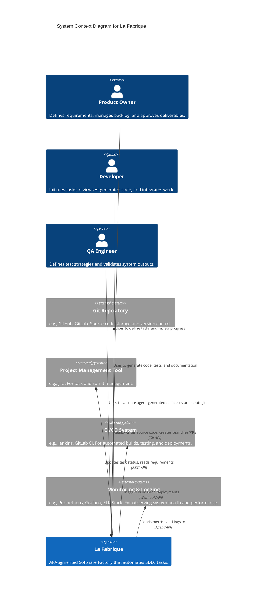

# ARCHITECTURE.md

**Project:** La Fabrique — AI-Augmented Software Factory
**Version:** 1.1
**Author:** System Architect
**Last Updated:** 2025-04-12

## 1. Overview

La Fabrique is an AI-augmented software factory designed to accelerate and improve the software development lifecycle (SDLC). It leverages a multi-agent AI system to automate complex development tasks such as code generation, testing, documentation, and dependency analysis. The system provides a collaborative environment for human developers and AI agents, managed through a central orchestration engine.

This document outlines the high-level architecture of La Fabrique, detailing its components, their interactions, and the underlying design principles.

## 2. Architectural Principles

The architecture is guided by the following core principles:

*   **Modularity & Decoupling:** Components are designed as independent, loosely coupled services. This facilitates parallel development, independent deployment, and easier maintenance. The API Gateway serves as the single entry point, abstracting backend services from clients.
*   **Scalability:** The system is designed to scale horizontally. Key components like the Orchestration Engine and its agents are containerized and can be replicated to handle increased load.
*   **Stateful Orchestration:** Given the long-running and complex nature of software development tasks, the architecture relies on a stateful graph-based orchestration engine (LangGraph) to manage workflows, allow for cycles, and enable human-in-the-loop interventions.
*   **Data-Centric Design:** The choice of multiple database technologies (PostgreSQL, Neo4j) reflects a strategy to use the best tool for each type of data, separating transactional records from complex relational knowledge graphs.

## 3. System Context Diagram (C4 Level 1)

This diagram shows La Fabrique as a single system and illustrates its relationships with key users and external systems.



## 4. Container Diagram (C4 Level 2)

This diagram zooms into the La Fabrique system, showing the high-level technical containers (applications, services, databases) that constitute the system. It clarifies the primary responsibilities and technology choices for each component and how they interact.

```mermaid
C4Container
    title Container Diagram for La Fabrique

    Person(user, "User", "Developer, PO, QA via Web Browser")

    System_Ext(git_repo, "Git Repository", "e.g., GitHub, GitLab")
    System_Ext(llm_provider, "LLM Provider", "e.g., OpenAI, Anthropic, Google Gemini")

    System_Boundary(c1, "La Fabrique System") {
        Container(web_ui, "Web UI", "React / Next.js", "Provides the user interface for interacting with the factory.")
        Container(api_gateway, "API Gateway", "FastAPI (Python)", "Exposes a secure REST/GraphQL API. Handles authentication, request validation, and routing.")
        Container(orchestration_engine, "Orchestration Engine", "LangGraph (Python)", "Manages and executes multi-agent workflows. The core 'brain' of the system.")
        Container(core_services, "Core Services", "Python", "Handles business logic like project management, user authentication, and configuration.")

        ContainerDb(postgres_db, "Primary Database", "PostgreSQL + pgvector", "Stores structured data: users, projects, tasks, sprints, and vector embeddings for RAG.")
        ContainerDb(neo4j_db, "Graph Database", "Neo4j", "Stores the SDLC Knowledge Graph: code dependencies, task relationships, architectural components.")
    }

    ' User Interactions
    Rel(user, web_ui, "Uses", "HTTPS")
    Rel(web_ui, api_gateway, "Makes API calls to", "HTTPS/JSON")

    ' Internal Interactions
    Rel(api_gateway, core_services, "Forwards requests to", "gRPC/HTTP")
    Rel(api_gateway, orchestration_engine, "Initiates and queries agent workflows", "gRPC/HTTP")

    Rel(core_services, postgres_db, "Reads/Writes user and project data", "JDBC")

    Rel(orchestration_engine, core_services, "Retrieves project context", "gRPC/HTTP")
    Rel(orchestration_engine, postgres_db, "Reads/Writes workflow state and uses pgvector for RAG", "JDBC")
    Rel(orchestration_engine, neo4j_db, "Reads/Writes SDLC graph data", "Bolt")

    ' External System Interactions
    Rel(orchestration_engine, llm_provider, "Sends prompts to", "HTTPS/API")
    Rel(orchestration_engine, git_repo, "Reads/Writes code and repository data", "Git API")
```

## 5. Multi-Agent Orchestration Engine (LangGraph)

The **Orchestration Engine** is the heart of La Fabrique and directly addresses the need for a robust, stateful system to manage complex AI workflows. We have selected **LangGraph** for this purpose due to its inherent capabilities.

**Why LangGraph?**
*   **State Management:** It explicitly passes a `state` object between nodes, ensuring every agent has access to the full context of the ongoing task. This is critical for long-running operations like generating a full feature slice.
*   **Cycles and Graphs:** Software development is not a linear process. LangGraph's graph structure allows for cycles (e.g., code generation -> testing -> code correction -> re-testing), which is impossible in a traditional Directed Acyclic Graph (DAG) pipeline.
*   **Human-in-the-Loop:** We can define specific nodes that pause execution and wait for human input or approval. This is essential for code reviews, architectural decisions, and conflict resolution.

**Conceptual Workflow Example: "Implement New API Endpoint"**

1.  **Initiation:** A user requests a new API endpoint via the **Web UI**. The request is routed through the **API Gateway** to the **Orchestration Engine**.
2.  **Graph Execution Begins:** The engine compiles the relevant agent graph and initializes a `state` object containing the user's request, project context, and relevant files.
3.  **Planner Agent (Node):** The first node is a `PlannerAgent`. It analyzes the request and breaks it down into a sequence of steps (e.g., 1. Read relevant models, 2. Create controller file, 3. Create service file, 4. Create unit tests, 5. Update API documentation). This plan is added to the `state`.
4.  **Conditional Routing (Edge):** Based on the plan, a conditional edge routes the workflow to the `CodeGenerationAgent`.
5.  **Code Generation Agent (Node):** This agent executes the first coding step. It uses a `GitTool` to read existing files and a `FileSystemTool` to write the new controller file. The generated code is added to the `state`.
6.  **Testing Agent (Node):** The graph transitions to the `TestGenerationAgent`, which reads the new controller code from the `state` and generates corresponding unit tests.
7.  **Validation & Correction (Cycle):** The workflow moves to a `CodeValidationAgent` which runs the newly created tests.
    *   **If tests pass:** A conditional edge routes the graph back to the `CodeGenerationAgent` to work on the next step in the plan.
    *   **If tests fail:** The failure log is added to the `state`, and a different edge routes the workflow *back* to the `CodeGenerationAgent` with instructions to fix the code, thus forming a correction cycle.
8.  **Human Approval (Node):** Once all steps are complete and tests pass, the graph can transition to a `HumanApproval` node. The system pauses, notifies the developer via the UI, and waits for a "approve" or "reject" action.
9.  **Completion:** Upon approval, a final `CommitAgent` node commits the changes to a new branch in the **Git Repository** and updates the task status. The final `state` is persisted in the **Primary Database**.

## 6. Data Architecture

*   **PostgreSQL + pgvector (Primary Database):** This relational database serves as the primary source of truth for structured, transactional data.
    *   **Responsibilities:** User accounts, project configurations, sprint metadata, task statuses, and agent workflow logs.
    *   **pgvector Extension:** Used to store vector embeddings of documents, code snippets, and conversation history. This enables powerful Retrieval-Augmented Generation (RAG) for agents, providing them with relevant context to improve accuracy.

*   **Neo4j (Graph Database):** This database is purpose-built to store and query highly interconnected data, which is prevalent in the SDLC.
    *   **Responsibilities:** Models the "SDLC Knowledge Graph." This includes file-to-file dependencies, function call graphs, task precedence relationships, and architectural component connections.
    *   **Use Case:** An agent can query this graph to understand the potential impact of a code change (e.g., "What services will be affected if I modify this data model?") before starting work.

## 7. Technology Stack Summary

| Component              | Technology                         | Rationale                                          |
| ---------------------- | ---------------------------------- | -------------------------------------------------- |
| Web UI                 | React / Next.js                    | Modern, component-based framework for rich UIs.    |
| API Gateway            | FastAPI (Python)                   | High performance, automatic API docs, Python ecosystem. |
| Orchestration Engine   | LangGraph (Python)                 | Manages stateful, cyclical, multi-agent workflows. |
| Core Services          | Python (gRPC)                      | General-purpose logic, microservice communication. |
| Primary/Vector DB      | PostgreSQL + pgvector              | Robust, reliable RDBMS with integrated vector search. |
| Graph DB               | Neo4j                              | Industry standard for graph data modeling and querying. |
| Containerization       | Docker                             | Standard for packaging and isolating applications. |
| Deployment             | Kubernetes (target)                | Scalable and resilient container orchestration.    |

## 8. Deployment and Operations

All components of La Fabrique are designed to be deployed as Docker containers. For production environments, these containers will be managed by a Kubernetes cluster to ensure scalability, high availability, and automated health checks.

The CI/CD pipeline, managed by an external system like GitLab CI, will be responsible for building container images, running automated tests as defined in the `TESTING_STRATEGY.md`, and deploying new versions to the cluster.

**Monitoring and Logging:**
The La Fabrique system is instrumented to export critical operational data. It has a formal relationship with an external **Monitoring & Logging** system (e.g., Prometheus for metrics, ELK Stack for logs).
*   **Metrics:** The API Gateway and Orchestration Engine export key performance indicators (KPIs) such as API request latency, error rates, agent task success/failure rates, and workflow execution times.
*   **Logs:** All containers produce structured logs (JSON format) detailing their operations, which are aggregated in a central logging platform for debugging and auditing. This provides observability into both system health and agent behavior.