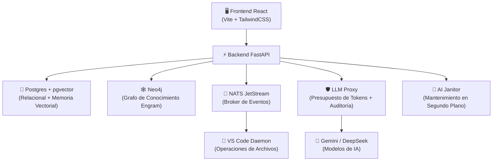

<div align="center">
  

# Le Fabrique

[](https://www.docker.com/)
[](https://www.python.org/)
[](https://fastapi.tiangolo.com/)
[](https://reactjs.org/)
[](https://www.typescriptlang.org/)

**Plataforma autónoma de desarrollo de software impulsada por IA**

> **Idiomas:** [🇺🇸 English](README.md) | [🇪🇸 Español](README.es.md)

</div>

👔 **¿No eres desarrollador o usuario técnico?** Por favor, lee la [**Guía de Negocio para Managers**](USER_GUIDE.es.md) para comprender cómo utilizar Le Fabrique para automatizar la ingeniería de tu empresa.

---

## 📑 Índice
- [🚀 Características Clave](#-características-clave)
- [🏗️ Arquitectura](#️-arquitectura)
- [🛠️ Stack Tecnológico](#️-stack-tecnológico)
- [📥 Primeros Pasos](#-primeros-pasos)
- [📖 Documentación de la API](#-documentación-de-la-api)
- [📁 Estructura del Proyecto](#-estructura-del-proyecto)
- [⚖️ Licencia](#️-licencia)
- [🆘 Soporte](#-soporte--mantenimiento)

---

## 🚀 Características Clave

- **🧠 Inteligencia de Agentes Híbrida**: Orquesta Gemini (Arquitecto/PO) y DeepSeek (Dev/QA) para lograr el equilibrio perfecto entre razonamiento y programación rentable.
- **🔄 Gestión del Ciclo de Vida Completo**: Capaz de crear nuevos proyectos desde cero, evolucionar código existente generado por IA y mantener/mejorar sistemas legados escritos por humanos.
- **📜 Bandeja de Salida Transaccional (Outbox)**: Garantiza la entrega de mensajes NATS sincronizando la publicación de eventos con las transacciones de Postgres.
- **🔄 Checkpointing de LangGraph**: Suspensión y reanudación asíncrona de flujos de trabajo mediante `MemorySaver`.
- **🛡️ Proxy LLM Centralizado**: Presupuesto estricto de tokens y auditoría de seguridad para todas las interacciones de IA.
- **🔌 Integración con VS Code**: Un daemon nativo y una extensión cierran la brecha entre la orquestación de IA y tu IDE local.
- **📊 Monitoreo Glassroom**: Transmisión de eventos SSE en tiempo real para supervisar visualmente el progreso de los agentes.
- **🎫 Bot de Soporte Integrado**: Mesa de ayuda con IA, creación de tickets, niveles de severidad y seguimiento de estado (ES/EN).

[⬆ Volver al inicio](#le-fabrique)

---

## 🏗️ Arquitectura



[⬆ Volver al inicio](#le-fabrique)

---

## 🛠️ Stack Tecnológico

| Capa | Tecnología |
|---|---|
| **Backend** | FastAPI, LangGraph, SQLAlchemy |
| **Frontend** | React, TypeScript, TailwindCSS, Vite |
| **Memoria** | Postgres (pgvector) + Neo4j (Grafo de Conocimiento Temporal) |
| **Broker** | NATS JetStream |
| **Modelos IA** | Gemini (Google AI Studio) + DeepSeek |
| **Infraestructura** | Docker Compose, VS Code CLI |

[⬆ Volver al inicio](#le-fabrique)

---

## 📥 Primeros Pasos

### 1. Requisitos Previos
- Docker y Docker Compose
- CLI de VS Code (comando `code`)
- Python 3.11+ y Node.js 18+

### 2. Configuración del Entorno
```bash
cp .env.example .env
# Edita .env — agrega tu GEMINI_API_KEY y DEEPSEEK_API_KEY
```

### 3. Iniciar Todos los Servicios
```bash
docker compose up -d
```

### 4. Ejecutar el Daemon Local de VS Code
```bash
pip install nats-py
python vscode-daemon/daemon.py
```

### 5. Acceder al Dashboard
Abre **http://localhost:5173** en tu navegador.

[⬆ Volver al inicio](#le-fabrique)

---

## 📖 Documentación de la API

Le Fabrique expone una interfaz OpenAPI completamente autodocumentada:

- **Swagger UI (Interactivo):** `http://localhost:8000/docs`
- **ReDoc (Detallado):** `http://localhost:8000/redoc`

---

## 🛠️ Soporte y Observabilidad

- **Logs Estructurados:** Todos los eventos se registran en formato JSON — compatible con ELK, Datadog o Splunk.
- **Bot de Soporte:** Mesa de ayuda con IA integrada, creación de tickets, niveles de severidad y seguimiento de estado.
- **Exportación de Logs:** Los administradores pueden descargar un paquete completo de auditoría vía `GET /v1/support/logs`.

---

## 📁 Estructura del Proyecto

```
le-fabrique/
├── backend/          # App FastAPI + lógica de agentes LangGraph
│   ├── agents/       # Definiciones del grafo de agentes
│   ├── app/          # Rutas API, schemas, config
│   ├── janitor/      # Worker de mantenimiento en segundo plano
│   ├── llm/          # Model factory (Gemini + DeepSeek)
│   └── memory/       # Procesador de Engramas (pgvector + Neo4j)
├── frontend/         # Dashboard React + TypeScript (Vite)
│   ├── src/
│   │   ├── components/   # KanbanBoard, GlassRoom, SupportBot…
│   │   ├── pages/        # SprintWorkspace, Analytics, Generate…
│   │   └── i18n/         # Traducciones EN + ES
│   └── electron/     # Shell Electron (modo escritorio opcional)
├── llm-proxy/        # Pasarela de presupuesto de tokens y auditoría
├── vscode-daemon/    # Suscriptor NATS local para operaciones de archivos
├── vscode-extension/ # Bridge de integración con VS Code
├── db/               # Scripts de inicialización de Postgres
├── deployment/       # Manifiestos de Kubernetes
├── docker-compose.yml
└── .env.example
```

[⬆ Volver al inicio](#le-fabrique)

---

## ⚖️ Licencia

**Software Propietario.** Todos los derechos reservados.  
Copyright © 2026 Carolina Pereira.

Queda estrictamente prohibida la copia, distribución o uso comercial no autorizado de este sistema, por cualquier medio, sin el permiso explícito y por escrito de la propietaria.

---

## 🆘 Soporte & Mantenimiento

- **Soporte del Sistema:** Le Fabrique es mantenido por **Carolina Pereira**. Los errores críticos se reportan automáticamente a la proveedora para su resolución.
- **Soporte de Proyectos:** Para incidencias con el código generado por la IA, usa el Bot de Soporte integrado.
- **Contacto:** Para consultas sobre licencias y acuerdos SLA Enterprise, contacta directamente con la propietaria.

[⬆ Volver al inicio](#le-fabrique)
