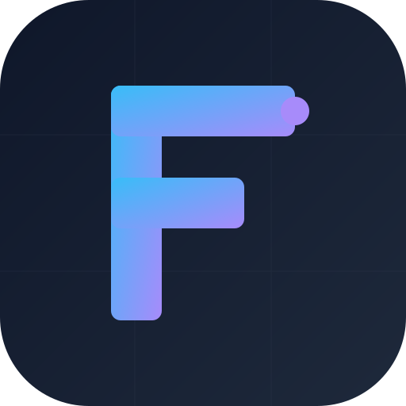
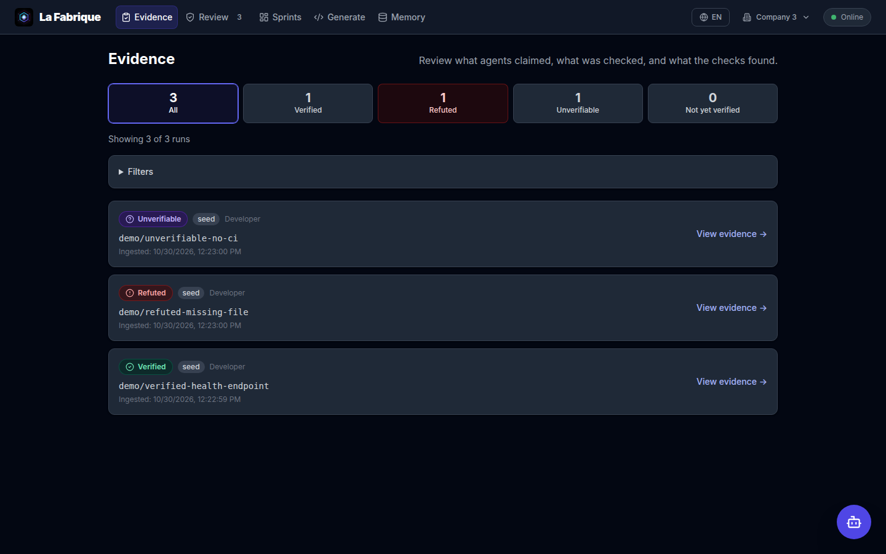

<div align="center">
  

# La Fabrique

[](https://github.com/careb36/la-fabrique/actions/workflows/backend-tests.yml)
[](LICENSE)

**Proyectos de TI a cargo de una empresa de agentes de IA, con pruebas de lo que hicieron.**

[English](README.md) | [Español](README.es.md)

</div>

## Qué es

La Fabrique es una empresa de agentes de IA que planifica, construye y
documenta proyectos de TI, y registra evidencia verificable de lo que hicieron
los agentes. Hoy el ciclo ejecuta tareas de software de punta a punta: de una
especificación a los archivos en disco, los tests, la revisión y un pull
request. También compila la documentación de un proyecto a partir de sus
registros. Ciencia de datos, machine learning, automatización e investigación
son la dirección, todavía no están construidos
([`docs/POSITIONING.md`](docs/POSITIONING.md)).

Los agentes son productores intercambiables. El producto es la capa que
verifica su trabajo:

- **Afirmaciones y observaciones nunca comparten un campo.** Lo que dice un
  agente (su resumen, su lista de archivos, su propio reporte de tests) es una
  afirmación. Solo lo que la plataforma observó cuenta como evidencia.
- **Un Verifier decide sin un modelo.** Cada ejecución queda `verified`,
  `refuted` o `unverifiable`, según controles deterministas: archivos en disco,
  tests que corrió el daemon, tests de aceptación, estándares, paquetes que
  existen de verdad.
- **Hay una barrera antes de QA.** El trabajo fallido o sin confirmar vuelve a
  rehacerse. Los cambios de alto riesgo (autenticación, secretos, pagos, CI)
  esperan a una persona.
- **El registro deja ver cualquier alteración.** El log de auditoría es una
  cadena de hashes por empresa, y la plataforma calcula los hashes; nunca los
  toma del agente.



## Qué podés hacer hoy

- **Planificar**: el PO convierte un pedido en una especificación con
  criterios verificables; el Architect propone la arquitectura; el PO la
  divide en tareas de sprint.
- **Correr sprints**: un tablero de cinco columnas, la revisión del diff de
  cada ejecución como en un pull request, y una retrospectiva al cerrar cada
  sprint.
- **Trabajar sobre tu código**: el daemon escribe archivos, corre tests en un
  sandbox y puede usar una rama de git por tarea y publicar un pull request en
  borrador.
- **Documentar**: un paquete de documentación y una wiki del proyecto
  compilados desde los registros, cada afirmación citando uno.
- **Medir**: [el bench](bench/README.md) evalúa la fábrica con
  especificaciones de referencia y tests escritos por una persona.

## Inicio rápido

Necesitás Docker 24+ con Compose v2, y Python 3.9+ en la computadora que tiene
tus proyectos.

```bash
cp .env.example .env
# Completá POSTGRES_PASSWORD, NEO4J_PASSWORD y NEO4J_AUTH, JWT_SECRET_KEY,
# FERNET_SECRET_KEY, AUDIT_SIGNING_KEY y DEEPSEEK_API_KEY.

docker compose up -d          # backend :8000, frontend :5173, proxy LLM :5100
./scripts/start-daemon.sh     # en la computadora que tiene tus proyectos
                              # (.\scripts\start-daemon.ps1 en Windows)
```

`DEEPSEEK_API_KEY` es la única clave de modelo que hace falta. `QWEN_API_KEY`
es opcional: configurala para que un rol use un modelo de Qwen. La API de
DeepSeek procesa los pedidos en China; antes de enviar datos personales o de
clientes, leé `DEEPSEEK_API_KEY` en
[`docs/CONFIGURATION.md`](docs/CONFIGURATION.md).

Después:

1. Revisá el stack: `curl -s localhost:8000/health` (`/health/deep` para cada
   dependencia). La documentación de la API está en
   `http://localhost:8000/docs`.
2. Revisá las claves de modelo: `curl -s localhost:5100/v1/providers`.
3. Abrí `http://localhost:5173`, registrate y creá una **New company**. Elegí
   una carpeta de proyecto en la computadora del daemon, por ejemplo
   `/home/vos/src/app`.
4. Escribí una especificación o planificá un sprint, y seguilo en el tablero.

Neo4j es opcional y está activado por defecto. Para correr sin él:
`NEO4J_ENABLED=false docker compose up -d --scale neo4j=0`.

## Arquitectura

```
Frontend React --REST/SSE--> Backend FastAPI --> Postgres (pgvector), Neo4j (opcional)
                                |      |
                                |      +--> Proxy LLM --> DeepSeek (por defecto), Qwen
                                |
                                +--NATS JetStream--> daemon del workspace (archivos, git, tests, sandbox)
```

- **Backend** (`backend/`): catorce contextos con una regla de dependencias
  que se verifica. El contexto de evidencia importa solo contracts y platform,
  así que lo que juzga una ejecución nunca depende del código que la produjo
  ([`docs/ARCHITECTURE.md`](docs/ARCHITECTURE.md)).
- **Daemon del workspace** (`vscode-daemon/`): corre nativo en macOS, Linux o
  Windows. Es el único componente que toca tus archivos.
- **Proxy LLM** (`llm-proxy/`): toda llamada a un modelo pasa por él. Aplica
  presupuestos de tokens por empresa y enruta según el id del modelo.

## Documentación

- [`docs/README.md`](docs/README.md): el índice de todos los documentos
- [`docs/CONFIGURATION.md`](docs/CONFIGURATION.md): todas las variables de entorno
- [`docs/OPERATIONS.md`](docs/OPERATIONS.md): despliegue, actualizaciones, backups, incidentes
- [`docs/TESTING.md`](docs/TESTING.md): las suites de tests y la CI (`scripts/check.sh quick` o `full`)
- [`docs/POSITIONING.md`](docs/POSITIONING.md): la dirección y las reglas de diseño
- [`USER_GUIDE.es.md`](USER_GUIDE.es.md): una guía para gerentes, sin código
- [`CONTRIBUTING.md`](CONTRIBUTING.md): cómo contribuir; los agentes de código empiezan por [`CLAUDE.md`](CLAUDE.md)
- [`SECURITY.md`](SECURITY.md): la política de seguridad y cómo reportar una vulnerabilidad

## Seguridad

Los agentes escriben archivos y ejecutan comandos donde corre el daemon.
Apuntalo solo a carpetas que puedas modificar, preferí el sandbox `container`
y mantené NATS ligado a `127.0.0.1`, salvo que el daemon esté en otra máquina.

## Licencia

Apache License 2.0. Ver [`LICENSE`](LICENSE) y [`NOTICE`](NOTICE).
