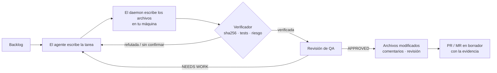
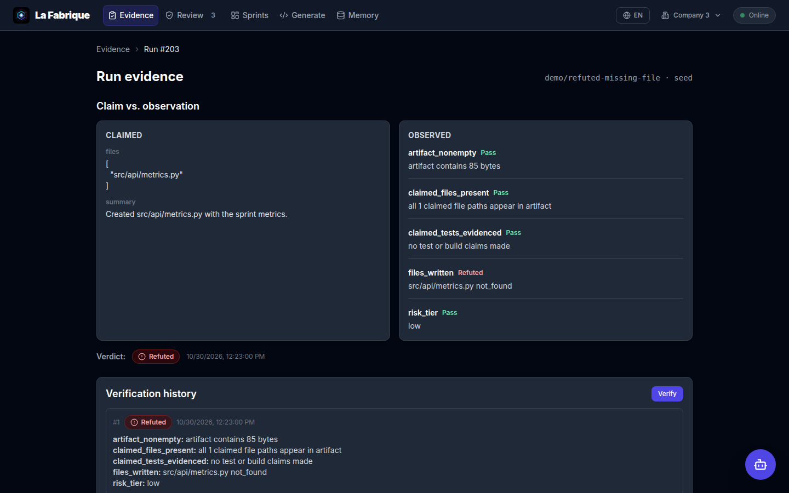
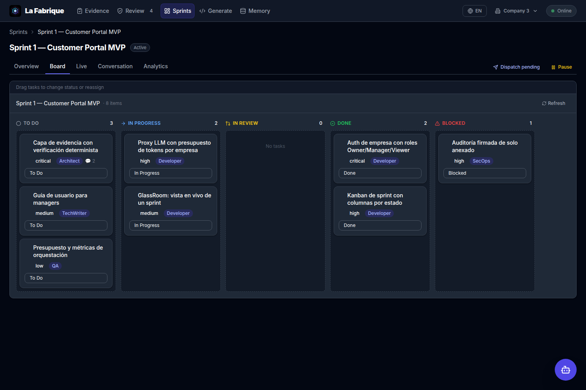
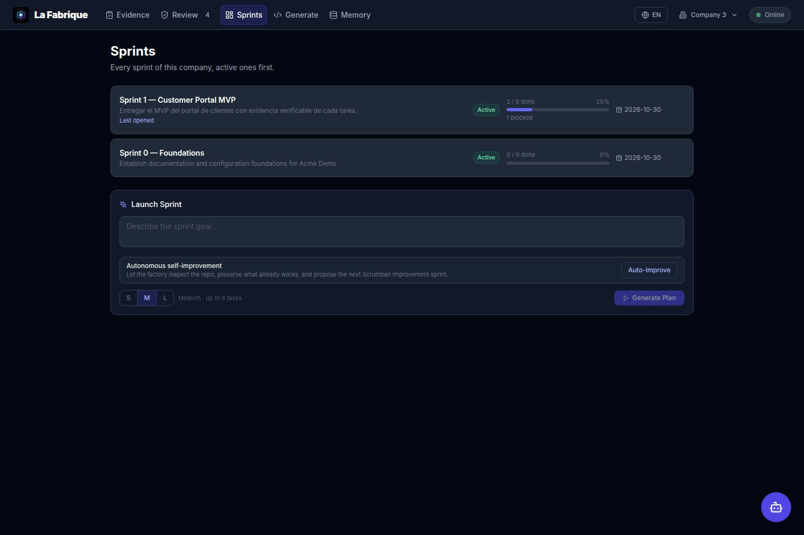
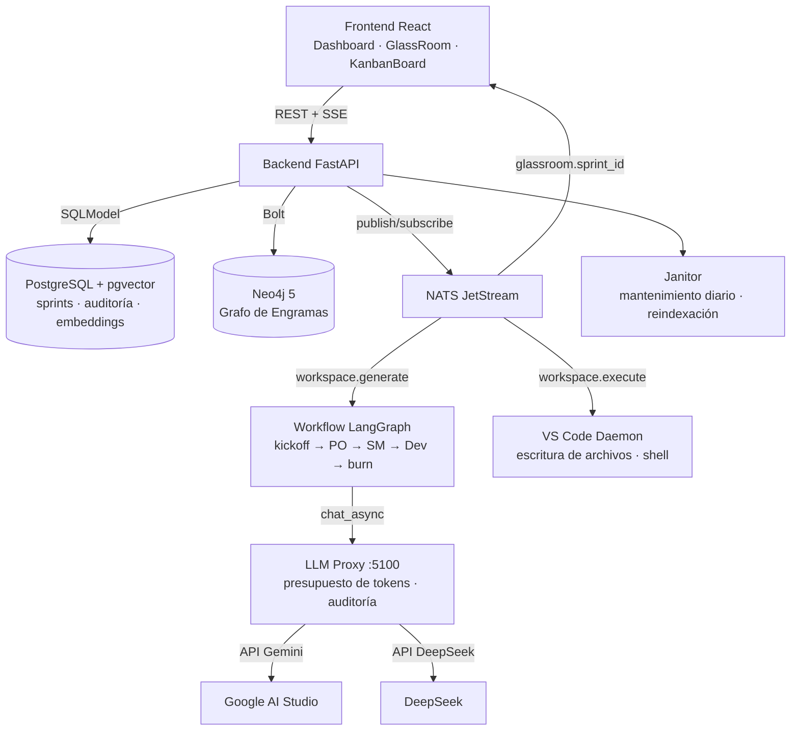
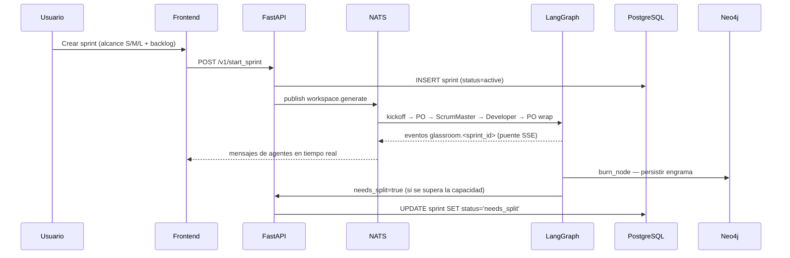
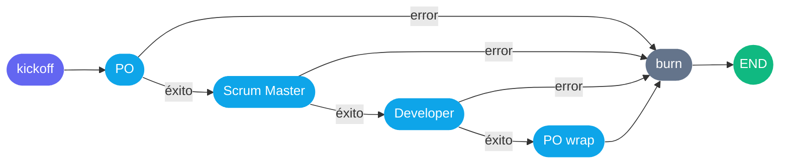

<div align="center">
  

# La Fabrique

[](https://github.com/careb36/la-fabrique/actions/workflows/backend-tests.yml)
[](https://www.docker.com/)
[](https://www.python.org/)
[](https://fastapi.tiangolo.com/)
[](https://reactjs.org/)
[](https://www.typescriptlang.org/)
[](LICENSE)

### Pruebas, no promesas, para cada línea de código que escribe un agente de IA

> **Idiomas:** [🇺🇸 English](README.md) | [🇪🇸 Español](README.es.md)

</div>

---

Los agentes de IA escriben código más rápido de lo que cualquier equipo puede
leerlo. La velocidad ya no es el cuello de botella. Lo que falta es una
respuesta confiable a una sola pregunta:

> **¿El agente hizo de verdad lo que dice que hizo?**

La Fabrique la responde con evidencia. Cada entrega de un agente se contrasta
con lo que hay realmente en disco, con lo que devolvieron los tests y con lo
que informó el CI. Lo que el agente cuenta de su propio trabajo se guarda
aparte y nunca cuenta como prueba. Después, el trabajo le llega a tu equipo
como tu equipo ya trabaja: una rama, un diff y una pull request en GitHub o
GitLab, con la evidencia en la descripción.

<div align="center">


</div>

## Por qué La Fabrique

| | Sin La Fabrique | Con La Fabrique |
|---|---|---|
| **Confianza** | El agente dice "listo, los tests pasan" y alguien tiene que creerle | Cada ejecución recibe un veredicto, `verified`, `refuted` o `unverifiable`, calculado a partir de archivos, hashes y códigos de salida; nunca lo decide un modelo |
| **Revisión** | Quien revisa recibe una pared de texto generado | Una vista de **Archivos modificados** como la de una pull request: números de línea, comentarios por línea, Aprobar o Pedir cambios |
| **Git** | Los archivos generados caen en tu copia de trabajo | Con **Rama de Git por tarea** activada: una rama por tarea y un commit por entrega, en un worktree aparte, sin tocar nunca tu checkout |
| **Entrega** | Copiar, pegar y abrir la pull request a mano | **Publicar como pull request**: la rama se sube con tus propias credenciales y se abre una PR (GitHub) o MR (GitLab) en borrador con la evidencia |
| **Aprendizaje** | Los mismos errores, sprint tras sprint | Las retrospectivas proponen procedimientos y los números deciden si se quedan o se revierten |
| **Control** | Todo o nada | Niveles de autonomía, una bandeja de revisión y niveles de riesgo: una entrega cuyas rutas de archivo marcan autenticación, secretos, pagos o el pipeline de CI siempre espera a una persona |
| **Auditoría** | Logs que cualquiera puede editar | Una cadena de hashes por empresa, con firma HMAC opcional, que muestra dónde se borró, alteró o reordenó una fila |

## Qué hace

**📋 Arranca desde una especificación.** Dale un brief al PO y recibí
requisitos numerados con criterios de aceptación escritos como *dado / cuando /
entonces*, metas de calidad con número, restricciones y las preguntas que el PO
no pudo resolver. Un chequeo determinístico bloquea la aprobación mientras un
requisito no tenga un criterio que se pueda probar o una pregunta siga sin
respuesta; vos respondés, editás y aprobás. Después cada tarea nombra los
criterios que cubre, trabaja y se revisa solo contra ellos, y la
especificación muestra qué criterios quedaron hechos.

**🔍 Verifica cada entrega.** El daemon del workspace escribe los archivos del
agente y los vuelve a leer. Lo que decide si un archivo existe es el sha256
que informa el daemon, no la palabra del agente. Con los tests de entrega
activados, también corre la suite del proyecto y registra el código de salida.
Una entrega que no se puede confirmar vuelve a rehacerse sin consultar a
ningún modelo.

**🧑‍⚖️ Pone a las personas donde importan.** QA tiene que escribir un
`APPROVED:` explícito para cerrar una tarea. Una entrega que se clasifica como
de alto riesgo por las rutas que escribe (autenticación, secretos, pagos, el
pipeline de CI) espera a un Manager en cualquier nivel de autonomía. La bandeja de **Revisión** lista
exactamente lo que necesita a una persona: tareas bloqueadas, propuestas de
procedimiento y ejecuciones externas que nadie decidió todavía.

**🌿 Trabaja como GitHub y GitLab.** Diffs observados en disco, comentarios
por línea y revisiones que devuelven el trabajo con los comentarios como
feedback. Con **Rama de Git por tarea** activada, cada tarea tiene su rama y
cada entrega es un commit, en un worktree aparte de tu checkout. Con un clic, la rama se publica
como pull request o merge request en borrador. Si ya hay una abierta, se
actualiza su descripción; si la rama avanzó más allá del commit de la
ejecución, la publicación se rechaza.

**🏭 Gestiona una empresa de agentes.** PO, Architect, ScrumMaster, Developer,
QA, SecOps y TechWriter se pasan el trabajo y cada traspaso queda registrado
como mensaje. El ScrumMaster analiza cada tarea bloqueada y decide entre otro
intento, con una indicación para hacerlo, o dejarla en manos de una persona.
Todos los roles pueden usar las herramientas MCP que conectes.

**📈 Aprende, y se puede medir.** Cada sprint cerrado produce una
retrospectiva. El ScrumMaster propone procedimientos en un formato fijo y, dos
sprints después, cada uno se mantiene o se revierte según el retrabajo por
tarea y la proporción de tareas bloqueadas. La página de Sprints responde con
números, no con adjetivos, si la empresa está aprendiendo.

**🔐 Preparada para auditorías.** Cada tabla está acotada por empresa y por rol
(Owner, Manager, Viewer). Las afirmaciones y las observaciones viven en campos
separados. Los presupuestos de tokens se controlan en un único proxy. El log
de auditoría es una cadena de hashes por empresa.

## Cómo funciona



1. **Planificación.** Se arma un sprint de alcance S, M o L y cada tarea entra en una cola durable.
2. **Producción.** El agente asignado escribe la tarea. El daemon la escribe en tu máquina, como un commit en `fabrique/task-<id>` cuando la empresa trabaja con ramas de Git.
3. **Verificación.** Controles deterministas deciden `verified`, `refuted` o `unverifiable` y fijan el nivel de riesgo.
4. **Revisión.** QA revisa un extracto de los archivos escritos. Cuando corresponde, una persona revisa en **Archivos modificados** el diff que observó el daemon.
5. **Entrega.** La rama se publica como pull request o merge request, con la evidencia en la descripción.
6. **Aprendizaje.** El sprint se cierra, corre la retrospectiva y se miden los procedimientos.

## Calidad comprobable

- Unos 900 tests de backend y 430 de frontend corren en cada pull request, sin necesidad de servicios externos.
- Una prueba de punta a punta en el CI lleva una empresa entera por tres sprints contra PostgreSQL y NATS JetStream reales; al final, un verificador independiente rechaza cualquier historial de tarea ilegal.
- Un límite de tamaño por archivo, un linter con versión fija y una regla de i18n que rompe el build ante texto sin traducir mantienen el código en orden a medida que crece.
- La interfaz es completamente bilingüe, en inglés y en español.

## Inicio rápido

```bash
cp .env.example .env          # contraseñas de las bases, JWT_SECRET_KEY, QWEN_API_KEY y DEEPSEEK_API_KEY
docker compose up -d          # backend :8000 · frontend :5173 · proxy de LLM :5100
./scripts/start-daemon.sh     # en la computadora donde están tus proyectos (.\scripts\start-daemon.ps1 en Windows)
```

El equipo por defecto usa Qwen (PO, Architect, ScrumMaster, SecOps, TechWriter)
y DeepSeek (Developer, QA), así que necesita las dos claves. El modelo de cada
agente se cambia en la página **Agentes**, y `NEMOTRON_ROLES` pasa roles a NVIDIA
Nemotron en Nebius (ver *Model Providers* en el [README en inglés](README.md#model-providers-nebius--nvidia-nemotron)).

Abrí `http://localhost:5173`, creá una empresa, apuntala a la carpeta de un
proyecto y planificá tu primer sprint. Para probarla sin claves de API,
`scripts/seed_demo_evidence.py` carga una ejecución por veredicto.

> **¿No sos del área técnica?** La [**Guía de Negocio para Managers**](USER_GUIDE.es.md) explica La Fabrique sin código.
>
> **Por qué está construida así:** el razonamiento y las reglas de diseño están en [`docs/POSITIONING.md`](docs/POSITIONING.md).

## Capturas de pantalla









---

## Índice

- [Por qué La Fabrique](#por-qué-la-fabrique)
- [Qué hace](#qué-hace)
- [Cómo funciona](#cómo-funciona)
- [Inicio rápido](#inicio-rápido)
- [Descripción General](#descripción-general)
- [Arquitectura](#arquitectura)
- [Stack Tecnológico](#stack-tecnológico)
- [Requisitos](#requisitos)
- [Instalación](#instalación)
- [Primeros Pasos](#primeros-pasos)
- [Orquestación de Agentes](#orquestación-de-agentes)
- [GlassRoom](#glassroom)
- [Estructura del Proyecto](#estructura-del-proyecto)
- [Referencia de la API](#referencia-de-la-api)
- [Pruebas](#pruebas)
- [Contribuir](#contribuir)
- [Seguridad](#seguridad)
- [Uso responsable](#uso-responsable)
- [Hoja de ruta](#hoja-de-ruta)
- [Documentación](#documentación)
- [Licencia](#licencia)

---

## Descripción General

El trabajo se organiza en **AI Sprints** — unidades de alcance acotado y verificable, no de duración fija. Cada ítem del backlog se convierte en un `AgentRun`: la afirmación del agente sobre lo que hizo, más las observaciones que la plataforma reúne por su cuenta. Una corrida solo queda cerrada cuando la verificación le produjo un veredicto.

**Niveles de alcance por sprint:**

| Tamaño | Máx. ítems en backlog | Uso típico |
|--------|----------------------|------------|
| S      | 4                    | Correcciones, features pequeñas |
| M      | 8                    | Iteraciones de features (por defecto) |
| L      | 12                   | Features grandes, trabajo fundacional |

Cuando un workflow de agentes agota su capacidad antes de completar todos los ítems, el sprint pasa a estado `needs_split` — señal de que el alcance debe dividirse en sprints más pequeños antes de reintentar.

**Ciclo de vida del sprint:** `active` → `completed` | `needs_split` | `cancelled`

---

## Arquitectura



### Flujo de datos de un sprint



[⬆ Volver al inicio](#la-fabrique)

---

## Stack Tecnológico

| Capa | Tecnología |
|---|---|
| **Backend** | Python 3.12, FastAPI, LangGraph, SQLModel |
| **Frontend** | React 18, TypeScript, TailwindCSS, Vite, Zustand |
| **Memoria Vectorial** | PostgreSQL 15 + pgvector |
| **Grafo de Conocimiento** | Neo4j 5.15 Enterprise + APOC |
| **Broker de Mensajes** | NATS JetStream |
| **Modelos de IA** | Gemini (Google AI Studio) + DeepSeek |
| **Infraestructura** | Docker Compose (8 servicios), VS Code CLI |

[⬆ Volver al inicio](#la-fabrique)

---

## Requisitos

- **Docker** 24.0+ con Docker Compose v2
- **Python** 3.12+ (para desarrollo local)
- **Node.js** 24+ (para desarrollo frontend) — `engines.node >=24` y CI usa Node 24
- **API Keys:** Google AI Studio (Gemini), DeepSeek

[⬆ Volver al inicio](#la-fabrique)

---

## Instalación

La forma canónica de levantar el entorno local es `reset_infra.sh`:

```bash
# 1. Copiar y configurar el entorno
cp .env.example .env
# Editar .env — completar GEMINI_API_KEY, DEEPSEEK_API_KEY,
# POSTGRES_PASSWORD, NEO4J_PASSWORD, JWT_SECRET_KEY

# 2. Inicio limpio completo
./reset_infra.sh
```

El script ejecuta 6 pasos: `down -v` → prune de Docker → `build --no-cache` → `up -d` → espera de health-checks → `ps`. Al finalizar:

- **Frontend:** `http://localhost:5173`
- **API Backend + Swagger:** `http://localhost:8000/docs`
- **LLM Proxy:** `http://localhost:5100`
- **Jaeger Tracing UI:** `http://localhost:16686`

**Reinicios incrementales** (tras cambios en el código):

```bash
docker compose up -d --build backend
docker compose up -d --build frontend
```

**Daemon local de VS Code** (opcional — para escritura real de archivos en tu IDE):

```bash
pip install nats-py
python vscode-daemon/daemon.py
```

[⬆ Volver al inicio](#la-fabrique)

---

## Primeros Pasos

Una vez que el stack esté en marcha, puedes interactuar con la API:

```bash
# Health check
curl http://localhost:8000/health

# Crear una empresa
curl -X POST http://localhost:8000/v1/init_company \
  -H "Content-Type: application/json" \
  -d '{"company_name": "Mi Empresa"}'

# Iniciar un sprint
curl -X POST http://localhost:8000/v1/start_sprint \
  -H "Content-Type: application/json" \
  -d '{
    "company_id": "<company_id>",
    "scope": "M",
    "backlog": ["Implementar autenticación de usuario", "Añadir widgets al dashboard"]
  }'

# Abrir documentación de la API
open http://localhost:8000/docs
```

[⬆ Volver al inicio](#la-fabrique)

---

## Orquestación de Agentes

Cada kickoff de sprint dispara un **workflow LangGraph** a través del subject NATS `workspace.generate`. El grafo tiene una topología fija con `recursion_limit=12`:



**Responsabilidades de cada nodo:**

| Nodo | Agente | Responsabilidad |
|------|--------|----------------|
| `kickoff` | Sistema | Valida el brief del sprint, extrae ítems del backlog, emite evento de estado inicial |
| `po` | Product Owner | Prioriza el backlog (OpenProject opcional), identifica el ítem de mayor riesgo |
| `scrum_master` | Scrum Master | Secuencia el trabajo, detecta bloqueos, asigna el primer movimiento al Developer |
| `developer` | Developer | Toma el primer ítem accionable, detalla el plan de implementación, señala dependencias |
| `po_wrap` | Product Owner | Cierra el kickoff con resumen de 3 puntos: prioridad · dueño · próxima acción |
| `burn` | Sistema | Persiste engrama en Neo4j; publica el evento de finalización del kickoff en NATS |

**Manejo de errores:** Cualquier fallo en un nodo establece `last_error` y cortocircuita hacia `burn`. El `GraphRecursionError` se captura explícitamente a nivel de workflow. En ambos casos el kickoff falló, pero el sprint sigue `active`: el agent worker publica `Kickoff failed: <reason>; tasks continue` en el Glassroom y las tareas del backlog siguen ejecutándose en el task worker. Solo una decisión explícita de división marca un sprint como `needs_split`.

**Enrutamiento de modelos:** `ModelFactory.ROLE_MODEL_MAP` resuelve cada rol hacia un LLM específico vía el proxy — se cambia el modelo por rol en configuración sin tocar el código.

### Arrancar y frenar el trabajo

El Sprint 0 de una compañía nueva arranca enseguida solo si marcás **Iniciar el Sprint 0 apenas se cree la compañía** en el asistente (nunca con autonomía 1); si no, la página del sprint lo muestra sin empezar, con un botón **Iniciar**. En la pestaña Board un Manager puede **Pausar** (no se reparte, revisa ni reintenta nada hasta **Reanudar**), **Detener** un sprint para siempre y cambiar la **Autonomía** de la compañía: 1, cada tarea aprobada espera a una persona; 2, solo esperan las entregas de alto riesgo; 3, además los sprints siguientes y los procedimientos corren solos. Si un proveedor de modelos rechaza una llamada por falta de saldo, el sprint se pausa solo y la página dice qué proveedor; recargá saldo y reanudá.

### Herramientas MCP

Los agentes pueden usar herramientas de cualquier servidor [Model Context Protocol](https://modelcontextprotocol.io). Un Manager configura los servidores de la compañía con el mismo mapa `mcpServers` que leen los demás clientes MCP:

```bash
curl -X POST http://localhost:8000/v1/mcp/servers \
  -H "Authorization: Bearer $TOKEN" -H "Content-Type: application/json" \
  -d '{
    "company_id": 1,
    "mcpServers": {
      "docs":   {"url": "https://docs.example.com/mcp", "headers": {"Authorization": "Bearer ..."}},
      "github": {"command": "npx", "args": ["-y", "@modelcontextprotocol/server-github"],
                 "env": {"GITHUB_PERSONAL_ACCESS_TOKEN": "..."}, "roles": ["Developer"]}
    }
  }'
```

- `url` es un servidor streamable HTTP (`"type": "sse"` para el transporte anterior); `command` es un servidor stdio, que arranca dentro del contenedor del backend, así que su runtime (`npx`, `uvx`, …) tiene que estar en esa imagen.
- `env` y `headers` son secretos: se guardan cifrados con Fernet (`FERNET_SECRET_KEY`), la API lista solo sus nombres (`GET /v1/mcp/servers`) y se enmascaran en los resultados que ve el modelo.
- `roles` limita un servidor a algunos roles de agente; sin él, lo puede usar cualquier rol que ejecute tareas. `PATCH /v1/mcp/servers/{id}` desactiva un servidor o cambia sus roles; `GET /v1/mcp/servers/{id}/tools` se conecta en el momento y lista lo que anuncia.

Cuando corre una tarea, el modelo ve las herramientas como `<servidor>__<herramienta>` y puede llamarlas durante como mucho `MCP_MAX_TOOL_ROUNDS` rondas antes de entregar. Cada llamada es **una observación que hizo el backend** — servidor, herramienta, argumentos, si falló, duración, sha256 del resultado — registrada en la evidencia del run y mostrada por el Verifier como `tools_used`, aparte de lo que el modelo afirma haber aprendido. Una herramienta que su servidor no marca como de solo lectura sube el nivel de riesgo de la entrega, así que una tarea aprobada que la usó espera a una persona en los mismos puntos que lo haría un archivo sensible.

### Arrancar desde una especificación

Un Manager abre **Especificaciones** (menú de la empresa), escribe un brief — unas pocas oraciones sobre qué se quiere y para quién — y le pide un borrador al PO. El PO contesta en una forma fija que el backend revisa: requisitos, cada uno con criterios de aceptación escritos como *dado / cuando / entonces*; atributos de calidad, cada uno con un número para medirlo; restricciones; y las preguntas que no pudo resolver con el brief. El backend numera todo (`REQ-1`, `REQ-1.2`, `NFR-1`), nunca el modelo, y corre un chequeo determinístico: un requisito sin criterio, un criterio con un paso vacío, una meta de calidad sin número o una pregunta sin responder **bloquean** la aprobación; una promesa sin número ("rápido", "fácil", "fast") es un aviso para mirar. Vos respondés las preguntas, le pedís al PO una revisión (tus respuestas van a su prompt), editás en un formulario con estructura, o escribís la especificación entera, y la aprobás. Una versión aprobada nunca se edita: **Revisar** abre la siguiente versión como borrador, que la reemplaza cuando se aprueba.

Planificar un sprint **desde una especificación** hace que el PO la divida en tareas que nombran los criterios que cubre cada una y las tareas que tienen que estar hechas antes; el plan lista los criterios que ninguna tarea cubre, así nada se pierde en silencio, y el sprint conserva los dos vínculos. El worker sigue el orden que fijó el plan: una tarea espera, con una nota que dice a qué, hasta que todas las que necesita estén hechas, y arranca apenas cierra la última; las que no tienen nada entre sí corren en paralelo. Una tarea que espera por otra que vos tenés que decidir queda bloqueada con el motivo, así el sprint puede cerrar y la bandeja de Revisión muestra qué destraba tu decisión; decidís, y la tarea se libera. El prompt de cada tarea lleva solo los requisitos que cubre, QA revisa la entrega contra esos mismos criterios, y la página de la especificación muestra, por criterio, si una tarea quedó hecha, bloqueada, planificada o todavía no existe (`/v1/specifications`, `POST /v1/plan_sprint` y `POST /v1/start_sprint` con `specification_id`).

### La arquitectura, como dato

Con la especificación aprobada, un Manager le pide al Architect un diseño, o lo escribe: los **módulos** (de qué se encarga cada uno, dónde vive en el repositorio, de qué depende, qué requisitos cubre), las **interfaces** entre ellos con un contrato que un test pueda exigir, las **decisiones** que un desarrollador tomaría solo si nadie las tomara antes, con sus consecuencias, y las **convenciones** que sigue cada tarea. El backend numera todo (`MOD-1`, `IF-1`, `ADR-1`) y traduce los nombres que usó el Architect a esos ids; un chequeo determinístico bloquea la aprobación ante un módulo o requisito inexistente, un ciclo de dependencias, una decisión sin lo decidido o una pregunta sin responder, y avisa cuando ningún módulo cubre un requisito. Vos respondés las preguntas del Architect, pedís una revisión, editás y aprobás; **Escribir en el repositorio** lo deja en `docs/ARCHITECTURE.md` a través del daemon del workspace, y el sha256 que el daemon lee del archivo es lo que La Fabrique guarda.

Desde ahí el PO planifica siguiendo los módulos, y el prompt de cada tarea y la revisión de QA llevan los módulos a los que apuntan sus requisitos, con sus interfaces, más las decisiones y convenciones que sigue cada tarea: cambiarlas es decisión del Architect, no de una tarea (`/v1/architectures`).

### Trabajar en ramas de Git

Con **Rama de Git por tarea** activado (pestaña Board, un Manager; `PUT /v1/companies/{id}/git`), los agentes trabajan sobre un repositorio Git como trabaja la gente en GitHub y GitLab: una entrega nunca cae en tu checkout. Cada tarea tiene su rama, `fabrique/task-<id>`, que arranca de la base que nombres (`git_base_branch`) o del commit que tu repositorio tiene en el checkout; cada entrega es un commit en ella, de autor *La Fabrique* con los trailers `Fabrique-Task:` y `Fabrique-Sprint:`, escrito en un worktree dentro del directorio git del repositorio (`.git/fabrique-worktrees/`). Tu árbol de trabajo, tu índice y tu rama nunca se tocan. El commit, su padre y la rama son lo que dijo git, guardado en la evidencia del run; los tests que corre el daemon después de una entrega corren en ese worktree; los **Archivos modificados** del run nombran la rama y el commit. Para probar el trabajo de una tarea, `git checkout fabrique/task-<id>` (o abrí el worktree); hacer el merge lo decidís vos.

Para llevar la rama de una tarea a GitHub o GitLab, un Manager aprieta **Publicar como pull request** en los Archivos modificados del run. El daemon del workspace sube la rama al `origin` del repositorio con tus propias credenciales de Git en esa computadora (nunca ve un token) y abre una pull request en borrador con `gh` o una merge request en borrador con `glab` si están instalados y con sesión iniciada; si no, te da la página para abrirla. La descripción es la evidencia del run tal como la observó el Verifier: el veredicto, cada chequeo, los archivos que el daemon leyó de vuelta y el commit, con lo que el agente solo declaró aparte y un trailer `Fabrique-Run:` que vuelve al run. Solo se suben ramas `fabrique/`, nunca forzadas; cada publicación queda en el run y en la auditoría (`POST /v1/agent_runs/{id}/publish`, `GET /v1/agent_runs/{id}/publications`).

Cuando la gente revisa esa solicitud en GitHub o GitLab, **Traer comentarios** lee lo que escribieron, con el mismo login de `gh` o `glab`, y lo devuelve al run: los comentarios de línea, en su línea dentro de Archivos modificados; las revisiones y la conversación, al lado; cada uno marcado con dónde se escribió y un link. Leer de nuevo nunca duplica. La próxima revisión que envíes acá se los lleva al agente como tus propios comentarios; una revisión enviada en la plataforma no decide nada acá (`POST /v1/agent_runs/{id}/publications/{pid}/sync`).

### Revisar un run como un pull request

Cada página de run tiene una pestaña **Archivos modificados** armada como GitHub y GitLab muestran un pull request: los archivos con sus líneas agregadas y quitadas, y después los fragmentos de cada archivo con el número de línea viejo y el nuevo, una casilla **Visto** que pliega un archivo, y los archivos largos mostrados en parte hasta que pedís el resto. Los cambios son una observación, nunca el relato del agente:

- en una tarea que entregaron los agentes, el daemon del workspace lee cada archivo justo antes de escribirlo y lo vuelve a leer después, e informa el diff entre esos bytes (`vscode-daemon/file_diff.py`) junto al sha256 que ya informaba; un archivo binario o demasiado grande aparece con sus conteos y sin diff;
- en un pull request ingerido desde GitHub, el diff que devolvió GitHub;
- en un productor que mandó un diff como artefacto sin que se observara nada en un disco, ese diff, rotulado como lo que el productor propone.

Lo que el productor declaró pero ninguna observación cubre aparece aparte, así la revisión ve el hueco en vez de una afirmación mostrada como cambio. `GET /v1/agent_runs/{id}/changes` devuelve los mismos archivos a cualquier cliente.

Un Manager revisa como se revisa un pull request: pasá el mouse por una línea y tocá **+** para comentarla (una línea borrada se comenta en su lado viejo), **Resolvé** un comentario que ya no aplica y después **Enviá la revisión** con *Comentar*, *Aprobar* o *Pedir cambios*. La revisión lleva los comentarios abiertos. Lo que hace depende de quién produjo el run:

- en una tarea que entregaron los agentes de la compañía, sigue decidiendo el ciclo de revisión (QA, el Verifier), así que la revisión de una persona actúa solo donde el ciclo espera a una persona: **Pedir cambios** devuelve al trabajo una tarea bloqueada para una persona, con la revisión y sus comentarios, archivo por línea, como el `NEEDS WORK:` que recibe el próximo intento del Developer; **Aprobar** acepta una entrega que QA aprobó y que espera a una persona (una retención por alto riesgo, o cualquier aprobación con autonomía 1); una tarea en la que los agentes siguen trabajando, o cuyo sprint está cerrado, se rechaza con el motivo;
- en el run de cualquier otro productor, la revisión registra la aprobación o el rechazo, con los comentarios como su devolución.

Las revisiones y los comentarios son palabras de una persona, nunca evidencia: quedan auditados y el veredicto sigue siendo del Verifier (`/v1/agent_runs/{id}/comments`, `/v1/agent_runs/{id}/reviews`).

[⬆ Volver al inicio](#la-fabrique)

---

## GlassRoom

El GlassRoom es la vista de observabilidad en tiempo real de un sprint en ejecución. Usa Server-Sent Events (SSE) para transmitir los mensajes NATS de `glassroom.<sprint_id>` directamente al navegador.

**Diseño de 3 columnas:**

| Columna | Contenido |
|---------|-----------|
| Barra lateral izquierda | Metadata del sprint (badge de alcance, indicador de estado) + lista de agentes conectados |
| Feed de mensajes | Mensajes agrupados por turno de agente (estilo Slack); `NeedsSplitBanner` ante eventos de scope excedido |
| Panel derecho | Tarjetas de estado FSM por agente — `active` (verde) · `waiting` (brand) · `error` (rojo) · `idle` (gris) |

**Tipos de eventos:** `status`, `agent_start`, `message`, `agent_complete`, `error`, `needs_split`

El endpoint SSE (`GET /v1/glassroom/stream?sprint_id=<id>`) reproduce los últimos 50 eventos al conectarse, garantizando contexto completo para clientes que se unan tarde. Se envían pings de keepalive cada 15 segundos para mantener la conexión activa.

[⬆ Volver al inicio](#la-fabrique)

---

## Estructura del Proyecto

```
la-fabrique/
├── backend/
│   ├── agents/
│   │   ├── graph.py                  # Workflow multiagente LangGraph
│   │   └── tools/
│   │       └── openproject_tools.py  # Creación de work packages
│   ├── app/
│   │   ├── main.py                   # Punto de entrada FastAPI · 4 workers · puente SSE
│   │   ├── models/                   # ORM SQLModel (Sprint, Company, BacklogItem…)
│   │   ├── schemas.py                # Schemas Pydantic de request/response
│   │   ├── database.py               # Engine · sesión · _ensure_runtime_schema()
│   │   ├── routers/                  # sprint · agents · enterprise · support
│   │   ├── services/
│   │   │   ├── agent_worker.py       # Consumidor NATS → ejecución LangGraph
│   │   │   ├── task_worker.py        # Worker de asignación de tareas
│   │   │   └── outbox_service.py     # Outbox transaccional → drenaje NATS
│   │   └── nats_client.py            # Wrapper async de publish/subscribe NATS
│   ├── llm/
│   │   └── model_factory.py          # Mapeo rol → modelo
│   ├── memory/
│   │   └── engram_processor.py       # Persistencia de engramas (pgvector + Neo4j)
│   ├── llm_proxy_client.py           # Cliente HTTP para el servicio LLM Proxy
│   └── telemetry.py                  # Configuración de trazas OpenTelemetry
├── frontend/
│   └── src/
│       ├── components/
│       │   ├── GlassRoom.tsx         # Vista en tiempo real del sprint (3 columnas)
│       │   ├── KanbanBoard.tsx       # Tablero de backlog del sprint (dnd-kit)
│       │   ├── ControlPanel.tsx      # UI de configuración de sprint
│       │   └── ErrorBoundary.tsx     # Error boundary global de React
│       ├── pages/
│       │   ├── Dashboard.tsx         # Strip KPI · tarjetas de sprint · lanzamiento rápido
│       │   └── CompanyNew.tsx        # Wizard de onboarding de empresa
│       ├── store/
│       │   └── agentStore.ts         # Store Zustand FSM (idle/active/waiting/error)
│       └── i18n/                     # Archivos de traducción EN + ES
├── llm-proxy/                        # Gateway de presupuesto de tokens y auditoría (Flask :5100)
├── vscode-daemon/                    # Suscriptor NATS local para operaciones en el IDE
├── scripts/
│   └── verify_infra.py               # Script de verificación de salud de la infraestructura
├── db/
│   └── init-db/init.sql              # DDL de bootstrap de Postgres
├── docker-compose.yml                # Definición del stack local (8 servicios)
├── reset_infra.sh                    # Script canónico de reset completo
└── .env.example                      # Plantilla de variables de entorno requeridas
```

[⬆ Volver al inicio](#la-fabrique)

---

## Referencia de la API

Documentación interactiva disponible en `http://localhost:8000/docs` con el entorno levantado.

| Método | Ruta | Descripción |
|--------|------|-------------|
| `GET`  | `/health` | Health check del servicio |
| `POST` | `/v1/init_company` | Crear empresa con tamaño de alcance por defecto (S/M/L) |
| `GET` · `POST` · `PUT` | `/v1/specifications` (+ `/draft`, `/{id}/questions/{i}`, `/{id}/approve`, `/{id}/revise`) | La especificación: requisitos numerados con criterios dado / cuando / entonces, chequeada de forma determinística; el PO la redacta y revisa desde un brief, una persona responde, edita y aprueba; cobertura por criterio leída de los tableros |
| `GET` · `POST` · `PUT` | `/v1/architectures` (+ `/draft`, `/{id}/questions/{i}`, `/{id}/approve`, `/{id}/revise`, `/{id}/write`, `/{id}/document`) | La arquitectura de una especificación aprobada: módulos, interfaces, decisiones y convenciones, chequeada de forma determinística; el Architect la redacta y revisa, una persona aprueba; escrita en el repositorio por el daemon, con su hash guardado |
| `POST` | `/v1/plan_sprint` | Armar el backlog desde un objetivo o desde una especificación aprobada (`specification_id`: las tareas nombran los criterios que cubren, `uncovered` lista el resto) |
| `POST` | `/v1/start_sprint` | Iniciar sprint; valida restricción de alcance y cantidad de ítems; `specification_id` y el `covers` de cada tarea conservan el vínculo con la especificación; el `depends_on` de cada tarea (posiciones) fija el orden que sigue el worker |
| `POST` | `/v1/generate` | Disparar workflow LangGraph vía NATS |
| `GET`  | `/v1/glassroom/stream` | Stream SSE de eventos de agentes en tiempo real |
| `POST` | `/v1/audit` | Registrar entrada de auditoría estructurada |
| `GET`  | `/v1/memory/search` | Búsqueda semántica en memoria de engramas (pgvector) |
| `POST` | `/v1/memory/store` | Almacenar contenido en memoria vectorial |

[⬆ Volver al inicio](#la-fabrique)

---

## Pruebas

### Backend

```bash
cd backend && PYTHONPATH=.:app python3 -m pytest tests -q
```

La suite de pruebas backend usa pytest con SQLite en memoria — no requiere servicios externos.

### Frontend

```bash
cd frontend
npm run test:run    # Vitest + Testing Library (modo CI)
npm run test        # Modo watch durante el desarrollo
```

### CI

Las pruebas se ejecutan automáticamente en cada pull request vía GitHub Actions:
- `.github/workflows/backend-tests.yml` — suite pytest backend
- `.github/workflows/frontend-build.yml` — frontend tsc + vitest + build

[⬆ Volver al inicio](#la-fabrique)

---

## Contribuir

Consulta [CONTRIBUTING.md](CONTRIBUTING.md) para estándares de desarrollo, estrategia de ramas y convenciones de commits.

[⬆ Volver al inicio](#la-fabrique)

---

## Seguridad

Consulta [SECURITY.md](SECURITY.md) para la política de seguridad y el proceso de reporte de vulnerabilidades.

[⬆ Volver al inicio](#la-fabrique)

---

## Uso responsable

Los agentes de La Fabrique escriben archivos y ejecutan comandos en el equipo
donde corre el **daemon del espacio de trabajo** — igual que haría un IDE.
Apúntalo solo a carpetas que poseas o estés autorizado a modificar, y conecta
únicamente repositorios que tengas derecho a cambiar. La salida del modelo es una
ayuda para una persona, no una determinación: la verificación es determinista,
pero la decisión de aprobar, reintentar o rechazar una tarea siempre es de una
persona. Ver [SECURITY.md](SECURITY.md).

[⬆ Volver al inicio](#la-fabrique)

---

## Hoja de ruta

| Ítem | Estado |
| --- | --- |
| Verificación determinista (afirmaciones vs. observaciones) | Hecho |
| Cadena de auditoría firmada y de solo anexado | Hecho |
| Presupuestos de tokens por empresa en un único proxy de LLM | Hecho |
| Enrutado a Nebius Token Factory / NVIDIA Nemotron | Hecho |
| Orquestación de sprints con reintento y escalado del ScrumMaster | Hecho |
| Página de evidencia con resumen por veredicto | Hecho |
| Agente revisor que sugiere (nunca decide) sobre ejecuciones de otros productores | Hecho |
| Cualificación de relaciones entre entidades en el grafo engram | Planificado |
| Indicadores de calidad de datos por fuente | Planificado |
| Procedimientos deterministas medidos contra su propia adopción | Planificado |

[⬆ Volver al inicio](#la-fabrique)

---

## Documentación

[Arquitectura](ARCHITECTURE.md) · [Posicionamiento](docs/POSITIONING.md) ·
[Referencia de la API](docs/API.md) · [Modelo de amenazas](docs/threat_model.md) ·
[Guía de usuario](USER_GUIDE.es.md) · [Contribuir](CONTRIBUTING.md) ·
[Seguridad](SECURITY.md) · [Código de conducta](CODE_OF_CONDUCT.md) ·
[Changelog](CHANGELOG.md) · [Hackathon](docs/HACKATHON.md)

---

## Licencia

**Apache License 2.0.** Ver [LICENSE](LICENSE).  
Copyright © 2026 Carolina Pereira.

[⬆ Volver al inicio](#la-fabrique)

---

## Soporte y Mantenimiento

- **Soporte del Sistema:** La Fabrique es mantenido por **Carolina Pereira**. Los errores críticos se reportan automáticamente a la proveedora para su resolución.
- **Soporte de Proyectos:** Para incidencias con el código generado por la IA en tus proyectos, usa el Bot de Soporte integrado.
- **Contacto:** Para consultas sobre licencias y acuerdos SLA Enterprise, contacta directamente con la propietaria.

[⬆ Volver al inicio](#la-fabrique)
