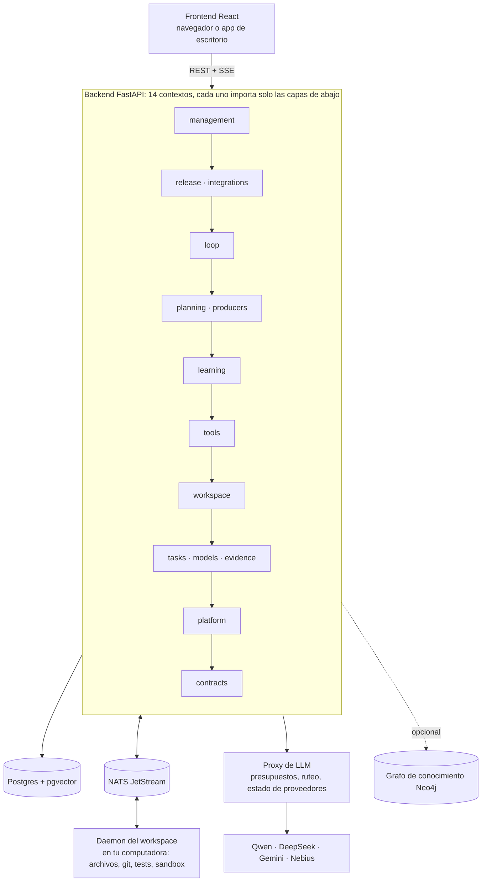

<div align="center">
  

# La Fabrique

[](https://github.com/careb36/la-fabrique/actions/workflows/backend-tests.yml)
[](https://www.docker.com/)
[](https://www.python.org/)
[](https://fastapi.tiangolo.com/)
[](https://reactjs.org/)
[](https://www.typescriptlang.org/)
[](LICENSE)

### Proyectos de TI de cualquier tipo, a cargo de una empresa de agentes de IA: pruebas, no promesas, de lo que hacen

> **Idiomas:** [🇺🇸 English](README.md) | [🇪🇸 Español](README.es.md)

</div>

---

## Qué es

La Fabrique es una plataforma para llevar adelante proyectos de TI con una
empresa de agentes de IA: software, ciencia de datos, machine learning, deep
learning y lo que cada proyecto necesite. Los agentes planifican el trabajo,
lo construyen y lo documentan, y la plataforma registra evidencia verificable
de lo que hicieron de verdad.

Los agentes son productores intercambiables. El producto es la capa que los
observa, verifica su trabajo y guarda el registro
([`docs/POSITIONING.md`](docs/POSITIONING.md), en inglés).

**Qué está construido hoy y qué es dirección.**

- **Construido:** el loop ejecuta tareas de software de punta a punta, desde
  una especificación hasta los archivos en disco, los tests, la revisión y una
  pull request. El **paquete de documentación** arma los documentos de gestión
  de un proyecto a partir de sus registros (según la Guía del PMBOK, con
  diagramas C4 y documentos de seguridad según OWASP WSTG), y cada afirmación
  que contiene cita un registro. El [bench](bench/README.md) evalúa la fábrica
  con especificaciones de referencia y tests escritos por una persona.
- **Dirección, todavía no construido:** tipos de proyecto para ciencia de
  datos, machine learning y deep learning, con sus propios entregables y su
  propia evidencia; automatización más allá del loop de software; e
  investigación. Hoy las herramientas de investigación solo les permiten a los
  roles que deciden leer fuentes oficiales. Cómo se aplican las reglas de
  evidencia a ese trabajo, y lo que decidió la dueña del proyecto al respecto,
  está en
  [`docs/POSITIONING.md`](docs/POSITIONING.md#scope-2026-11-19-it-projects-of-any-kind)
  (en inglés).

<div align="center">


</div>

## Por qué: cómo hace la plataforma para que los agentes hagan lo que dicen

La pregunta que responde La Fabrique es **"¿el agente hizo de verdad lo que
dice que hizo?"**. No le cree al agente ni a otro agente. Registra lo que
observó y decide solo a partir de eso.

| Lo que dice el agente | Lo que registra la plataforma en su lugar |
|---|---|
| "Escribí estos archivos" | El sha256 de cada archivo tal como el daemon del workspace lo volvió a leer del disco, y el diff contra los bytes que había antes |
| "Los tests pasan" | El código de salida y la salida de la suite que corrió el daemon después de la entrega, por criterio de aceptación |
| "Usé esta biblioteca" | La respuesta del registro de paquetes para ese nombre y esa versión exacta |
| "Primero revisé el código" | Cada archivo que el agente leyó con las herramientas, con su sha256, y cada llamada a una herramienta que el backend hizo por él |
| "La precisión es 0,94" | Una afirmación, hasta que la plataforma corra la evaluación por su cuenta (dirección para proyectos de ML) |

1. **Las afirmaciones y las observaciones nunca comparten un campo.** Lo que
   declara un productor (su resumen, su lista de archivos, su propio informe de
   tests, un mensaje a otro agente) se guarda como afirmación. Solo cuenta como
   evidencia lo que la plataforma observó. Es la regla de diseño 1 del
   posicionamiento, y todas las tablas la respetan.
2. **El Verificador decide, sin un modelo.** Cada ejecución recibe un
   veredicto, `verified`, `refuted` o `unverifiable`, a partir de chequeos
   determinísticos: archivos escritos, tests corridos, tests de aceptación por
   criterio (y sin modificar), cada comando que una entrega tenía que correr,
   los estándares de calidad (un secreto en un archivo refuta), el anclaje en
   la realidad (un paquete, una versión o un import inventados refutan), una
   auditoría de dependencias, un escaneo de secretos y un SAST, un sondeo OWASP
   WSTG de la aplicación en ejecución, los archivos leídos antes de
   modificarlos, las fuentes consultadas y el sandbox donde corrieron los
   tests. `unverifiable` es un veredicto de verdad y nunca se convierte en
   `verified`. El detalle:
   [`docs/contexts/evidence.md`](docs/contexts/evidence.md).
3. **Hay una compuerta antes de QA.** Una entrega refutada o sin confirmar,
   tests que fallan, un test de aceptación editado o un estándar violado
   vuelven a rehacerse con el motivo, sin consultar a ningún modelo. Antes de
   cada corrida se comprueba el hash de los archivos de tests de aceptación, y
   se restauran si una entrega los cambió. Recién entonces revisa QA, y solo un
   `APPROVED:` explícito cierra una tarea
   ([`docs/SPRINT_LOOP.md`](docs/SPRINT_LOOP.md), pasos 4 a 6).
4. **Los niveles de riesgo retienen el trabajo para una persona.** Las rutas de
   autenticación, secretos, pagos o el pipeline de CI hacen que una entrega sea
   de alto riesgo. También una herramienta que puede cambiar el mundo y un
   archivo modificado sin haberlo leído antes. Una entrega de alto riesgo
   espera a una persona en cualquier nivel de autonomía. Un productor puede
   subir su propio nivel, nunca bajarlo. El nivel de autonomía (de 1 a 3)
   decide qué más espera.
5. **El log de auditoría es una cadena de hashes por empresa, de solo
   agregado.** Las filas se enlazan con HMAC-SHA256; `GET /v1/audit/chain` dice
   si la cadena está intacta o dónde se borró, alteró o reordenó una fila. Como
   la fábrica tiene su propia clave, la cabeza de la cadena se puede anclar
   fuera de ella: un webhook, una autoridad de sellado de tiempo RFC 3161 o la
   clave Ed25519 del cliente
   ([`docs/design/AUDIT_ANCHORS.md`](docs/design/AUDIT_ANCHORS.md)). Los
   eventos de cada tarea también forman una cadena de hashes.
6. **Los hashes los calcula la plataforma, nunca la parte registrada.** El
   backend calcula el sha256 de un artefacto que ingiere, de la salida de cada
   comando y de cada log completo que guarda; un hash que venga en una
   respuesta no se lee.
7. **Segregación de funciones.** Quien pidió el trabajo, o lo escribió, no lo
   puede aprobar (en las acciones de alto riesgo por defecto, o en todas). Una
   excepción para una sola persona es una concesión explícita y auditada del
   Owner, y un informe lista cada aprobación junto a quienes la pidieron
   ([`docs/design/SEGREGATION_OF_DUTIES.md`](docs/design/SEGREGATION_OF_DUTIES.md)).
   Cada registro está acotado por empresa y por rol (Owner, Manager, Viewer).

Los agentes que asesoran a las personas (los agentes Manager, Reviewer y
Support) se miden igual: sus sugerencias se guardan aparte de las decisiones
que registran las personas, y sus aciertos se cuentan contra esas decisiones.

## Qué podés hacer hoy

**Planificar.**
- **Especificaciones**: el PO convierte un brief en requisitos numerados con
  criterios *dado / cuando / entonces*; un chequeo determinístico bloquea la
  aprobación ante un criterio que no se puede probar o una pregunta abierta
  ([planning](docs/contexts/planning.md)).
- **Arquitectura como datos**: el Architect propone módulos, interfaces,
  decisiones y convenciones; una vez aprobada, se escribe en el repositorio y
  el prompt y la revisión de cada tarea la siguen.
- **Sprints desde una especificación**: el PO divide el trabajo en tareas que
  nombran los criterios que cubren y sus dependencias, con primero una tarea de
  escribir tests por requisito. Una cola de entrada guarda los pedidos que
  llegan hasta que una persona los decide.

**Correr el sprint.**
- **El tablero**: cinco columnas de estado, vistas guardadas y filtros, un
  gráfico de avance (lo que se dijo hecho contra lo verificado), notas del
  tablero entre tareas y la conversación de los agentes por tarea
  ([loop](docs/contexts/loop.md), [tasks](docs/contexts/tasks.md)).
- **Revisar como una pull request**: la pestaña **Archivos modificados** de
  cada ejecución muestra el diff que observó el daemon, con comentarios por
  línea y *Aprobar* o *Pedir cambios*. La bandeja de **Revisión** lista lo que
  necesita a una persona.
- **Aprendizaje**: cada sprint cerrado tiene su retrospectiva; el ScrumMaster
  analiza las tareas bloqueadas y propone procedimientos, que los números del
  tablero mantienen o revierten dos sprints después
  ([learning](docs/contexts/learning.md)).
- **Modelos y costo**: modelos por rol, ruteo según la dificultad de la tarea y
  el costo de cada ejecución, tarea y sprint en tokens y centavos
  ([models](docs/contexts/models.md)).

**Trabajar sobre tu código.**
- **Daemon del workspace**: corre de forma nativa en macOS, Linux o Windows,
  escribe los archivos de los agentes, les lee el proyecto y corre los tests;
  las entregas quedan en cola mientras está desconectado
  ([workspace](docs/contexts/workspace.md)).
- **Sandbox**: el código que escriben los agentes corre en el host, en un
  contenedor efímero (sin red, con límites, sin capabilities) o con
  bubblewrap. El daemon informa lo que aplicó, y una corrida en el host queda
  como hallazgo.
- **Git**: con **Rama de Git por tarea**, una rama por tarea y un commit por
  entrega, en un worktree aparte. Las ramas de un sprint se integran en orden
  de dependencias y la suite corre sobre el resultado. Publicá una pull
  request (GitHub) o una merge request (GitLab) en borrador con la evidencia
  en la descripción, y traé de vuelta los comentarios de quienes revisan
  ([release](docs/contexts/release.md)).
- **Herramientas**: servidores MCP por empresa, las herramientas de workspace
  del Developer, un mapa del repositorio y herramientas de investigación que
  leen fuentes oficiales; cada llamada es una observación
  ([tools](docs/contexts/tools.md)).
- **Otros productores**: agentes de programación de terminal como productores,
  y pull requests de GitHub ingeridas y verificadas como ejecuciones
  ([producers](docs/contexts/producers.md)).

**Documentar.**
- **Paquete de documentación**: acta de constitución, alcance, EDT, matriz de
  trazabilidad, RACI, registro de riesgos, lecciones aprendidas, diagramas C4
  y el plan de tests OWASP WSTG, armados a partir de los registros; las
  secciones que solo puede decidir una persona quedan como plantillas
  ([`docs/design/PROJECT_DOCUMENTATION.md`](docs/design/PROJECT_DOCUMENTATION.md)).
- **Wiki del proyecto**: páginas que se actualizan al cerrar el sprint a
  partir de ejecuciones verificadas, con cada afirmación citada, y que se
  marcan como desactualizadas cuando cambia lo que citan
  ([`docs/design/PROJECT_WIKI.md`](docs/design/PROJECT_WIKI.md)).

**Medir la fábrica.**
- **El bench**: especificaciones de referencia que pasan por la fábrica y se
  califican con tests escritos por una persona, con sus scorecards
  ([`bench/README.md`](bench/README.md)).
- **Estándares de calidad**: un catálogo para todos los proyectos, en el prompt
  de cada agente según su rol; un procedimiento puede sumarles, nunca
  relajarlos ([`docs/STANDARDS.md`](docs/STANDARDS.md)).

**Gestionar la empresa.**
- **Agente Manager y el resumen**: la dueña o el dueño actúa como cliente. El
  agente Manager se ocupa de las decisiones de rutina bajo reglas estrictas, y
  un resumen diario (también por correo) cuenta qué se hizo y qué espera su
  decisión ([management](docs/contexts/management.md)).
- **Mesa de ayuda**: reportes de errores y un chat de soporte, que analiza el
  agente Support cuando está activado.

**Conectar.**
- **Chat**: aprobá o devolvé entregas retenidas desde Slack o Microsoft Teams,
  con los mismos chequeos de rol y la misma auditoría que en la web
  ([`docs/design/CHAT_APPROVALS.md`](docs/design/CHAT_APPROVALS.md)).
- **Webhooks**: un webhook de notificaciones por empresa, firmado con HMAC
  ([integrations](docs/contexts/integrations.md)).
- **Inicio de sesión único**: OpenID Connect por empresa, con configuraciones
  listas para Google y Entra ID ([`docs/design/SSO.md`](docs/design/SSO.md)).
- **Equipos y uso**: agrupá a los miembros en equipos con un rol y exportá
  quién usó qué ([`docs/design/TEAMS_AND_USAGE.md`](docs/design/TEAMS_AND_USAGE.md)).
- **Glassroom**: la pestaña **En vivo** del sprint transmite la actividad de
  los agentes en tiempo real. La versión para visor vive en la rama
  `main_meta`.

La interfaz está en inglés y en español, en el navegador o como aplicación de
escritorio ([frontend](docs/contexts/frontend.md)).

## Arquitectura



- **Backend**: `backend/app/services` está dividido en catorce contextos. El
  contexto de evidencia importa solo contracts y platform, así que lo que juzga
  una ejecución nunca depende del código que la produjo. La regla es un dato
  (`docs/architecture/contexts.json`) que verifica el CI con
  `scripts/check_architecture.py`. El detalle:
  [`docs/ARCHITECTURE.md`](docs/ARCHITECTURE.md) y un documento por contexto
  en [`docs/contexts/`](docs/contexts/) (en inglés).
- **Daemon del workspace** (`vscode-daemon/`): el único componente que toca
  los archivos del usuario. Habla con el backend por un protocolo NATS
  versionado.
- **Proxy de LLM** (`llm-proxy/`): toda llamada a un modelo pasa por él.
  Controla los presupuestos de tokens por empresa, rutea por id de modelo a
  los proveedores configurados, recurre a otro ante errores e informa qué
  respondió cada proveedor.
- **Almacenamiento**: Postgres con pgvector guarda todos los registros y la
  memoria semántica. Neo4j guarda el linaje de archivos y es opcional. Un
  contenedor janitor aplica la retención, y Jaeger recoge las trazas.
- **El task worker** (`services/loop/worker/`) lleva cada tarea desde el
  prompt hasta la decisión de QA ([`docs/SPRINT_LOOP.md`](docs/SPRINT_LOOP.md)).

## Inicio rápido

Requisitos: Docker 24+ con Compose v2, y Python 3.9+ en la computadora donde
corre el daemon del workspace. Node.js 24+ solo para desarrollar el frontend.

```bash
cp .env.example .env
# Definí al menos POSTGRES_PASSWORD, NEO4J_PASSWORD (y NEO4J_AUTH),
# JWT_SECRET_KEY, FERNET_SECRET_KEY, AUDIT_SIGNING_KEY,
# QWEN_API_KEY y DEEPSEEK_API_KEY.

docker compose up -d          # backend :8000, frontend :5173, proxy de LLM :5100
./scripts/start-daemon.sh     # en la computadora que tiene tus proyectos
                              # (.\scripts\start-daemon.ps1 en Windows)
```

1. **Revisá el stack**: `curl -s localhost:8000/health` (y `/health/deep`
   para cada dependencia). La documentación de la API está en
   `http://localhost:8000/docs`; las trazas, en `http://localhost:16686`.
2. **Revisá las claves de los modelos**: `curl -s localhost:5100/v1/providers | jq`
   lista qué respondió cada proveedor (`ok`, `no_credit`, `invalid_key`,
   `not_configured`…). Agregá `?refresh=1` para volver a comprobar después de
   cargar crédito.
3. **Creá el primer usuario y la empresa**: abrí `http://localhost:5173`,
   registrate y entrá a **Nueva compañía**: ponele nombre, elegí la carpeta del
   proyecto en la computadora del daemon (por ejemplo `/home/you/src/app` o
   `C:\Users\you\source\repos\app`) y revisá el equipo sugerido.
4. **Planificá**: escribí una especificación, o planificá un sprint a partir
   de un objetivo, y seguilo en el tablero.

El equipo por defecto corre sobre Qwen y DeepSeek. `AGENT_MODEL` pone a todos
los roles en un solo modelo (y entonces solo hace falta la clave de ese
proveedor), `AGENT_MODEL_<ROL>` define uno, y la página **Agentes** cambia el
modelo de un rol en cada empresa.

Neo4j es opcional y viene activado. Compose usa su imagen Enterprise con una
licencia de evaluación, así que para producción licenciala o desactivala:
`NEO4J_ENABLED=false docker compose up -d --scale neo4j=0`.

El despliegue real (un proxy inverso, un daemon en un servidor, asegurar NATS,
SSO, copias de seguridad, actualizaciones, rotación de claves, incidentes)
está en [`docs/OPERATIONS.md`](docs/OPERATIONS.md) (en inglés). Una guía sin
código para quienes gestionan: [`USER_GUIDE.es.md`](USER_GUIDE.es.md).

## Configuración

Cada variable de entorno, con su valor por defecto, el componente que la lee y
si es un secreto, está en [`docs/CONFIGURATION.md`](docs/CONFIGURATION.md).
Algunas cambian bastante el comportamiento: `AUTH_REQUIRED` (activada por
defecto), `DELIVERY_TESTS_ENABLED` (el daemon corre los tests del proyecto
después de cada entrega; desactivada por defecto), `DELIVERY_SANDBOX`
(`host`, `container` o `bwrap`), y `MANAGER_AGENT_ENABLED`,
`REVIEWER_AGENT_ENABLED` y `SUPPORT_AGENT_ENABLED` (desactivadas por defecto).

## Tests

```bash
scripts/check.sh quick   # mientras trabajás: lo que tu cambio puede romper
scripts/check.sh full    # antes de hacer push: todo lo que corre el CI
```

La suite del backend no necesita Postgres, NATS, Neo4j ni un modelo. El CI
también corre una prueba de punta a punta contra Postgres y NATS reales que
lleva a una empresa por varios sprints, el bench con un modelo falso y los
chequeos de arquitectura, de capas del frontend y de tamaño de archivos. Las
suites, sus tablas y los jobs de CI están en
[`docs/TESTING.md`](docs/TESTING.md).

## Contribuir

Trunk-based: cada cambio es una rama desde `main` con una sola pull request.
Leé [`CONTRIBUTING.md`](CONTRIBUTING.md) y el
[código de conducta](CODE_OF_CONDUCT.md); los agentes que trabajan sobre el
código arrancan por [`CLAUDE.md`](CLAUDE.md). Los cambios quedan en
[`CHANGELOG.md`](CHANGELOG.md).

## Seguridad

Reportá vulnerabilidades como se indica en [`SECURITY.md`](SECURITY.md), que
también contiene la línea base de seguridad. El modelo de amenazas está en
[`docs/threat_model.md`](docs/threat_model.md).

Los agentes escriben archivos y corren comandos donde corre el daemon del
workspace. Apuntalo solo a carpetas que puedas modificar, preferí el sandbox
`container` y dejá NATS escuchando en `127.0.0.1` salvo que el daemon esté en
otra máquina: cualquiera que llegue a NATS le puede pedir al daemon que corra
comandos.

## Licencia

Apache License 2.0. Mirá [`LICENSE`](LICENSE) y [`NOTICE`](NOTICE), que
también reconoce el código de terceros adaptado acá.
