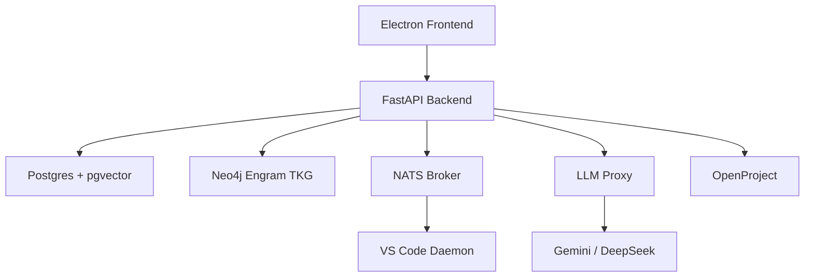

# 🏭 Fabrique (Sistema Fábrica)

[](https://www.docker.com/)
[](https://www.python.org/)
[](https://fastapi.tiangolo.com/)
[](https://reactjs.org/)
[](https://www.typescriptlang.org/)

> **Idiomas:** [🇺🇸 English](README.md) | [🇪🇸 Español](README.es.md)

👔 **¿No eres desarrollador o usuario técnico?** Por favor, lee la [**Guía de Negocio para Managers**](USER_GUIDE.es.md) para comprender cómo utilizar Fabrique para automatizar la ingeniería de tu empresa.

---

## 📑 Índice
- [🚀 Características Clave](#-características-clave)
- [🏗️ Arquitectura](#️-arquitectura)
- [🛠️ Stack Tecnológico](#️-stack-tecnológico)
- [📥 Primeros Pasos](#-primeros-pasos)
- [📖 Documentación de la API](#-documentación-de-la-api)
- [📁 Estructura del Proyecto](#-estructura-del-proyecto)
- [⚖️ Licencia](#️-licencia)
- [🆘 Soporte](#-soporte)

---

## 🚀 Características Clave

- **🧠 Inteligencia de Agentes Híbrida**: Orquesta Gemini 1.5 Pro (Arquitecto/PO) y DeepSeek (Dev/QA) para lograr el equilibrio perfecto entre razonamiento y programación rentable.
- **🔄 Gestión del Ciclo de Vida Completo**: Capaz de crear nuevos proyectos desde cero, evolucionar código existente generado por IA y mantener/mejorar sistemas legados escritos por humanos.
- **📋 Integración Nativa con OpenProject**: Los agentes actúan como miembros reales del equipo, creando paquetes de trabajo de forma autónoma, registrando el progreso y actualizando tickets en tus tableros de OpenProject.
- **📜 Bandeja de Salida Transaccional (Outbox)**: Garantiza la entrega de mensajes NATS sincronizando la publicación de eventos con las transacciones de Postgres.
- **🔄 Checkpointing de LangGraph**: Suspensión y reanudación asíncrona de flujos de trabajo mediante `MemorySaver`.
- **🛡️ Proxy LLM Centralizado**: Presupuesto estricto de tokens y auditoría de seguridad para todas las interacciones de IA.
- **🔌 Integración con VS Code**: Un daemon nativo y una extensión cierran la brecha entre la orquestación de IA y tu IDE local.
- **📊 Monitoreo Glassroom**: Transmisión de eventos SSE en tiempo real para supervisar visualmente el progreso de los agentes.

[⬆ Volver al inicio](#-fabrique-sistema-fábrica)

---

## 🏗️ Arquitectura



[⬆ Volver al inicio](#-fabrique-sistema-fábrica)

---

## 🛠️ Stack Tecnológico

- **Backend**: FastAPI, LangGraph, SQLAlchemy.
- **Frontend**: React, TypeScript, Electron, TailwindCSS.
- **Memoria**: Postgres (pgvector) + Neo4j (Grafo de Conocimiento Temporal).
- **Broker**: NATS (JetStream).
- **Gestión de Proyectos**: OpenProject.
- **Infraestructura**: Docker Compose, VS Code CLI.

[⬆ Volver al inicio](#-fabrique-sistema-fábrica)

---

## 📥 Primeros Pasos

### 1. Requisitos Previos
- Docker y Docker Compose
- CLI de VS Code (comando `code`)
- Python 3.11+ y Node.js 18+

### 2. Configuración del Entorno
Crea un archivo `.env` a partir del ejemplo:
```bash
cp .env.example .env
# Edita .env con tus claves de API (GEMINI_API_KEY, DEEPSEEK_API_KEY, etc.)
```

### 3. Iniciar Servicios
```bash
docker-compose up -d
```

### 4. Ejecutar el Daemon Local
```bash
pip install nats-py
python vscode-daemon/daemon.py
```

[⬆ Volver al inicio](#-fabrique-sistema-fábrica)
---

## 📖 Documentación de la API

Fabrique utiliza una API autodocumentada basada en el estándar OpenAPI. Puedes acceder a la documentación interactiva en:

- **Swagger UI (Interactivo):** `http://localhost:8000/docs`
- **ReDoc (Detallado):** `http://localhost:8000/redoc`

---

## 🛠️ Soporte y Observabilidad

- **Logs Estructurados:** Todos los eventos del sistema se registran en formato JSON para una integración sencilla con ELK, Datadog o Splunk.
- **Bot de Soporte:** Un Bot de soporte con IA integrado permite a los usuarios hacer preguntas y reportar errores directamente en el Proyecto de Soporte.
- **Exportación de Logs:** Los administradores pueden descargar un paquete completo de logs de auditoría a través del endpoint `/v1/support/logs` para una resolución rápida de problemas.

---

## 📁 Estructura del Proyecto
---

## 📁 Estructura del Proyecto

*   `backend/`: Aplicación FastAPI y lógica de agentes LangGraph.
*   `frontend/`: Dashboard de Electron + React.
*   `vscode-daemon/`: Suscriptor NATS local para operaciones de archivos.
*   `vscode-extension/`: Herramientas de integración para VS Code.
*   `llm-proxy/`: Pasarela de presupuesto de tokens y auditoría.
*   `db/`: Scripts de inicialización de la base de datos.

[⬆ Volver al inicio](#-fabrique-sistema-fábrica)

---

## ⚖️ Licencia

**Software Propietario.** Todos los derechos reservados.
Copyright © 2026 Carolina Pereira.

Queda estrictamente prohibida la copia, distribución o uso comercial no autorizado de este sistema, por cualquier medio, sin el permiso explícito y por escrito de la propietaria.

---

## 🆘 Soporte y Mantenimiento

- **Soporte del Sistema:** El motor de Fabrique es mantenido por **Carolina Pereira**. Los errores del sistema se reportan automáticamente a la proveedora para su resolución en el repositorio central de GitHub.
- **Soporte de Proyectos:** Para incidencias relacionadas con el código generado por la IA en sus proyectos locales, utilice el Bot de Soporte integrado.
- **Contacto:** Para consultas sobre licencias y acuerdos de nivel de servicio (SLA) Enterprise, contacte directamente con la propietaria.

[⬆ Volver al inicio](#-fabrique-sistema-fábrica)
