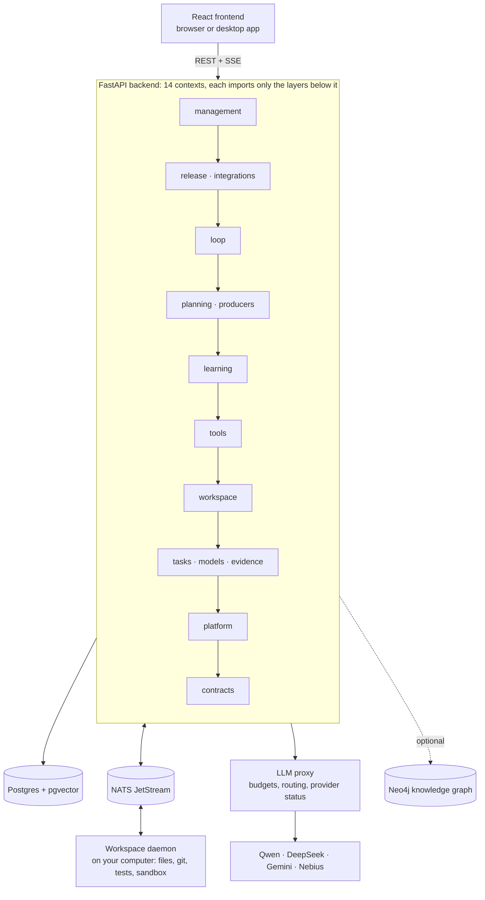

<div align="center">
  

# La Fabrique

[](https://github.com/careb36/la-fabrique/actions/workflows/backend-tests.yml)
[](https://www.docker.com/)
[](https://www.python.org/)
[](https://fastapi.tiangolo.com/)
[](https://reactjs.org/)
[](https://www.typescriptlang.org/)
[](LICENSE)

### IT projects of any kind, run by a company of AI agents: proof, not promises, for what they do

> **Languages:** [🇺🇸 English](README.md) | [🇪🇸 Español](README.es.md)

</div>

---

## What it is

La Fabrique is a platform for running IT projects with a company of AI agents:
software, data science, machine learning, deep learning and whatever else a
project calls for. The agents plan the work, build it and document it, and the
platform records verifiable evidence of what they actually did.

The agents are interchangeable producers. The product is the layer that
observes them, verifies their work and keeps the record
([`docs/POSITIONING.md`](docs/POSITIONING.md)).

**What is built today, and what is direction.**

- **Built:** the loop runs software tasks end to end, from a specification to
  the files on disk, the tests, the review and a pull request. The
  **documentation pack** compiles a project's management documents from its
  records (after the PMBOK Guide, with C4 diagrams and OWASP WSTG security
  documents), and every statement in it cites a record. The
  [bench](bench/README.md) grades the factory on reference specifications with
  tests a person wrote.
- **Direction, not built:** project types for data science, machine learning
  and deep learning, with their own deliverables and evidence; automation
  beyond the software loop; and research. Today the research tools only let
  the roles that decide read official sources. How the evidence rules apply to
  that work, and the owner's decisions on it, are in
  [`docs/POSITIONING.md`](docs/POSITIONING.md#scope-2026-11-19-it-projects-of-any-kind).

<div align="center">


</div>

## Why: how the platform makes agents do what they say

The question La Fabrique answers is **"did the agent actually do what it says
it did?"** It does not trust the agent's answer, or another agent's. It
records what it observed and decides from that alone.

| The agent says | What the platform records instead |
|---|---|
| "I wrote these files" | The sha256 of each file as the workspace daemon read it back from disk, and the diff against the bytes that were there before |
| "The tests pass" | The exit status and output of the suite the daemon ran after the delivery, per acceptance criterion |
| "I used this library" | The package registry's answer for that name and exact version |
| "I checked the code first" | Every file the agent read through the tools, with its sha256, and every tool call the backend made for it |
| "Accuracy is 0.94" | A claim, until the platform runs the evaluation itself (direction for ML projects) |

1. **Claims and observations never share a field.** What a producer declares
   (its summary, its file list, its own test report, a message to another
   agent) is stored as a claim. Only what the platform observed counts as
   evidence. This is design rule 1 of the positioning, and every table keeps
   it.
2. **The Verifier decides, without a model.** Each run gets a verdict,
   `verified`, `refuted` or `unverifiable`, from deterministic checks: files
   written, tests run, acceptance tests per criterion (and untouched), every
   command a delivery had to run, the quality standards (a secret in a file
   refutes), grounding (an invented package, version or import refutes), a
   dependency audit, secret scan and SAST, an OWASP WSTG probe of the running
   application, the files read before modification, the sources consulted and
   the sandbox the tests ran in. `unverifiable` is a real verdict and never
   turns into `verified`. Details:
   [`docs/contexts/evidence.md`](docs/contexts/evidence.md).
3. **A gate stands before QA.** A refuted or unconfirmed delivery, failed
   tests, an edited acceptance test or a violated standard goes back for
   rework with the reason, and no model is asked. Acceptance test files are
   checked by hash before each run and restored if a delivery changed them.
   Only then does QA review, and only an explicit `APPROVED:` closes a task
   ([`docs/SPRINT_LOOP.md`](docs/SPRINT_LOOP.md), steps 4 to 6).
4. **Risk tiers hold work for a person.** Paths for authentication, secrets,
   payments or the CI pipeline make a delivery high risk. So do a tool that
   may change the world and a file modified without being read first. A
   high-risk delivery waits for a person at every autonomy level. A producer
   may raise its own tier, never lower it. The autonomy level (1 to 3) decides
   what else waits.
5. **The audit log is an append-only hash chain per company.** Rows are
   HMAC-SHA256 linked; `GET /v1/audit/chain` says whether the chain is intact
   or where a row was deleted, altered or reordered. Because the factory holds
   its own key, the chain head can be anchored outside it: a webhook, an
   RFC 3161 timestamping authority or the customer's Ed25519 key
   ([`docs/design/AUDIT_ANCHORS.md`](docs/design/AUDIT_ANCHORS.md)). Each
   task's events form a hash chain too.
6. **Hashes come from the platform, never from the party recorded.** The
   backend computes the sha256 of an ingested artifact, of each command's
   output and of every full log it stores; a hash in a reply is not read.
7. **Segregation of duties.** The person who asked for the work, or wrote it,
   cannot approve it (for high-risk actions by default, or for all). A
   single-person exception is an Owner's explicit, audited grant, and a report
   lists every approval beside its requesters
   ([`docs/design/SEGREGATION_OF_DUTIES.md`](docs/design/SEGREGATION_OF_DUTIES.md)).
   Every record is scoped by company and role (Owner, Manager, Viewer).

The agents that advise people (the Manager, Reviewer and Support agents) are
measured the same way: their suggestions are stored apart from the decisions
people record, and their hit rate is counted against those decisions.

## What you can do with it today

**Plan.**
- **Specifications**: the PO turns a brief into numbered requirements with
  *given / when / then* criteria; a deterministic check blocks approval on a
  criterion that cannot be tested or an open question
  ([planning](docs/contexts/planning.md)).
- **Architecture as data**: the Architect proposes modules, interfaces,
  decisions and conventions; once approved, it is written to the repository
  and every task's prompt and review follow it.
- **Sprints from a specification**: the PO splits the work into tasks that
  name the criteria they cover and their dependencies, with a test-writing
  task per requirement first. An intake queue holds incoming requests until a
  person decides them.

**Run the sprint.**
- **The board**: five status columns, saved views and filters, a sprint
  progress chart (claimed done against verified), board notes between tasks,
  and the agents' conversation per task ([loop](docs/contexts/loop.md),
  [tasks](docs/contexts/tasks.md)).
- **Review like a pull request**: each run's **Files changed** tab shows the
  diff the daemon observed, with line comments and *Approve* or *Request
  changes*. The **Review** inbox lists what needs a person.
- **Learning**: each closed sprint has a retrospective; the ScrumMaster triages
  blocked tasks and proposes procedures, which the board's numbers keep or
  revert two sprints later ([learning](docs/contexts/learning.md)).
- **Model choice and cost**: per-role models, routing by task difficulty, and
  the cost of each run, task and sprint in tokens and cents
  ([models](docs/contexts/models.md)).

**Work on your code.**
- **Workspace daemon**: runs natively on macOS, Linux or Windows, writes the
  agents' files, reads the project for them and runs tests; deliveries
  queue while it is offline ([workspace](docs/contexts/workspace.md)).
- **Sandbox**: agent-written code runs on the host, in an ephemeral container
  (network off, limits, no capabilities) or under bubblewrap. The daemon
  reports what it applied, and a run on the host is a finding.
- **Git**: with **Git branch per task**, one branch per task and one commit per
  delivery in a separate worktree. A sprint's branches are integrated in
  dependency order and the suite runs on the result. Publish a draft pull
  request (GitHub) or merge request (GitLab) with the evidence in its
  description, and bring reviewers' comments back
  ([release](docs/contexts/release.md)).
- **Tools**: MCP servers per company, the Developer's workspace tools, a
  repository map and research tools that read official sources; every call is
  an observation ([tools](docs/contexts/tools.md)).
- **Other producers**: terminal coding agents as producers, and pull requests
  from GitHub ingested and verified as runs
  ([producers](docs/contexts/producers.md)).

**Document.**
- **Documentation pack**: charter, scope, WBS, traceability matrix, RACI, risk
  register, lessons learned, C4 diagrams and the OWASP WSTG test plan,
  compiled from the records; sections only a person can decide stay
  templates ([`docs/design/PROJECT_DOCUMENTATION.md`](docs/design/PROJECT_DOCUMENTATION.md)).
- **Project wiki**: pages updated at sprint close from verified runs, each
  statement cited, marked stale when what it cites changes
  ([`docs/design/PROJECT_WIKI.md`](docs/design/PROJECT_WIKI.md)).

**Measure the factory.**
- **The bench**: reference specifications run through the factory and graded
  by tests a person wrote, with scorecards ([`bench/README.md`](bench/README.md)).
- **Quality standards**: one catalogue for every project, in every agent's
  prompt by role; a procedure can add to them, never relax them
  ([`docs/STANDARDS.md`](docs/STANDARDS.md)).

**Manage the company.**
- **Manager agent and the brief**: the owner acts as a client. The Manager
  agent handles routine decisions under strict rules, and a daily brief (also
  by email) says what was done and what waits for the owner
  ([management](docs/contexts/management.md)).
- **Help desk**: bug reports and a support chat, triaged by the Support agent
  when enabled.

**Connect.**
- **Chat**: approve or send back held deliveries from Slack or Microsoft Teams,
  with the same role checks and audit as the web
  ([`docs/design/CHAT_APPROVALS.md`](docs/design/CHAT_APPROVALS.md)).
- **Webhooks**: a company notification webhook, HMAC-signed
  ([integrations](docs/contexts/integrations.md)).
- **Single sign-on**: OpenID Connect per company, with Google and Entra ID
  presets ([`docs/design/SSO.md`](docs/design/SSO.md)).
- **Teams and usage**: group members into teams with a role, and export who
  used what ([`docs/design/TEAMS_AND_USAGE.md`](docs/design/TEAMS_AND_USAGE.md)).
- **Glassroom**: the sprint's **Live** tab streams the agents' activity in real
  time. The headset version lives on the `main_meta` branch.

The interface is in English and Spanish, in the browser or as a desktop app
([frontend](docs/contexts/frontend.md)).

## Architecture



- **Backend**: `backend/app/services` is divided into fourteen contexts. The
  evidence context imports only contracts and platform, so what judges a run
  never depends on the code that produced it. The rule is data
  (`docs/architecture/contexts.json`), checked in CI by
  `scripts/check_architecture.py`. Details:
  [`docs/ARCHITECTURE.md`](docs/ARCHITECTURE.md) and one document per context
  in [`docs/contexts/`](docs/contexts/).
- **Workspace daemon** (`vscode-daemon/`): the only component that touches the
  user's files. It talks to the backend over a versioned NATS protocol.
- **LLM proxy** (`llm-proxy/`): every model call goes through it. It enforces
  per-company token budgets, routes by model id to the configured providers,
  falls back on errors and reports what each provider answered.
- **Storage**: Postgres with pgvector holds every record and the semantic
  memory. Neo4j holds file lineage and is optional. A janitor container
  applies retention, and Jaeger collects traces.
- **The task worker** (`services/loop/worker/`) drives each task from the
  prompt to QA's decision ([`docs/SPRINT_LOOP.md`](docs/SPRINT_LOOP.md)).

## Quick start

Requirements: Docker 24+ with Compose v2, and Python 3.9+ on the computer that
runs the workspace daemon. Node.js 24+ only for frontend development.

```bash
cp .env.example .env
# Set at least POSTGRES_PASSWORD, NEO4J_PASSWORD (and NEO4J_AUTH),
# JWT_SECRET_KEY, FERNET_SECRET_KEY, AUDIT_SIGNING_KEY,
# QWEN_API_KEY and DEEPSEEK_API_KEY.

docker compose up -d          # backend :8000, frontend :5173, LLM proxy :5100
./scripts/start-daemon.sh     # on the computer that holds your projects
                              # (.\scripts\start-daemon.ps1 on Windows)
```

1. **Check the stack**: `curl -s localhost:8000/health` (and `/health/deep`
   for each dependency). The API documentation is at
   `http://localhost:8000/docs`; traces at `http://localhost:16686`.
2. **Check the model keys**: `curl -s localhost:5100/v1/providers | jq` lists
   what each provider answered (`ok`, `no_credit`, `invalid_key`,
   `not_configured`…). Add `?refresh=1` to check again after topping up.
3. **Create the first user and company**: open `http://localhost:5173`,
   register, then **New company**: name it, choose the project folder on the
   daemon's computer (for example `/home/you/src/app` or
   `C:\Users\you\source\repos\app`) and review the suggested team.
4. **Plan**: write a specification, or plan a sprint from a goal, and follow
   it on the board.

The default team runs on Qwen and DeepSeek. `AGENT_MODEL` puts every role on
one model (then only that provider's key is needed), `AGENT_MODEL_<ROLE>` sets
one role, and the **Agents** page changes a role's model per company.

Neo4j is optional and on by default. Compose runs its Enterprise image under
an evaluation licence, so for production either license it or turn it off:
`NEO4J_ENABLED=false docker compose up -d --scale neo4j=0`.

Deploying for real (a reverse proxy, a daemon on a server, securing NATS,
SSO, backups, upgrades, key rotation, incidents) is in
[`docs/OPERATIONS.md`](docs/OPERATIONS.md). A guide without code for
managers: [`USER_GUIDE.md`](USER_GUIDE.md).

## Configuration

Every environment variable, with its default, the component that reads it and
whether it is a secret, is in [`docs/CONFIGURATION.md`](docs/CONFIGURATION.md).
A few change behaviour noticeably: `AUTH_REQUIRED` (on by default),
`DELIVERY_TESTS_ENABLED` (the daemon runs the project's tests after each
delivery; off by default), `DELIVERY_SANDBOX` (`host`, `container` or
`bwrap`), and `MANAGER_AGENT_ENABLED`, `REVIEWER_AGENT_ENABLED` and
`SUPPORT_AGENT_ENABLED` (off by default).

## Testing

```bash
scripts/check.sh quick   # while working: what your change can break
scripts/check.sh full    # before pushing: everything CI runs
```

The backend suite needs no Postgres, NATS, Neo4j or model. CI also runs an
end-to-end run against real Postgres and NATS that drives a company through
several sprints, the bench with a fake model, and the architecture, frontend
layer and file-size checks. The suites, their tables and the CI jobs are in
[`docs/TESTING.md`](docs/TESTING.md).

## Contributing

Trunk-based: each change is a branch from `main` with one pull request. Read
[`CONTRIBUTING.md`](CONTRIBUTING.md) and the
[code of conduct](CODE_OF_CONDUCT.md); agents working on the code start from
[`CLAUDE.md`](CLAUDE.md). Changes are recorded in [`CHANGELOG.md`](CHANGELOG.md).

## Security

Report vulnerabilities as described in [`SECURITY.md`](SECURITY.md), which
also holds the security baseline. The threat model is
[`docs/threat_model.md`](docs/threat_model.md).

The agents write files and run commands where the workspace daemon runs. Point
it only at folders you may modify, prefer the `container` sandbox, and keep
NATS bound to `127.0.0.1` unless the daemon is on another machine: anyone who
reaches NATS can ask the daemon to run commands.

## Licence

Apache License 2.0. See [`LICENSE`](LICENSE) and [`NOTICE`](NOTICE), which
also credits the third-party code adapted here.
