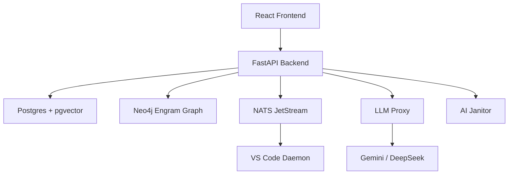

<div align="center">
  

# Le Fabrique

[](https://www.docker.com/)
[](https://www.python.org/)
[](https://fastapi.tiangolo.com/)
[](https://reactjs.org/)
[](https://www.typescriptlang.org/)

**AI-powered autonomous software development platform**

> **Languages:** [🇺🇸 English](README.md) | [🇪🇸 Español](README.es.md)

</div>

👔 **Not a developer or technical user?** Please read the [**Manager's Business Guide**](USER_GUIDE.md) to understand how to use Le Fabrique to automate your company's engineering.

---

## 📑 Table of Contents
- [🚀 Key Features](#-key-features)
- [🏗️ Architecture](#️-architecture)
- [🛠️ Tech Stack](#️-tech-stack)
- [📥 Getting Started](#-getting-started)
- [📖 API Documentation](#-api-documentation)
- [📁 Project Structure](#-project-structure)
- [⚖️ License](#️-license)
- [🆘 Support](#-support--maintenance)

---

## 🚀 Key Features

- **🧠 Hybrid Agent Intelligence**: Orchestrates Gemini (Architect/PO) and DeepSeek (Dev/QA) for the perfect balance of reasoning and cost-effective coding.
- **🔄 Full Lifecycle Management**: Capable of creating new projects from scratch, evolving existing AI-generated code, and maintaining/improving legacy human-written systems.
- **📜 Transactional Outbox**: Guarantees NATS message delivery by syncing event publishing with Postgres transactions.
- **🔄 LangGraph Checkpointing**: Asynchronous workflow suspension/resumption using `MemorySaver`.
- **🛡️ Centralized LLM Proxy**: Strict token budgeting and security auditing for all AI interactions.
- **🔌 VS Code Integration**: A native daemon and extension bridge the gap between AI orchestration and your local IDE.
- **📊 Glassroom Monitoring**: Real-time SSE event streaming to monitor agent progress visually.
- **🎫 Built-in Support Bot**: AI-powered help desk with ticket tracking, severity levels, and status follow-up (EN/ES).

[⬆ Back to Top](#le-fabrique)

---

## 🏗️ Architecture



[⬆ Back to Top](#le-fabrique)

---

## 🛠️ Tech Stack

| Layer | Technology |
|---|---|
| **Backend** | FastAPI, LangGraph, SQLAlchemy |
| **Frontend** | React, TypeScript, TailwindCSS, Vite |
| **Memory** | Postgres (pgvector) + Neo4j (Temporal Knowledge Graph) |
| **Broker** | NATS JetStream |
| **AI Models** | Gemini (via Google AI Studio) + DeepSeek |
| **Infrastructure** | Docker Compose, VS Code CLI |

[⬆ Back to Top](#le-fabrique)

---

## 📥 Getting Started

### 1. Prerequisites
- Docker & Docker Compose
- VS Code CLI (`code` command)
- Python 3.11+ & Node.js 18+

### 2. Environment Setup
```bash
cp .env.example .env
# Edit .env — add your GEMINI_API_KEY and DEEPSEEK_API_KEY
```

### 3. Launch All Services
```bash
docker compose up -d
```

### 4. Run the Local VS Code Daemon
```bash
pip install nats-py
python vscode-daemon/daemon.py
```

### 5. Access the Dashboard
Open **http://localhost:5173** in your browser.

[⬆ Back to Top](#le-fabrique)

---

## 📖 API Documentation

Le Fabrique exposes a fully self-documented OpenAPI interface:

- **Swagger UI (Interactive):** `http://localhost:8000/docs`
- **ReDoc (Detailed):** `http://localhost:8000/redoc`

---

## 🛠️ Support & Observability

- **Structured Logging:** All events logged in JSON format — compatible with ELK, Datadog, or Splunk.
- **Support Bot:** Built-in AI help desk with ticket creation, severity levels, and status tracking.
- **Log Export:** Administrators can download a full audit bundle via `GET /v1/support/logs`.

---

## 📁 Project Structure

```
le-fabrique/
├── backend/          # FastAPI app + LangGraph agent logic
│   ├── agents/       # Agent graph definitions
│   ├── app/          # API routes, schemas, config
│   ├── janitor/      # Background maintenance worker
│   ├── llm/          # Model factory (Gemini + DeepSeek)
│   └── memory/       # Engram processor (pgvector + Neo4j)
├── frontend/         # React + TypeScript dashboard (Vite)
│   ├── src/
│   │   ├── components/   # KanbanBoard, GlassRoom, SupportBot…
│   │   ├── pages/        # SprintWorkspace, Analytics, Generate…
│   │   └── i18n/         # EN + ES translations
│   └── electron/     # Electron shell (optional desktop mode)
├── llm-proxy/        # Token budget & auditing gateway
├── vscode-daemon/    # Local NATS subscriber for file operations
├── vscode-extension/ # VS Code integration bridge
├── db/               # Postgres initialization scripts
├── deployment/       # Kubernetes manifests
├── docker-compose.yml
└── .env.example
```

[⬆ Back to Top](#le-fabrique)

---

## ⚖️ License

**Proprietary Software.** All rights reserved.  
Copyright © 2026 Carolina Pereira.

Unauthorized copying, distribution, or commercial use of this system, via any medium, is strictly prohibited without explicit written permission from the owner.

---

## 🆘 Support & Maintenance

- **System Support:** Le Fabrique is maintained by **Carolina Pereira**. Critical errors are automatically reported to the vendor for resolution.
- **Project Support:** For issues with AI-generated code in your projects, use the built-in Support Bot.
- **Contact:** For licensing and Enterprise SLA inquiries, please contact the owner directly.

[⬆ Back to Top](#le-fabrique)
