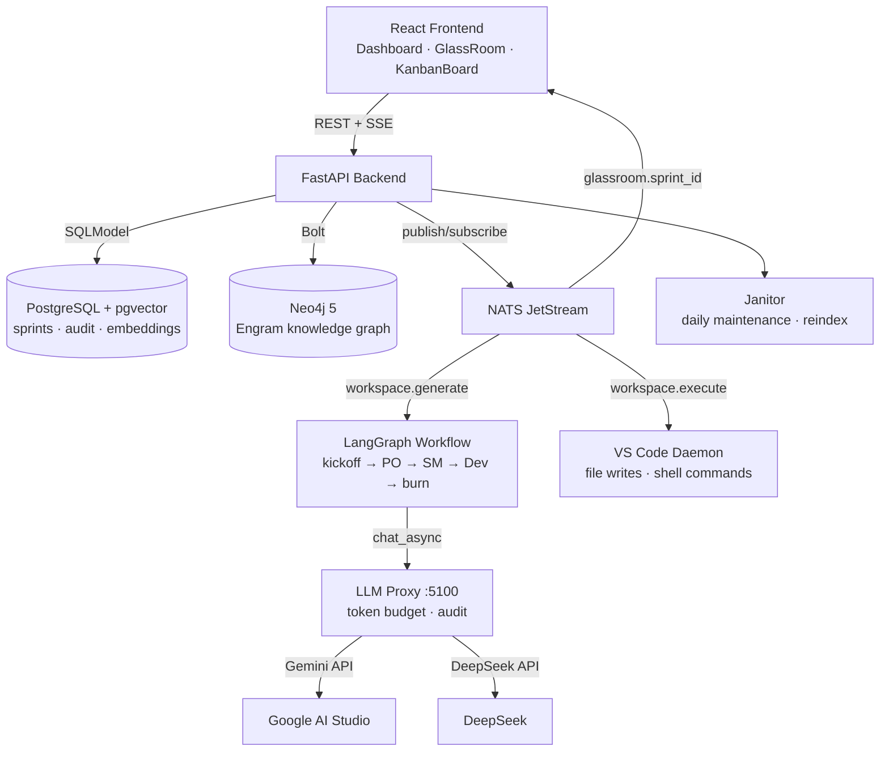
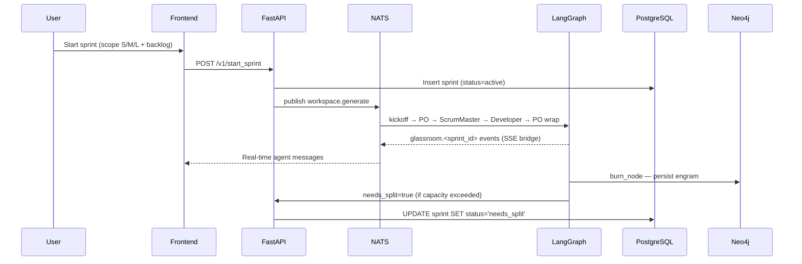
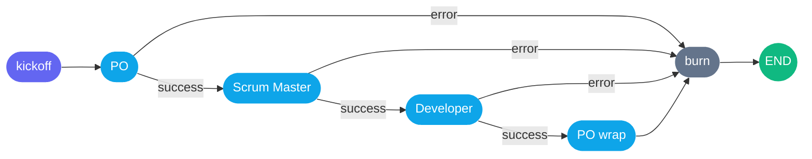

<div align="center">
  

# La Fabrique

[](https://www.docker.com/)
[](https://www.python.org/)
[](https://fastapi.tiangolo.com/)
[](https://reactjs.org/)
[](https://www.typescriptlang.org/)

**AI-powered autonomous software development platform**

> **Languages:** [🇺🇸 English](README.md) | [🇪🇸 Español](README.es.md)

</div>

👔 **Not a developer or technical user?** Please read the [**Manager's Business Guide**](USER_GUIDE.md) to understand how to use La Fabrique to automate your company's engineering.

---

## Table of Contents

- [System Overview](#system-overview)
- [Architecture](#architecture)
- [Tech Stack](#tech-stack)
- [Local Setup](#local-setup)
- [Agent Orchestration](#agent-orchestration)
- [GlassRoom](#glassroom)
- [Project Structure](#project-structure)
- [API Reference](#api-reference)
- [License](#license)

---

## System Overview

La Fabrique is a multi-agent platform that orchestrates AI agents through a structured sprint lifecycle. Work is organized into **AI Sprints** — units of bounded, verifiable scope rather than fixed durations.

**Sprint scope tiers:**

| Size | Max backlog items | Typical use |
|------|-------------------|-------------|
| S    | 4                 | Bug fixes, small features |
| M    | 8                 | Feature iterations (default) |
| L    | 12                | Large features, foundational work |

When an agent workflow exhausts its capacity before completing all items, the sprint transitions to `needs_split` — signalling that the scope must be broken into smaller sprints before retrying.

**Sprint lifecycle:** `active` → `completed` | `needs_split` | `cancelled`

---

## Architecture



### Data flow for a sprint



[⬆ Back to Top](#la-fabrique)

---

## Tech Stack

| Layer | Technology |
|---|---|
| **Backend** | Python 3.12, FastAPI, LangGraph, SQLModel |
| **Frontend** | React 18, TypeScript, TailwindCSS, Vite, Zustand |
| **Vector Memory** | PostgreSQL 15 + pgvector |
| **Knowledge Graph** | Neo4j 5.15 Enterprise + APOC |
| **Message Broker** | NATS JetStream |
| **AI Models** | Gemini (via Google AI Studio) + DeepSeek |
| **Infrastructure** | Docker Compose (8 services), VS Code CLI |

[⬆ Back to Top](#la-fabrique)

---

## Local Setup

The canonical way to start a clean local environment is `reset_infra.sh`:

```bash
# 1. Copy and configure environment
cp .env.example .env
# Edit .env — fill in GEMINI_API_KEY, DEEPSEEK_API_KEY,
# POSTGRES_PASSWORD, NEO4J_PASSWORD

# 2. Full clean start
./reset_infra.sh
```

The script runs 6 steps: `down -v` → Docker prune → `build --no-cache` → `up -d` → health-check wait → `ps`. After it completes:

- **Frontend:** `http://localhost:5173`
- **Backend API + Swagger:** `http://localhost:8000/docs`
- **LLM Proxy:** `http://localhost:5100`

**Prerequisites:** Docker Desktop, Docker Compose v2

**Incremental restarts** (after code changes):

```bash
docker compose up -d --build backend
docker compose up -d --build frontend
```

**Local VS Code daemon** (optional — for actual file writes to your IDE):

```bash
pip install nats-py
python vscode-daemon/daemon.py
```

[⬆ Back to Top](#la-fabrique)

---

## Agent Orchestration

Each sprint kickoff triggers a **LangGraph workflow** via the `workspace.generate` NATS subject. The graph has a fixed topology with `recursion_limit=12`:



**Node responsibilities:**

| Node | Agent | Responsibility |
|------|-------|----------------|
| `kickoff` | System | Validates sprint brief, extracts backlog items, emits opening status event |
| `po` | Product Owner | Creates OpenProject work package, prioritizes backlog, identifies riskiest item |
| `scrum_master` | Scrum Master | Sequences work, surfaces blockers, assigns first execution move to Developer |
| `developer` | Developer | Claims first actionable item, states implementation plan, flags dependencies |
| `po_wrap` | Product Owner | Closes kickoff with 3-bullet summary: priority · owner · next action |
| `burn` | System | Persists engram to Neo4j; publishes `needs_split` or completion event |

**Error handling:** Any node failure sets `last_error` and short-circuits to `burn`, which marks the sprint `needs_split`. `GraphRecursionError` is caught explicitly at the workflow level and also returns `needs_split: True`.

**Model routing:** `ModelFactory.ROLE_MODEL_MAP` resolves each role to a specific LLM via the proxy — swap models per role in configuration without code changes.

[⬆ Back to Top](#la-fabrique)

---

## GlassRoom

The GlassRoom is the real-time observability view for a running sprint. It uses Server-Sent Events (SSE) to stream `glassroom.<sprint_id>` NATS messages directly to the browser.

**3-column layout:**

| Column | Content |
|--------|---------|
| Left Sidebar | Sprint metadata (scope badge, status dot) + online agent roster |
| Message Feed | Slack-style grouped messages per agent turn; `NeedsSplitBanner` on scope-exceeded events |
| Right Panel | Per-agent FSM state cards — `active` (green) · `waiting` (brand) · `error` (red) · `idle` (gray) |

**Event types:** `status`, `agent_start`, `message`, `agent_complete`, `error`, `needs_split`

The SSE endpoint (`GET /v1/glassroom/stream?sprint_id=<id>`) replays the last 50 events on connect so late-joining clients get full context. Keepalive pings are sent every 15 seconds to maintain the connection.

[⬆ Back to Top](#la-fabrique)

---

## Project Structure

```
la-fabrique/
├── backend/
│   ├── agents/
│   │   ├── graph.py                  # LangGraph multi-agent workflow
│   │   └── tools/
│   │       └── openproject_tools.py  # Work package creation
│   ├── app/
│   │   ├── main.py                   # FastAPI entry point · 4 bg workers · SSE bridge
│   │   ├── models/                   # SQLModel ORM (Sprint, Company, BacklogItem…)
│   │   ├── schemas.py                # Pydantic request/response schemas
│   │   ├── database.py               # Engine · session · _ensure_runtime_schema()
│   │   ├── routers/                  # sprint · agents · enterprise · support
│   │   ├── services/
│   │   │   ├── agent_worker.py       # NATS consumer → LangGraph execution
│   │   │   ├── task_worker.py        # Task assignment worker
│   │   │   └── outbox_service.py     # Transactional outbox → NATS drain
│   │   └── nats_client.py            # Async NATS publish/subscribe wrapper
│   ├── llm/
│   │   └── model_factory.py          # Role → model mapping
│   ├── memory/
│   │   └── engram_processor.py       # pgvector + Neo4j engram persistence
│   ├── llm_proxy_client.py           # HTTP client for LLM proxy service
│   └── telemetry.py                  # OpenTelemetry tracer setup
├── frontend/
│   └── src/
│       ├── components/
│       │   ├── GlassRoom.tsx         # 3-column real-time sprint view
│       │   ├── KanbanBoard.tsx       # Sprint backlog board (dnd-kit)
│       │   ├── ControlPanel.tsx      # Sprint configuration UI
│       │   └── ErrorBoundary.tsx     # Global React error boundary
│       ├── pages/
│       │   ├── Dashboard.tsx         # KPI strip · sprint cards · quick launch
│       │   └── CompanyNew.tsx        # Company onboarding wizard
│       ├── store/
│       │   └── agentStore.ts         # Zustand FSM store (idle/active/waiting/error)
│       └── i18n/                     # EN + ES translation files
├── llm-proxy/                        # Token budget + audit gateway (Flask :5100)
├── vscode-daemon/                    # Local NATS subscriber for IDE file operations
├── scripts/
│   └── verify_infra.py               # Infrastructure health verification script
├── db/
│   └── init-db/init.sql              # Postgres bootstrap DDL
├── docker-compose.yml                # 8-service local stack definition
├── reset_infra.sh                    # Canonical full-reset script
└── .env.example                      # Required environment variables template
```

[⬆ Back to Top](#la-fabrique)

---

## API Reference

Interactive docs at `http://localhost:8000/docs` when running locally.

| Method | Path | Description |
|--------|------|-------------|
| `GET`  | `/health` | Service health check |
| `POST` | `/v1/init_company` | Create company with default scope size (S/M/L) |
| `POST` | `/v1/start_sprint` | Start sprint; validates scope constraint and item count |
| `POST` | `/v1/generate` | Trigger LangGraph workflow via NATS |
| `GET`  | `/v1/glassroom/stream` | SSE stream for real-time sprint agent events |
| `POST` | `/v1/audit` | Write structured audit entry |
| `GET`  | `/v1/memory/search` | Semantic search over engram memory (pgvector) |
| `POST` | `/v1/memory/store` | Store content in vector memory |

[⬆ Back to Top](#la-fabrique)

---

## Support & Observability

- **Structured Logging:** All events logged in JSON — compatible with ELK, Datadog, or Splunk.
- **OpenTelemetry:** Distributed traces exported from the agent worker and graph nodes.
- **Support Bot:** Built-in AI help desk with ticket creation, severity levels, and status tracking (EN/ES).
- **Log Export:** Administrators can download a full audit bundle via `GET /v1/support/logs`.

---

## License

**Proprietary Software.** All rights reserved.  
Copyright © 2026 Carolina Pereira.

Unauthorized copying, distribution, or commercial use of this system, via any medium, is strictly prohibited without explicit written permission from the owner.

---

## Support & Maintenance

- **System Support:** La Fabrique is maintained by **Carolina Pereira**. Critical errors are automatically reported to the vendor for resolution.
- **Project Support:** For issues with AI-generated code in your projects, use the built-in Support Bot.
- **Contact:** For licensing and Enterprise SLA inquiries, please contact the owner directly.

[⬆ Back to Top](#la-fabrique)
