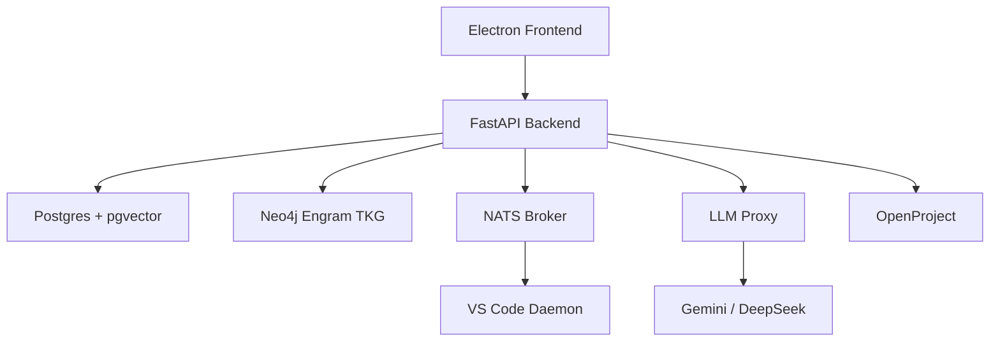

# 🏭 Fabrique (Factory System)

[](https://www.docker.com/)
[](https://www.python.org/)
[](https://fastapi.tiangolo.com/)
[](https://reactjs.org/)
[](https://www.typescriptlang.org/)

> **Languages:** [🇺🇸 English](README.md) | [🇪🇸 Español](README.es.md)

👔 **Not a developer or technical user?** Please read the [**Manager's Business Guide**](USER_GUIDE.md) to understand how to use Fabrique to automate your company's engineering.

---

## 📑 Table of Contents
- [🚀 Key Features](#-key-features)
- [🏗️ Architecture](#️-architecture)
- [🛠️ Tech Stack](#️-tech-stack)
- [📥 Getting Started](#-getting-started)
- [📖 API Documentation](#-api-documentation)
- [📁 Project Structure](#-project-structure)
- [⚖️ License](#️-license)
- [🆘 Support](#-support)

---

## 🚀 Key Features

- **🧠 Hybrid Agent Intelligence**: Orchestrates Gemini 1.5 Pro (Architect/PO) and DeepSeek (Dev/QA) for the perfect balance of reasoning and cost-effective coding.
- **🔄 Full Lifecycle Management**: Capable of creating new projects from scratch, evolving existing AI-generated code, and maintaining/improving legacy human-written systems.
- **📋 Native OpenProject Integration**: Agents act as real team members, autonomously creating work packages, logging progress, and transitioning tickets in your OpenProject boards.
- **📜 Transactional Outbox**: Guarantees NATS message delivery by syncing event publishing with Postgres transactions.
- **🔄 LangGraph Checkpointing**: Asynchronous workflow suspension/resumption using `MemorySaver`.
- **🛡️ Centralized LLM Proxy**: Strict token budgeting and security auditing for all AI interactions.
- **🔌 VS Code Integration**: A native daemon and extension bridge the gap between AI orchestration and your local IDE.
- **📊 Glassroom Monitoring**: Real-time SSE event streaming to monitor agent progress visually.

[⬆ Back to Top](#-fabrique-factory-system)

---

## 🏗️ Architecture



[⬆ Back to Top](#-fabrique-factory-system)

---

## 🛠️ Tech Stack

- **Backend**: FastAPI, LangGraph, SQLAlchemy.
- **Frontend**: React, TypeScript, Electron, TailwindCSS.
- **Memory**: Postgres (pgvector) + Neo4j (Temporal Knowledge Graph).
- **Broker**: NATS (JetStream).
- **Project Management**: OpenProject.
- **Infrastructure**: Docker Compose, VS Code CLI.

[⬆ Back to Top](#-fabrique-factory-system)

---

## 📥 Getting Started

### 1. Prerequisites
- Docker & Docker Compose
- VS Code CLI (`code` command)
- Python 3.11+ & Node.js 18+

### 2. Environment Setup
Create a `.env` file from the example:
```bash
cp .env.example .env
# Edit .env with your API keys (GEMINI_API_KEY, DEEPSEEK_API_KEY, etc.)
```

### 3. Launch Services
```bash
docker-compose up -d
```

### 4. Run the Local Daemon
```bash
pip install nats-py
python vscode-daemon/daemon.py
```

[⬆ Back to Top](#-fabrique-factory-system)
---

## 📖 API Documentation

Fabrique uses a self-documenting API based on the OpenAPI standard. You can access interactive documentation at:

- **Swagger UI (Interactive):** `http://localhost:8000/docs`
- **ReDoc (Detailed):** `http://localhost:8000/redoc`

---

## 🛠️ Support & Observability

- **Structured Logging:** All system events are logged in JSON format for easy integration with ELK, Datadog, or Splunk.
- **Support Bot:** A built-in AI Support Bot allows users to ask questions and report bugs directly into the Support Project.
- **Log Export:** Administrators can download a full audit log bundle via the `/v1/support/logs` endpoint for rapid troubleshooting.

---

## 📁 Project Structure
---

## 📁 Project Structure

*   `backend/`: FastAPI application & LangGraph agent logic.
*   `frontend/`: Electron + React dashboard.
*   `vscode-daemon/`: Local NATS subscriber for file operations.
*   `vscode-extension/`: VS Code integration tools.
*   `llm-proxy/`: Token budget & auditing gateway.
*   `db/`: Database initialization scripts.

[⬆ Back to Top](#-fabrique-factory-system)

---

## ⚖️ License

**Proprietary Software.** All rights reserved. 
Copyright © 2026 Carolina Pereira.

Unauthorized copying, distribution, or commercial use of this system, via any medium, is strictly prohibited without explicit written permission from the owner.

---

## 🆘 Support & Maintenance

- **System Support:** The Fabrique Engine is maintained by **Carolina Pereira**. System errors are automatically reported to the vendor for resolution in the core GitHub repository.
- **Project Support:** For issues related to the AI agents' code generation in your local projects, use the built-in AI Support Bot.
- **Contact:** For licensing and Enterprise SLA inquiries, please contact the owner directly.

[⬆ Back to Top](#-fabrique-factory-system)
