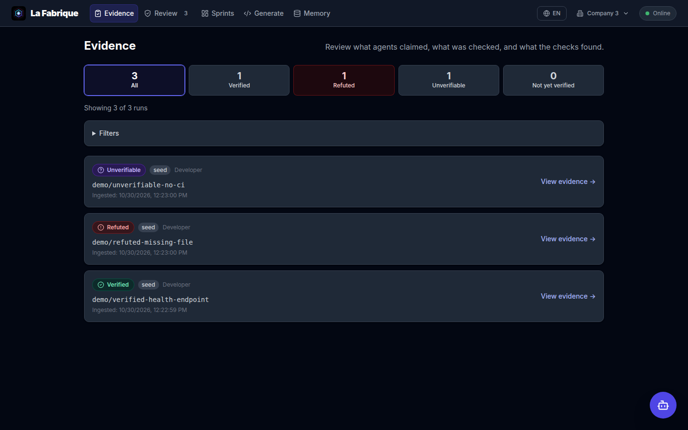
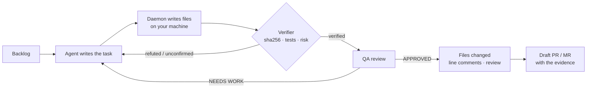
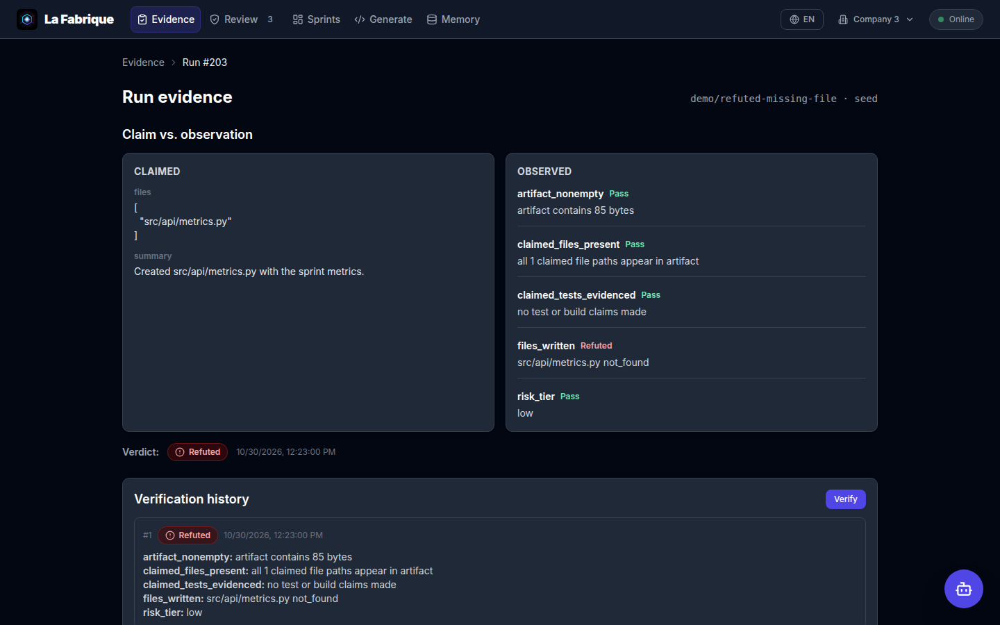
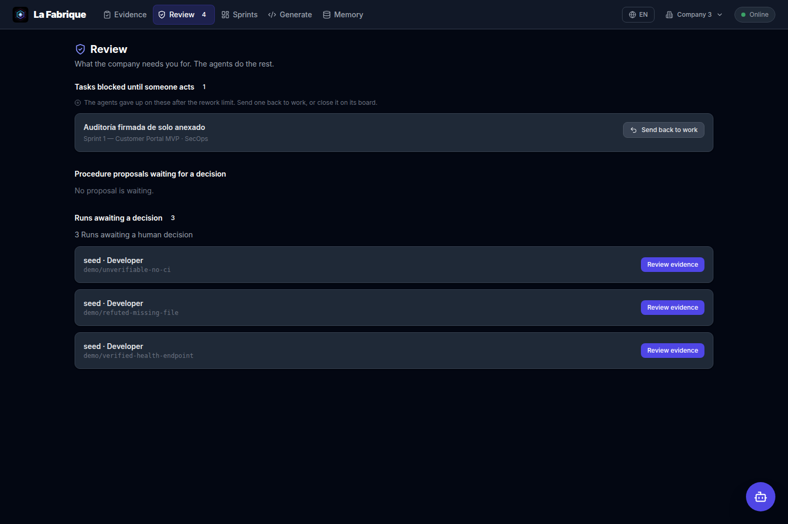
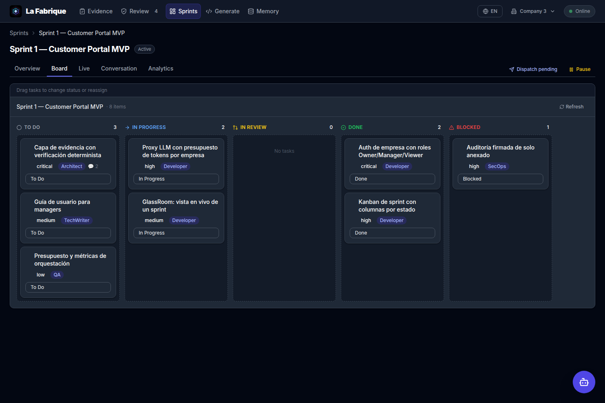
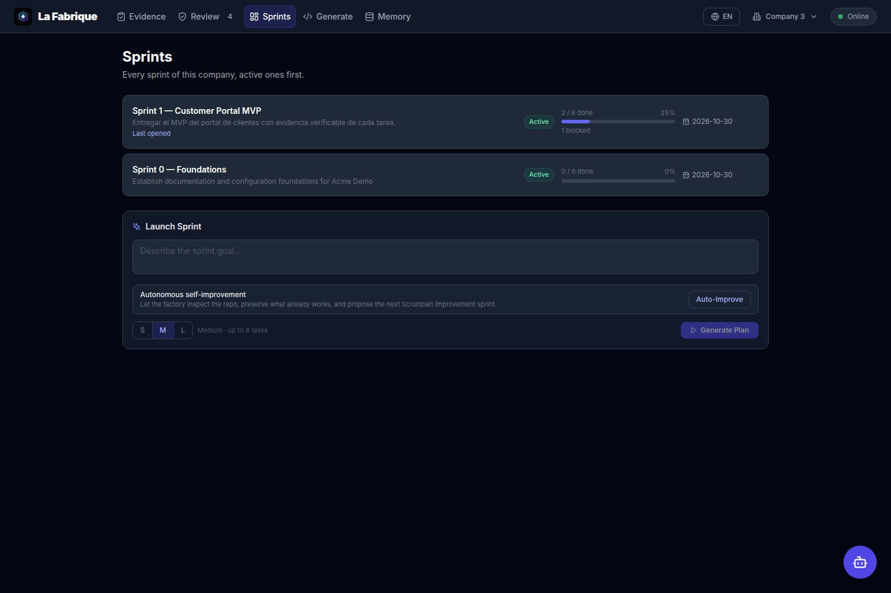
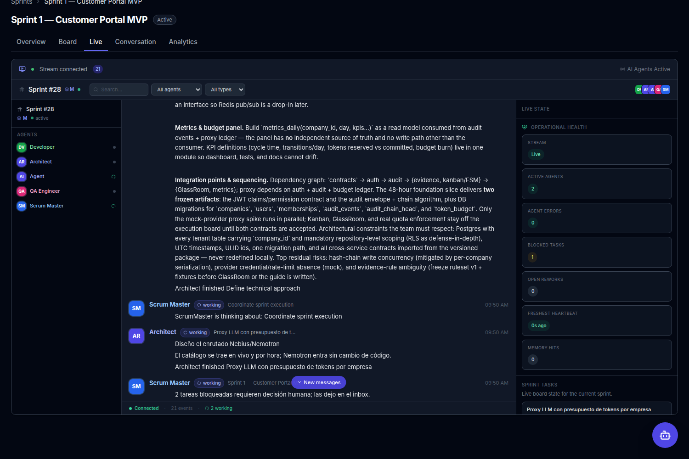
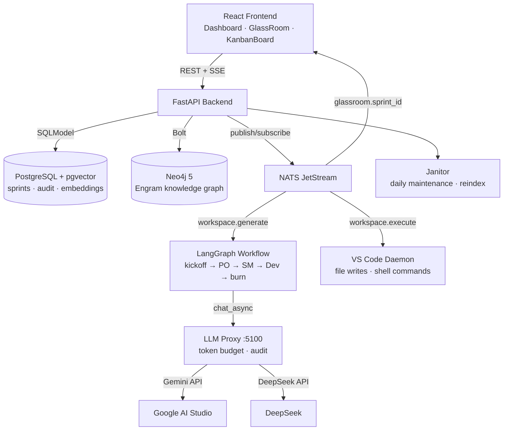
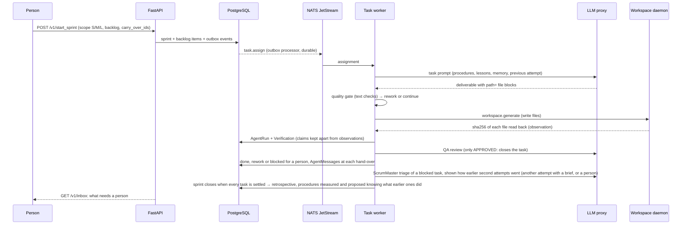

<div align="center">
  

# La Fabrique

[](https://github.com/careb36/la-fabrique/actions/workflows/backend-tests.yml)
[](https://www.docker.com/)
[](https://www.python.org/)
[](https://fastapi.tiangolo.com/)
[](https://reactjs.org/)
[](https://www.typescriptlang.org/)
[](LICENSE)

### Proof, not promises, for every line of code an AI agent writes

> **Languages:** [🇺🇸 English](README.md) | [🇪🇸 Español](README.es.md)

</div>

---

AI agents write code faster than any team can read it. Speed is no longer the
bottleneck. What teams lack is a trustworthy answer to one question:

> **Did the agent actually do what it says it did?**

La Fabrique answers it with evidence. Every delivery an agent makes is checked
against what is really on disk, what the tests really returned and what the CI
really reported. The agent's account of its own work is kept apart and never
counts as proof. Then the work reaches your team the way your team already
works: as a branch, a diff and a pull request on GitHub or GitLab, with the
evidence in its description.

<div align="center">



</div>

## Why La Fabrique

| | Without it | With La Fabrique |
|---|---|---|
| **Trust** | The agent says "done, tests pass" and someone has to believe it | Each run gets a verdict, `verified`, `refuted` or `unverifiable`, computed from files, hashes and exit codes, never by a model |
| **Review** | Reviewers get a wall of generated text | A **Files changed** view like a pull request: line numbers, line comments, Approve or Request changes |
| **Git** | Generated files land in your working copy | With **Git branch per task** on: one branch per task, one commit per delivery, in a separate worktree, and your checkout is never touched |
| **Hand-off** | Copy, paste, open the pull request by hand | **Publish as pull request**: the branch is pushed with your own credentials and a draft PR (GitHub) or MR (GitLab) opens with the evidence |
| **Learning** | The same mistakes, sprint after sprint | Retrospectives propose procedures; the numbers keep them or revert them |
| **Control** | All or nothing | Autonomy levels, a review inbox, and risk tiers: a delivery whose file paths mark authentication, secrets, payments or the CI pipeline always waits for a person |
| **Audit** | Logs anyone can edit | A per-company hash chain, optionally HMAC-signed, that shows where a row was deleted, altered or reordered |

## What it does

**📋 Starts from a specification.** Give the PO a brief and get numbered
requirements with acceptance criteria written as *given / when / then*,
quality targets with a number, constraints, and the questions the PO could
not decide. A deterministic check blocks approval while a requirement has no
testable criterion or a question has no answer; you answer, edit and approve.
Each task then names the criteria it covers, works and is reviewed against
them alone, and the specification shows which criteria got done.

**🔍 Verifies every delivery.** The workspace daemon writes the agent's files
and reads them back; the sha256 it reports, not the agent's word, decides
whether the files exist. When delivery tests are enabled, it also runs the
project's suite and records the exit status. A delivery that cannot be
confirmed is sent back for rework without asking any model.

**🧑‍⚖️ Puts people where they matter.** QA has to write an explicit
`APPROVED:` before a task closes. A delivery classified as high risk by the
paths it writes (authentication, secrets, payments, the CI pipeline) waits for
a Manager at every autonomy level. The **Review** inbox lists exactly what needs a person: blocked
tasks, procedure proposals, outside runs nobody has decided on.

**🌿 Works like GitHub and GitLab.** Diffs observed on disk, comments on
lines, reviews that send work back with the comments as feedback. Turn on
**Git branch per task** and each task gets its own branch and each delivery a
commit, in a worktree apart from your checkout. One click publishes the branch
as a draft pull request or merge request; publishing again updates the open one, and a branch
that has moved past the run's commit is refused.

**🏭 Runs a company of agents.** PO, Architect, ScrumMaster, Developer, QA,
SecOps and TechWriter hand work to each other and record each hand-off as a
message. The ScrumMaster triages every blocked task and decides between
another attempt with a brief and leaving it to a person. Every role can call
the MCP tools you connect.

**📈 Learns, measurably.** Each closed sprint produces a retrospective. The
ScrumMaster proposes procedures in a fixed format, and two sprints later each
one is kept or reverted on rework per task and blocked share. The Sprints page
answers "is the company learning?" with numbers, not adjectives.

**🔐 Built for audits.** Every table is scoped by company and role
(Owner, Manager, Viewer). Claims and observations live in separate fields.
Token budgets are enforced at one proxy. The audit log is a hash chain per
company.

## How it works



1. **Plan** a sprint with S, M or L scope. Each task becomes an assignment on a durable queue.
2. **Produce.** The assigned agent writes the task. The daemon writes it on your machine, as a commit on `fabrique/task-<id>` when the company works on Git branches.
3. **Verify.** Deterministic checks decide `verified`, `refuted` or `unverifiable`, and set the risk tier.
4. **Review.** QA reviews a digest of the files written. When it matters, a person reviews the diff the daemon observed, in **Files changed**.
5. **Ship.** Publish the branch as a pull request or merge request, with the evidence in the description.
6. **Learn.** The sprint closes, the retrospective runs and procedures are measured.

## Quality you can check

- About 900 backend tests and 430 frontend tests run on every pull request, with no external services needed.
- An end-to-end run in CI drives a whole company through three sprints against real PostgreSQL and NATS JetStream, then has an independent checker reject any illegal task history.
- A file-size ratchet, a pinned linter and an i18n rule that fails the build on untranslated text keep the code base honest as it grows.
- The interface is fully bilingual, English and Spanish.
- Every project is held to the same **quality standards** ([`docs/STANDARDS.md`](docs/STANDARDS.md)): architecture, development, QA, security, evidence and audit, documentation, operations. They go into every agent's prompt by role, a company procedure can add to them but never relax them, and the ones that can be checked without a model are: a secret in a delivered file refutes the delivery, code without a test or an unpinned dependency is a finding the reviewer sees, a specification that says nothing about security, performance, reliability or accessibility is warned.

## Quick start

```bash
cp .env.example .env          # database passwords, JWT_SECRET_KEY, QWEN_API_KEY, DEEPSEEK_API_KEY
docker compose up -d          # backend :8000 · frontend :5173 · LLM proxy :5100
./scripts/start-daemon.sh     # on the computer that holds your projects (.\scripts\start-daemon.ps1 on Windows)
```

Neo4j (the knowledge graph behind file lineage) is optional and on by
default; the backend does not wait for it. To run without it (memory search
stays on Postgres): `NEO4J_ENABLED=false docker compose up -d --scale neo4j=0`.

The default team runs on Qwen (PO, Architect, ScrumMaster, SecOps, TechWriter)
and DeepSeek (Developer, QA), so it needs both keys. `AGENT_MODEL` puts the whole
team on one model instead (`AGENT_MODEL=deepseek-v4-pro` needs only
`DEEPSEEK_API_KEY`), and `AGENT_MODEL_<ROLE>` (`AGENT_MODEL_SCRUM_MASTER`, …)
sets one role. Each agent's model can also be changed on the **Agents** page,
and `NEMOTRON_ROLES` moves roles to NVIDIA Nemotron on Nebius (see [Model Providers](#model-providers-nebius--nvidia-nemotron)).

Open `http://localhost:5173`, create a company, point it at a project folder and
plan your first sprint. Try it without API keys: `scripts/seed_demo_evidence.py`
seeds one run per verdict.

> **Not a developer?** The [**Manager's Business Guide**](USER_GUIDE.md) explains La Fabrique without code.
>
> **Why it is built this way:** the reasoning and the design rules are in [`docs/POSITIONING.md`](docs/POSITIONING.md).

## Screenshots











---

## Table of Contents

- [Why La Fabrique](#why-la-fabrique)
- [What it does](#what-it-does)
- [How it works](#how-it-works)
- [Quick start](#quick-start)
- [System Overview](#system-overview)
- [Architecture](#architecture)
- [Tech Stack](#tech-stack)
- [Requirements](#requirements)
- [Installation](#installation)
- [Getting Started](#getting-started)
- [Agent Orchestration](#agent-orchestration)
- [Model Providers (Nebius / NVIDIA Nemotron)](#model-providers-nebius--nvidia-nemotron)
- [GlassRoom](#glassroom)
- [Project Structure](#project-structure)
- [API Reference](#api-reference)
- [Testing](#testing)
- [Contributing](#contributing)
- [Security](#security)
- [Responsible use](#responsible-use)
- [Roadmap](#roadmap)
- [Documentation](#documentation)
- [License](#license)

---

## System Overview

Work is organized into **AI Sprints** — units of bounded, verifiable scope rather than fixed durations. Each backlog item becomes an `AgentRun`: the agent's claim about what it did, plus the observations the platform gathers independently. A run is settled only when verification has produced a verdict for it.

**Sprint scope tiers:**

| Size | Max backlog items | Typical use |
|------|-------------------|-------------|
| S    | 4                 | Bug fixes, small features |
| M    | 8                 | Feature iterations (default) |
| L    | 12                | Large features, foundational work |

A sprint closes when every task is settled: done, or blocked until a person acts. Blocked tasks stay on the board, appear in the retrospective and count in the numbers the company's procedures are judged by; a person can send one back to work from the **Review** page or carry it into the next sprint, and with autonomy level 3 the company carries it over on its own, once. The escalation is answered: the ScrumMaster reads what blocked the task and decides, in a fixed format a parser checks, between another attempt with a brief for it or leaving it to a person. That decision is a message, so a claim: the Review page shows it, the brief travels with the next attempt into the agent's prompt, and the company never carries over on its own what the ScrumMaster left to a person. When the optional kickoff graph decides the scope exceeds the team's capacity, the sprint transitions to `needs_split`.

**Sprint lifecycle:** `active` ⇄ `paused` → `completed` | `needs_split` | `cancelled`

---

## Architecture



### Data flow for a sprint

Tasks are executed by the **task worker** (`backend/app/services/loop/task_worker.py`). The LangGraph graph is an optional kickoff conversation, off by default.



[⬆ Back to Top](#la-fabrique)

---

## Tech Stack

| Layer | Technology |
|---|---|
| **Backend** | Python 3.12, FastAPI, LangGraph, SQLModel |
| **Frontend** | React 18, TypeScript, TailwindCSS, Vite, Zustand |
| **Vector Memory** | PostgreSQL 15 + pgvector |
| **Knowledge Graph** | Neo4j 5.25 Enterprise + APOC |
| **Message Broker** | NATS JetStream |
| **AI Models** | NVIDIA Nemotron on Nebius Token Factory + Gemini + DeepSeek + Qwen |
| **Infrastructure** | Docker Compose (8 services), VS Code CLI |

[⬆ Back to Top](#la-fabrique)

---

## Requirements

- **Docker** 24.0+ with Docker Compose v2
- **Python** 3.12+ (for local development)
- **Node.js** 24+ (for frontend development; `frontend/package.json` sets
  `engines.node >=24` and CI runs Node 24)
- **API Keys:** Nebius Token Factory (NVIDIA Nemotron), Google AI Studio (Gemini), DeepSeek, Qwen

[⬆ Back to Top](#la-fabrique)

---

## Installation

The canonical way to start a clean local environment is `reset_infra.sh`:

```bash
# 1. Copy and configure environment
cp .env.example .env
# Edit .env — fill in GEMINI_API_KEY, DEEPSEEK_API_KEY,
# POSTGRES_PASSWORD, NEO4J_PASSWORD, JWT_SECRET_KEY

# 2. Full clean start
./reset_infra.sh
```

The script runs 6 steps: `down -v` → Docker prune → `build --no-cache` → `up -d` → 5-second wait → `ps`. After it completes:

- **Frontend:** `http://localhost:5173`
- **Backend API + Swagger:** `http://localhost:8000/docs`
- **LLM Proxy:** `http://localhost:5100`
- **Jaeger Tracing UI:** `http://localhost:16686`

**Incremental restarts** (after code changes):

```bash
docker compose up -d --build backend
docker compose up -d --build frontend
```

**Workspace daemon** (on the computer where you cloned your projects — the agents
write there, like an IDE would; works on macOS, Ubuntu/Linux and Windows):

```bash
./scripts/start-daemon.sh        # macOS / Linux
.\scripts\start-daemon.ps1       # Windows (PowerShell)
```

It creates a virtualenv in `vscode-daemon/.venv`, connects to `nats://localhost:4222`
(override with `NATS_URL`) and keeps retrying until the stack is up. Files the
agents deliver while it is not running are queued and written when it connects.

[⬆ Back to Top](#la-fabrique)

---

## Getting Started

Once the stack is running, you can interact with the API:

```bash
# Health check
curl http://localhost:8000/health

# Create a company
curl -X POST http://localhost:8000/v1/init_company \
  -H "Content-Type: application/json" \
  -d '{"company_name": "My Company"}'

# Start a sprint (carry_over_ids: blocked tasks of earlier sprints to try again)
curl -X POST http://localhost:8000/v1/start_sprint \
  -H "Content-Type: application/json" \
  -d '{
    "company_id": <company_id>,
    "sprint_name": "Sprint 1",
    "start_date": "2026-10-20",
    "scope_size": "M",
    "backlog_items": [
      {"title": "Implement user authentication", "description": "Login with email and password.", "assignee": "Developer"},
      {"title": "Add dashboard widgets", "description": "KPI tiles on the dashboard.", "assignee": "Developer"}
    ]
  }'

# What the company needs a person for
curl "http://localhost:8000/v1/inbox?company_id=<company_id>"

# Open API docs
open http://localhost:8000/docs
```

[⬆ Back to Top](#la-fabrique)

---

## Agent Orchestration

With `AGENT_GRAPH_ENABLED=true` (off by default), each sprint kickoff also runs a **LangGraph conversation** via the `workspace.generate` NATS subject; its transcript is recorded as an `AgentRun` and never blocks the sprint's tasks. The graph has a fixed topology with `recursion_limit=12`:


**Node responsibilities:**

| Node | Agent | Responsibility |
|------|-------|----------------|
| `kickoff` | System | Validates sprint brief, extracts backlog items, emits opening status event |
| `po` | Product Owner | Prioritizes backlog (OpenProject optional), identifies riskiest item |
| `scrum_master` | Scrum Master | Sequences work, surfaces blockers, assigns first execution move to Developer |
| `developer` | Developer | Claims first actionable item, states implementation plan, flags dependencies |
| `po_wrap` | Product Owner | Closes kickoff with 3-bullet summary: priority · owner · next action |
| `burn` | System | Persists engram to Neo4j; publishes the kickoff completion event |

**Error handling:** Any node failure sets `last_error` and short-circuits to `burn`. `GraphRecursionError` is caught explicitly at the workflow level. Either way the kickoff has failed, but the sprint stays `active`: the agent worker publishes `Kickoff failed: <reason>; tasks continue` to the Glassroom, and backlog tasks keep running in the task worker. Only an explicit split decision marks a sprint `needs_split`.

**Model routing:** `ModelFactory.ROLE_MODEL_MAP` resolves each role to a specific LLM via the proxy — swap models per role in configuration without code changes.

### Starting and stopping work

A new company's Sprint 0 starts at once only if you tick **Start Sprint 0 as soon as the company is created** in the wizard (never at autonomy level 1); otherwise the sprint page shows it as not started with a **Start** button. On the Board tab a Manager can **Pause** (nothing is dispatched, reviewed or retried until **Resume**), **Stop** a sprint for good, and change the company's **Autonomy**: 1, every approved task waits for a person; 2, only high-risk deliveries wait; 3, follow-up sprints and procedures also run on their own. If a model provider refuses a call for lack of credit, the sprint pauses itself and the page says which provider; top up and resume.

### MCP tools

Agents can use tools from any [Model Context Protocol](https://modelcontextprotocol.io) server. A Manager configures a company's servers with the same `mcpServers` map other MCP clients read:

```bash
curl -X POST http://localhost:8000/v1/mcp/servers \
  -H "Authorization: Bearer $TOKEN" -H "Content-Type: application/json" \
  -d '{
    "company_id": 1,
    "mcpServers": {
      "docs":   {"url": "https://docs.example.com/mcp", "headers": {"Authorization": "Bearer ..."}},
      "github": {"command": "npx", "args": ["-y", "@modelcontextprotocol/server-github"],
                 "env": {"GITHUB_PERSONAL_ACCESS_TOKEN": "..."}, "roles": ["Developer"]}
    }
  }'
```

- `url` is a streamable HTTP server (`"type": "sse"` for the older transport); `command` is a stdio server, started inside the backend container, so its runtime (`npx`, `uvx`, …) must be in that image.
- `env` and `headers` are secrets: stored Fernet-encrypted (`FERNET_SECRET_KEY`), listed by name only (`GET /v1/mcp/servers`), masked out of the results the model sees.
- `roles` limits a server to some agent roles; without it every role that executes tasks may use it. `PATCH /v1/mcp/servers/{id}` disables a server or changes its roles; `GET /v1/mcp/servers/{id}/tools` connects now and lists what it advertises.

When a task runs, the model sees the tools as `<server>__<tool>` and may call them for at most `MCP_MAX_TOOL_ROUNDS` rounds before it must deliver. Every call is **an observation the backend made** — server, tool, arguments, whether it erred, duration, sha256 of the result — recorded on the run's evidence and shown by the Verifier as `tools_used`, apart from what the model claims it learned. A tool its server does not mark read-only raises the delivery's risk tier, so an approved task that used one waits for a person at the same points a sensitive file would.

### The Developer reads the project first

Beside the MCP tools, the roles that deliver files (Developer, QA) get the **workspace tools**, served by the workspace daemon on the project as it is on disk: `workspace__list` (the tree), `workspace__read` (a file, numbered), `workspace__search` (the lines matching a pattern) and, with `DELIVERY_TESTS_ENABLED`, `workspace__run_tests` (the project's test command, or a narrower one on the same runner). Each task's prompt opens with a map of the repository (its top two levels), and the model may call the tools for at most `DEVELOPER_TOOL_ROUNDS` rounds before it delivers; `DEVELOPER_TOOLS_ENABLED=false` turns them off.

What the Developer read is evidence: every read is recorded with the file's sha256 and size as the daemon read them, and the Verifier's `context_read` check says which of the files the delivery modified were read first and which were not. A file modified without being read raises the risk tier, so the delivery waits for a person. What the model says it learned from a file stays a claim, and its own account of a test run is never evidence: the daemon's exit status after the delivery is.

The tools never open a file that may hold secrets (`.env`, keys, certificates, `.ssh`, `.aws`…), skip a symlink that leads out of the project, redact a secret-looking line before the model sees it, and a search runs in a child process the daemon stops at its deadline, so a pattern that backtracks forever costs that much and no more. With the Git workflow on, the tools look at the task's own worktree once it has delivered there.

### Where agent-written code runs

With `DELIVERY_TESTS_ENABLED`, the daemon runs tests a model wrote, and the Developer's `workspace__run_tests` runs them too. **Where** they run is a setting, `DELIVERY_SANDBOX`, and a company may choose its own under its settings (`PUT /v1/companies/{id}/sandbox`):

- **`host`**, the default, runs the command as the daemon's user, with its files, its network and its environment. This is what every earlier version did. Nothing is isolated.
- **`container`** gives each run an ephemeral Docker or Podman container. The task's worktree is mounted at `/workspace` and nothing else of the host is. The network is off unless `DELIVERY_SANDBOX_NETWORK` opens it. CPU, memory and process limits apply (`DELIVERY_SANDBOX_CPUS`, `_MEMORY_MB`, `_PIDS`), every capability is dropped, privilege escalation is blocked, the command runs as the host user's uid, and the image comes from `DELIVERY_SANDBOX_IMAGE`.
- **`bwrap`**, bubblewrap on Linux, mounts the system directories read-only and the worktree read-write. It runs the command in new namespaces (the network's too, unless opened) with a fresh `/tmp`. It applies no CPU or memory limit, and the report says so.

In both isolated modes, a sandboxed run sees no environment variable of the daemon's beyond a short base (`PATH`, `HOME=/tmp`, `LANG`), except the ones the company lists **by name** (`env`). Their values stay on the daemon's machine, so the backend never sends a secret. The person running the daemon can refuse the host for everything: `FABRIQUE_SANDBOX_REQUIRED=container` makes a `host` request run in a container, and the report says the daemon forced it. A mode that cannot run on that machine fails the test run with the reason. The tests then read as unverified, never as passed on the host.

The daemon reports what it applied, and that report is the evidence. The Verifier records it as the `sandbox` check, a record and never the verdict: the tests' exit status still decides. A run on the host is marked as a finding a Manager sees, and so is one from an older daemon that reports no sandbox. What each mode protects against, and what it does not, is in [`docs/threat_model.md`](docs/threat_model.md).

### The roles that decide read official sources

The PO, the Architect, SecOps and TechWriter decide with what their model remembers up to its cut-off date. With the **research tools** (`RESEARCH_TOOLS_ENABLED`, on by default; `RESEARCH_ROLES` names the roles) they check first, in the same bounded loop as the other tools: `research__fetch` reads one page of documentation, release notes or a standard as text, from a host on the company's list; `research__package` looks a dependency up at its registry (PyPI, npm, crates.io, the Go proxy: the latest version, when it was released, the last versions); `research__advisories` lists its known vulnerabilities from OSV. The list of sources starts with the official documentation hosts of the common stacks, the registries and the advisory databases; a Manager adds hosts under the company's settings (`PUT /v1/companies/{id}/research`), the deployment adds some for everyone (`RESEARCH_ALLOWED_HOSTS`), and nothing removes a default. A fetch carries no credential, follows a redirect only while it stays on the list, and is cut at `RESEARCH_FETCH_MAX_BYTES`. A web search, when a company wants one, comes from an MCP server it configures; the backend ships none.

Every call is **an observation the backend made**: the URL, when it was fetched, the HTTP status, the sha256 and size of what came back, and whether the host was allowed (a refusal is recorded too). A specification or an architecture drafted by an agent keeps the sources it consulted (`sources`, shown on its page), the Verifier records them on a task's run as the `sources` check, and that check also names the dependencies a delivery's manifests declare that nobody looked up at a registry. What the agent concluded from a source is its claim. The prompt of a research role says so: its knowledge has a cut-off date, the versions that count are the ones on disk, and a fact it did not check at the source is a guess it should call one.

### Starting from a specification

A Manager opens **Specifications** (company menu), writes a brief — a few sentences on what is wanted and for whom — and asks the PO for a draft. The PO answers in a fixed shape the backend checks: requirements, each with acceptance criteria as *given / when / then*; quality attributes, each with a number to measure it by; constraints; and the questions it could not decide from the brief. The backend numbers everything (`REQ-1`, `REQ-1.2`, `NFR-1`), never the model, and runs a deterministic check: a requirement without a criterion, a criterion with an empty step, a quality target without a number or an unanswered question **blocks** the approval; a promise without a number ("fast", "easy", "rápido") is a warning to look at. You answer the questions, ask the PO for a revision (your answers go into its prompt), edit in a structured form, or write the whole specification yourself, and approve it. An approved version is never edited: **Revise** opens the next version as a draft, which supersedes it on approval.

Planning a sprint **from a specification** has the PO split it into tasks that each name the criteria they cover and the tasks that must be done before them; the plan lists the criteria no task covers, so nothing is dropped silently, and the sprint keeps both links. The worker follows the order the plan set: a task waits, with a note saying for what, until every task it depends on is done, and starts the moment the last one closes; tasks with nothing between them run in parallel. A task waiting on one you must decide on is blocked with the reason, so the sprint can close and the Review inbox shows what your decision unblocks; decide, and the task is released. Each task's prompt carries only the requirements it covers, QA reviews the deliverable against the same criteria, and the specification page shows, per criterion, whether a task got done, is blocked, is planned or does not exist yet (`/v1/specifications`, `POST /v1/plan_sprint` and `POST /v1/start_sprint` with `specification_id`).

The specification is also **executable**. The plan puts, before the implementation tasks, one test-writing task per requirement for QA: one test per acceptance criterion, named after its id (`test_req_1_2_…`), written to the repository through the daemon like any other file, failing until the implementation exists. Each implementation task waits for the tests of the criteria it covers and its prompt names them. With `DELIVERY_TESTS_ENABLED`, the tests run after every delivery and the Verifier reads the runner's own per-test lines back into criteria: QA's tests are expected to fail before their implementation, an implementation that leaves its criterion failing goes back to work, and one that rewrites an acceptance test is refuted rather than quietly accepted, with QA's test put back before anything is judged. The specification page marks a criterion **verified** only when its test passed in a run La Fabrique observed, and the pull request's description says how many criteria are.

### The architecture, as data

Once a specification is approved, a Manager asks the Architect for a design, or writes one: the **modules** (what each is responsible for, where it lives in the repository, what it depends on, which requirements it covers), the **interfaces** between them with a contract a test can hold them to, the **decisions** a developer would otherwise take alone, with their consequences, and the **conventions** every task follows. The backend numbers everything (`MOD-1`, `IF-1`, `ADR-1`) and maps the Architect's names onto the ids; a deterministic check blocks approval on an unknown module or requirement, a dependency cycle, a decision without its decision or an unanswered question, and warns when a requirement is covered by no module. You answer the Architect's questions, ask for a revision, edit and approve; **Write to the repository** puts it in `docs/ARCHITECTURE.md` through the workspace daemon, whose sha256 of the file is what La Fabrique keeps.

From then on the PO plans along the modules, and each task's prompt and QA's review carry the modules its requirements map to, with their interfaces, plus the decisions and conventions every task follows — a change to them is the Architect's call, not a task's (`/v1/architectures`).

### Working on Git branches

With **Git branch per task** on (Board tab, a Manager; `PUT /v1/companies/{id}/git`), the agents work on a Git repository the way people do on GitHub and GitLab: a delivery never lands in your checkout. Each task gets its own branch, `fabrique/task-<id>`, started from the base you name (`git_base_branch`) or from the commit your repository has checked out; every delivery is one commit on it, authored *La Fabrique* with `Fabrique-Task:` and `Fabrique-Sprint:` trailers, written in a worktree under the repository's git directory (`.git/fabrique-worktrees/`). Your working tree, index and branch are never touched. The commit, its parent and the branch are what git said, kept on the run's evidence; the tests the daemon runs after a delivery run in that worktree; the run's **Files changed** name the branch and the commit. To try a task's work, `git checkout fabrique/task-<id>` (or open the worktree); merging it is your call.

To take a task's branch to GitHub or GitLab, a Manager presses **Publish as pull request** in the run's Files changed. The workspace daemon pushes the branch to the repository's `origin` with your own Git credentials on that computer (it never sees a token), then opens a draft pull request with `gh` or a draft merge request with `glab` when they are installed and logged in; without them you get the page that opens one. The description is the run's evidence as the Verifier observed it: the verdict, each check, the files the daemon read back and the commit, with what the agent only claimed labelled apart and a `Fabrique-Run:` trailer that leads back to the run. Only `fabrique/` branches are pushed, never forced; each publication is kept on the run and audited (`POST /v1/agent_runs/{id}/publish`, `GET /v1/agent_runs/{id}/publications`).

When people review that request on GitHub or GitLab, **Bring comments** reads what they wrote, with the same `gh` or `glab` login, and puts it back on the run: line comments on their lines in Files changed, reviews and conversation beside them, each marked with where it was written and a link to it. Reading again never duplicates. The next review you submit here carries them to the agent like your own comments; a review submitted on the platform decides nothing here (`POST /v1/agent_runs/{id}/publications/{pid}/sync`).

### Reviewing a run like a pull request

Every run page has a **Files changed** tab laid out the way GitHub and GitLab show a pull request: the files with their additions and deletions, then each file's hunks with the old and new line numbers, a **Viewed** box that folds a file, and long files shown in part until you ask for the rest. The changes are an observation, never the agent's account of them:

- for a task the agents delivered, the workspace daemon reads each file just before writing it and reads it back after, and reports the diff between those bytes (`vscode-daemon/file_diff.py`) beside the sha256 it already reported; a binary or oversized file is listed with its counts and no diff;
- for a pull request ingested from GitHub, the diff GitHub returned for it;
- for a producer that sent a diff as its artifact and nothing was observed on a disk, that diff, labelled as what the producer proposes.

What the producer declared but no observation covers is listed apart, so a review sees the gap instead of a claim shown as a change. `GET /v1/agent_runs/{id}/changes` returns the same files to any client.

A Manager reviews the way a pull request is reviewed: hover a line and press **+** to comment on it (a deleted line is commented on its old side), **Resolve** a comment that no longer applies, then **Submit review** with *Comment*, *Approve* or *Request changes*. The review carries the open comments. What it does depends on who produced the run:

- for a task the company's agents delivered, the review loop (QA, the Verifier) still decides, so a person's review acts only where the loop waits for a person: **Request changes** sends a task blocked for a person back to work, with the review and its comments, file by line, as the `NEEDS WORK:` feedback the Developer's next attempt receives; **Approve** accepts a delivery QA approved that waits for a person (a high-risk hold, or any approval at autonomy level 1); a task the agents are still working on, or whose sprint is closed, is refused with the reason;
- for any other producer's run, the review records the approval or the rejection, with the comments as its feedback.

Reviews and comments are a person's words, never evidence: they are audited, and the verdict stays the Verifier's (`/v1/agent_runs/{id}/comments`, `/v1/agent_runs/{id}/reviews`).

[⬆ Back to Top](#la-fabrique)

---

## Model Providers (Nebius / NVIDIA Nemotron)

Every model call goes through `llm-proxy/`, which routes each request by the
model id's prefix and only sends a request for an id that is in that provider's
fetched catalogue. Four providers are wired today:

| Provider | Model id prefix | Endpoint |
|---|---|---|
| `nebius` | `nvidia/`, `meta-llama/`, `mistralai/`, `deepseek-ai/`, `qwen/`, `google/` | `https://api.tokenfactory.nebius.com/v1` (Nebius Token Factory) |
| `gemini` | `gemini-`, `gemma-` | Google Generative Language API |
| `deepseek` | `deepseek-` | `https://api.deepseek.com/v1` |
| `qwen` | `qwen`, `qwq-`, `qvq-` | Qwen Cloud compatible mode |

**Nebius Token Factory serves the NVIDIA open models.** The key comes from
<https://tokenfactory.nebius.com> — its own console, *not*
`console.nebius.com`, whose IAM keys do not authenticate here. Log in, open
**Workspace → Explore → API keys**, create one and copy it (it is shown once).
Set `NEBIUS_API_KEY` and the proxy fetches the live catalogue at startup (and
hourly), lists what it found on `GET /v1/models`, and routes Nemotron ids to
Token Factory over the OpenAI-compatible chat endpoint:

```bash
curl -s localhost:5100/v1/models | jq '.models[] | select(.provider=="nebius")'
curl -s localhost:5100/v1/chat/completions \
  -H 'Content-Type: application/json' \
  -d '{"model":"nvidia/nemotron-3-super-120b-a12b",
       "messages":[{"role":"user","content":"Explain the outbox pattern"}]}'
```

Nothing about Nebius is hardcoded: the model list comes from Token Factory, so
new Nemotron releases appear without a code change. `NEBIUS_PROXY_URL` points
the provider at your own Nebius Serverless Endpoint instead of Token Factory.

Model ids above are examples — the ids Token Factory serves change, and the
proxy rejects anything not in the catalogue it fetched, so read the real list
before pinning one:

```bash
curl -s localhost:5100/v1/models | jq -r '.models[] | select(.provider=="nebius") | .id'
```

### Giving agent roles an NVIDIA model

The role defaults in `backend/llm/model_factory.py` are Qwen and DeepSeek. To
run specific roles on Nemotron, opt them in — unset means nothing changes:

```bash
# Comma-separated role names (case-insensitive).
NEMOTRON_ROLES=PO,Architect,SecOps,Developer,QA,TechWriter

# The model those roles get. The _STRATEGIC and _FAST variants override it
# per role: PO, Architect and SecOps read _STRATEGIC; TechWriter reads _FAST.
NEMOTRON_MODEL=nvidia/nemotron-3-super-120b-a12b
NEMOTRON_MODEL_STRATEGIC=nvidia/Nemotron-3-Ultra-550b-a55b
NEMOTRON_MODEL_FAST=nvidia/NVIDIA-Nemotron-3-Nano-30B-A3B
```

### Checking the integration end to end

`scripts/verify-nebius.sh` proves the three layers separately, so a failure
points at the broken one instead of the whole feature:

```bash
NEBIUS_API_KEY=... ./scripts/verify-nebius.sh
# or, against a proxy that is already running:
PROXY_URL=http://localhost:5100 ./scripts/verify-nebius.sh
```

| Layer | What it checks |
|-------|----------------|
| 1 | The key authenticates against Token Factory and lists the served models |
| 2 | The proxy publishes those models under `provider: nebius`, with tiers |
| 3 | A real chat completion comes back through the proxy |

The Nemotron models Token Factory serves are reasoning models: they spend
tokens on `reasoning` before writing `content`. With a small `max_tokens` the
completion can come back with `content: null` and `finish_reason: length` — the
request worked, it just ran out of budget. Give it a few hundred tokens.

`ModelFactory.model_for_role()` resolves this, and `get_model()` uses it, so
the choice reaches every LangGraph node. Requests still carry
`X-Agent-Role` and `X-Business-Unit-ID`, so per-role and per-company token
budgets apply to Nemotron calls exactly as they do to the others.

[⬆ Back to Top](#la-fabrique)

---

## GlassRoom

The GlassRoom is the real-time observability view for a running sprint. It uses Server-Sent Events (SSE) to stream `glassroom.<sprint_id>` NATS messages directly to the browser.

**3-column layout:**

| Column | Content |
|--------|---------|
| Left Sidebar | Sprint metadata (scope badge, status dot) + online agent roster |
| Message Feed | Slack-style grouped messages per agent turn; `NeedsSplitBanner` on scope-exceeded events |
| Right Panel | Per-agent FSM state cards — `active` (green) · `waiting` (brand) · `error` (red) · `idle` (gray) |

**Event types:** `status`, `agent_start`, `message`, `agent_complete`, `error`, `needs_split`

The SSE endpoint (`GET /v1/glassroom/stream?sprint_id=<id>`) replays the last 50 events on connect so late-joining clients get full context. With authentication required it also takes `ticket=<t>`, a five-minute token for that sprint from `POST /v1/sprints/{id}/stream_ticket` (a browser EventSource cannot send an Authorization header). Keepalive pings are sent every 15 seconds to maintain the connection.

The same room in a headset, Glassroom VR (the Meta VR Start Developer Competition entry), lives on the `main_meta` branch; `main` is the web product.

[⬆ Back to Top](#la-fabrique)

---

## Project Structure

```
la-fabrique/
├── backend/
│   ├── agents/
│   │   ├── graph.py                  # LangGraph multi-agent workflow
│   │   └── tools/
│   │       └── openproject_tools.py  # Work package creation
│   ├── app/
│   │   ├── main.py                   # FastAPI entry point · 4 bg workers · SSE bridge
│   │   ├── models/                   # SQLModel ORM (Sprint, Company, BacklogItem…)
│   │   ├── schemas.py                # Pydantic request/response schemas
│   │   ├── database.py               # Engine · session · prepare_database() (schema at head)
│   │   ├── routers/                  # sprint · inbox · procedures · messages · agent_runs · support · workspace · github
│   │   ├── services/
│   │   │   ├── agent_worker.py       # NATS consumer → LangGraph execution
│   │   │   ├── task_worker.py        # Executes tasks, delivery gate, QA review, closes sprints
│   │   │   ├── procedures.py         # Procedures: proposals, adoption, keep/revert by the numbers
│   │   │   ├── carry_over.py         # A blocked task gets another attempt in the next sprint
│   │   │   ├── scrum_master.py       # The ScrumMaster answers escalations: triage of a blocked task
│   │   │   ├── board.py              # Pure readers of a task's comment thread
│   │   │   ├── console_assistants.py # Terminal assistants on the daemon's machine (Copilot CLI, Claude CLI)
│   │   │   ├── support_agent.py      # Triages help-desk tickets (SUPPORT_AGENT_ENABLED)
│   │   │   ├── reviewer_agent.py     # Suggests the decision on other producers' runs (REVIEWER_AGENT_ENABLED)
│   │   │   └── outbox_service.py     # Transactional outbox → NATS drain
│   │   └── nats_client.py            # Async NATS publish/subscribe wrapper
│   ├── llm/
│   │   └── model_factory.py          # Role → model mapping
│   ├── memory/
│   │   └── engram_processor.py       # pgvector + Neo4j engram persistence
│   ├── llm_proxy_client.py           # HTTP client for LLM proxy service
│   └── telemetry.py                  # OpenTelemetry tracer setup
├── frontend/
│   └── src/
│       ├── components/
│       │   ├── GlassRoom.tsx         # 3-column real-time sprint view
│       │   ├── KanbanBoard.tsx       # Sprint backlog board (dnd-kit)
│       │   ├── GovernancePanel.tsx   # Review: what needs a person (inbox)
│       │   ├── Conversation.tsx      # Messages between roles per sprint and task
│       │   ├── ControlPanel.tsx      # Sprint configuration UI
│       │   └── ErrorBoundary.tsx     # Global React error boundary
│       ├── pages/
│       │   ├── Dashboard.tsx         # Sprint planner (QuickLaunch) with carry-over of blocked tasks
│       │   ├── Sprints.tsx           # Every sprint with done, blocked and rework counts
│       │   ├── Procedures.tsx        # Proposals, procedures in force, history with their numbers
│       │   └── CompanyNew.tsx        # Company onboarding wizard
│       ├── store/
│       │   └── agentStore.ts         # Zustand FSM store (idle/active/waiting/error)
│       └── i18n/                     # EN + ES translation files
├── llm-proxy/                        # Token budget + audit gateway (Flask :5100)
├── vscode-daemon/                    # Local NATS subscriber for IDE file operations
├── scripts/
│   └── verify_infra.py               # Infrastructure health verification script
├── db/
│   └── init-db/init.sql              # Postgres bootstrap DDL
├── docker-compose.yml                # 8-service local stack definition
├── reset_infra.sh                    # Canonical full-reset script
└── .env.example                      # Required environment variables template
```

[⬆ Back to Top](#la-fabrique)

---

## API Reference

Interactive docs at `http://localhost:8000/docs` when running locally. Routes other than the public ones require a JWT (`POST /v1/auth/login`) and a company role: Viewer reads, Manager runs sprints and decides, Owner invites.

| Method | Path | Description |
|--------|------|-------------|
| `GET`  | `/health` | Service health check; `/health/deep` probes each dependency |
| `GET`  | `/v1/capabilities` | Feature flags (graph, memory, GitHub, support agent); public |
| `POST` | `/v1/auth/register` · `/v1/auth/login` · `GET /v1/auth/me` | Accounts and sessions |
| `POST` | `/v1/company/invite` | Invite a member (Owner) |
| `POST` | `/v1/init_company` | Create a company, its agents and the foundation sprint |
| `POST` | `/v1/discover_team` | Inspect a project folder through the daemon and suggest a team |
| `GET` · `POST` · `PATCH` · `DELETE` | `/v1/agents` | The company's agents and their models (Viewer reads; Manager creates, changes, deletes) |
| `GET` · `POST` · `PUT` | `/v1/specifications` (+ `/draft`, `/{id}/questions/{i}`, `/{id}/approve`, `/{id}/revise`) | The specification: numbered requirements with given / when / then criteria, checked deterministically; the PO drafts and revises from a brief, a person answers, edits and approves; coverage per criterion from the boards |
| `GET` · `POST` · `PUT` | `/v1/architectures` (+ `/draft`, `/{id}/questions/{i}`, `/{id}/approve`, `/{id}/revise`, `/{id}/write`, `/{id}/document`) | The architecture of an approved specification: modules, interfaces, decisions and conventions, checked deterministically; the Architect drafts and revises, a person approves; written to the repository through the daemon with its hash kept |
| `POST` | `/v1/plan_sprint` · `/v1/plan_self_improvement_sprint` | Turn a goal, an approved specification (`specification_id`: tasks name the criteria they cover, `uncovered` lists the rest), or the repository, into a backlog |
| `POST` | `/v1/start_sprint` | Start a sprint; validates the scope; `carry_over_ids` retries blocked tasks; `specification_id` and each task's `covers` keep the link to the specification; each task's `depends_on` (positions) sets the order the worker follows |
| `GET`  | `/v1/sprints` | The company's sprints with done, blocked and rework counts, and their second attempts: tasks carried over, how many got done, with and without the ScrumMaster's brief; and tasks with and without console-assistant advice, and with and without the Architect's brief, done and rework per group |
| `GET`  | `/v1/sprints/{id}/board` | The Kanban board of a sprint |
| `POST` | `/v1/sprints/{id}/pause` · `/resume` · `/dispatch` | Hold, resume or re-queue a sprint's tasks |
| `PATCH` | `/v1/backlog/{id}` | Change a task's status, priority or assignee, or add a note (Manager) |
| `GET` · `POST` | `/v1/sprints/{id}/integration` · `/integrate` · `/integration/publish` | A sprint's task branches merged into `fabrique/sprint-<id>` in dependency order and the suite run on the result (on its own when a sprint closes with the Git workflow on), and one pull or merge request for the sprint (Viewer reads, Manager integrates and publishes) |
| `GET`  | `/v1/inbox` | What needs a person: blocked tasks (with the ScrumMaster's triage of each), procedure proposals, undecided runs of other producers, integrations stopped at a conflict or a failing suite |
| `GET`  | `/v1/messages` | The conversation between roles (filters: sprint, task, kind) |
| `GET` · `POST` | `/v1/procedures` (+ `/adopt`, `/reject`, `/retire`) | The rules each role follows, proposed by the ScrumMaster and measured by the board |
| `GET` | `/v1/standards` | The factory's quality standards, the same for every company, with what the loop checks without a model |
| `GET` · `POST` | `/v1/agent_runs` (+ `/verify`, `/approve`, `/verifications`) | Evidence: runs, deterministic verifications, human decisions |
| `GET`  | `/v1/agent_runs/reviewer_record` | How often the Reviewer agent's suggestions matched the decisions people recorded, beside the Verifier's verdict alone (`REVIEWER_AGENT_ENABLED`) |
| `POST` | `/v1/integrations/github/bindings` · `/webhook` · `/backfill` | Record a repository's pull requests as runs |
| `GET`  | `/v1/workspace/status` · `/browse` · `/inspect` | The daemon on the person's computer: folder picker and project check |
| `GET`  | `/v1/glassroom/stream` | SSE stream of a sprint's agent events (with a `ticket` when authentication is required); the sprint's history is replayed first, with event ids that stay the same on every connection |
| `POST` | `/v1/sprints/{id}/stream_ticket` | A five-minute ticket for that stream (Viewer) |
| `GET`  | `/v1/enterprise/quotas` · `/quota_usage_history` · `/lineage` · `/v1/analytics/summary` | Budgets, usage and metrics |
| `POST` | `/v1/support/report_bug` · `/chat` · `GET /v1/support/tickets` | The help desk; triaged by the Support agent when enabled. The tickets' `severity` filter reads a support admin's decision first, else the reporter's choice |
| `GET`  | `/v1/support/agent_record` | Support admins: how often the Support agent's suggestions matched their decisions on severity and category (unusable answers counted as misses), beside the choices of the reporters who made one |
| `POST` | `/v1/generate` | Trigger the optional LangGraph workflow (409 unless enabled) |
| `GET`  | `/v1/memory/search` · `POST /v1/memory/store` | Semantic memory over pgvector |
| `POST` | `/v1/audit` · `GET /v1/audit/verify` | Structured, signed audit entries |
| `GET` | `/v1/audit/chain?company_id=` | Walks the company's audit hash chain: intact or where it breaks (gap, link, altered row), and its head (Viewer) |

[⬆ Back to Top](#la-fabrique)

---

## Testing

### Backend

```bash
cd backend && PYTHONPATH=.:app python3 -m pytest tests -q
```

The backend test suite uses pytest with in-memory SQLite — no external services required.

### Frontend

```bash
cd frontend
npm run test:run    # Vitest + Testing Library (CI mode)
npm run test        # Watch mode during development
```

### CI

Tests run automatically on every pull request via GitHub Actions:
- `.github/workflows/backend-tests.yml` — backend pytest suite
- `.github/workflows/frontend-build.yml` — frontend tsc + vitest + build

[⬆ Back to Top](#la-fabrique)

---

## Contributing

See [CONTRIBUTING.md](CONTRIBUTING.md) for development standards, branch strategy, and commit conventions.

[⬆ Back to Top](#la-fabrique)

---

## Security

See [SECURITY.md](SECURITY.md) for the security policy and vulnerability reporting process.

[⬆ Back to Top](#la-fabrique)

---

## Responsible use

La Fabrique's agents write files and run commands on the computer where the
**workspace daemon** runs — like an IDE would. Point the daemon only at folders
you own or are authorised to modify, and only connect a repository you have the
right to change. Model output is an aid for a person, not a determination:
verification is deterministic, but the decision to approve, carry over or reject
a task is always a person's. See [SECURITY.md](SECURITY.md).

[⬆ Back to Top](#la-fabrique)

---

## Roadmap

| Item | Status |
| --- | --- |
| Deterministic verification (claims vs. observations) | Done |
| Append-only, signed audit chain | Done |
| Per-company token budgets at a single LLM proxy | Done |
| Nebius Token Factory / NVIDIA Nemotron routing | Done |
| Sprint orchestration with carry-over and ScrumMaster escalation | Done |
| Evidence page with per-verdict summary | Done |
| Reviewer agent that suggests (never decides) on other producers' runs | Done |
| Qualification of relationships between entities in the engram graph | Planned |
| Per-source data-quality indicators | Planned |
| Deterministic procedures measured against their own adoption | Planned |

[⬆ Back to Top](#la-fabrique)

---

## Documentation

[Architecture](ARCHITECTURE.md) · [Positioning](docs/POSITIONING.md) ·
[API reference](docs/API.md) · [Threat model](docs/threat_model.md) ·
[User guide](USER_GUIDE.md) · [Contributing](CONTRIBUTING.md) ·
[Security](SECURITY.md) · [Code of conduct](CODE_OF_CONDUCT.md) ·
[Changelog](CHANGELOG.md) · [Hackathon](docs/HACKATHON.md)

---

## License

**Apache License 2.0.** See [LICENSE](LICENSE).  
Copyright © 2026 Carolina Pereira.

[⬆ Back to Top](#la-fabrique)

---

## Support & Maintenance

- **System Support:** La Fabrique is maintained by **Carolina Pereira**. Critical errors are automatically reported to the vendor for resolution.
- **Project Support:** For issues with AI-generated code in your projects, use the built-in Support Bot.
- **Contact:** For licensing and Enterprise SLA inquiries, please contact the owner directly.

[⬆ Back to Top](#la-fabrique)
