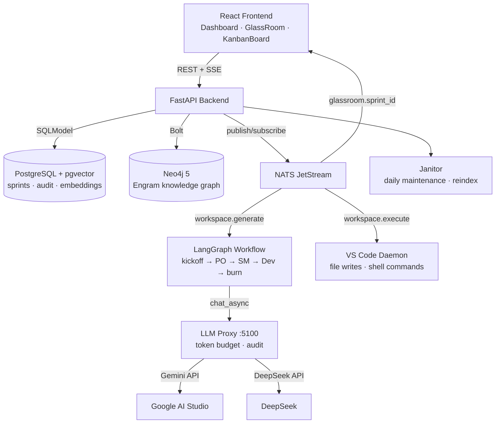

<div align="center">
  

# La Fabrique

[](https://www.docker.com/)
[](https://www.python.org/)
[](https://fastapi.tiangolo.com/)
[](https://reactjs.org/)
[](https://www.typescriptlang.org/)
[](LICENSE.md)

**AI-powered autonomous software development platform**

> **Languages:** [🇺🇸 English](README.md) | [🇪🇸 Español](README.es.md)

</div>

---

## About

La Fabrique is a multi-agent platform that orchestrates AI agents through a structured sprint lifecycle. Work is organized into **AI Sprints** — units of bounded, verifiable scope rather than fixed durations.

The platform provides:
- **Multi-agent orchestration** via LangGraph workflows
- **Real-time observability** through the GlassRoom SSE stream
- **Knowledge graph memory** with Neo4j Engram nodes
- **Vector semantic search** via pgvector
- **Enterprise governance** with RBAC, token budgets, and audit trails

> **Not a developer or technical user?** Please read the [**Manager's Business Guide**](USER_GUIDE.md) to understand how to use La Fabrique to automate your company's engineering.

---

## Table of Contents

- [System Overview](#system-overview)
- [Architecture](#architecture)
- [Tech Stack](#tech-stack)
- [Requirements](#requirements)
- [Installation](#installation)
- [Getting Started](#getting-started)
- [Agent Orchestration](#agent-orchestration)
- [GlassRoom](#glassroom)
- [Project Structure](#project-structure)
- [API Reference](#api-reference)
- [Testing](#testing)
- [Contributing](#contributing)
- [Security](#security)
- [License](#license)

---

## System Overview

La Fabrique is a multi-agent platform that orchestrates AI agents through a structured sprint lifecycle. Work is organized into **AI Sprints** — units of bounded, verifiable scope rather than fixed durations.

**Sprint scope tiers:**

| Size | Max backlog items | Typical use |
|------|-------------------|-------------|
| S    | 4                 | Bug fixes, small features |
| M    | 8                 | Feature iterations (default) |
| L    | 12                | Large features, foundational work |

A sprint closes when every task is settled: done, or blocked until a person acts. Blocked tasks stay on the board, appear in the retrospective and count in the numbers the company's procedures are judged by; a person can send one back to work from the **Review** page or carry it into the next sprint, and with autonomy level 3 the company carries it over on its own, once. The escalation is answered: the ScrumMaster reads what blocked the task and decides, in a fixed format a parser checks, between another attempt with a brief for it or leaving it to a person. That decision is a message, so a claim: the Review page shows it, the brief travels with the next attempt into the agent's prompt, and the company never carries over on its own what the ScrumMaster left to a person. When the optional kickoff graph decides the scope exceeds the team's capacity, the sprint transitions to `needs_split`.

**Sprint lifecycle:** `active` ⇄ `paused` → `completed` | `needs_split` | `cancelled`

---

## Architecture



### Data flow for a sprint

Tasks are executed by the **task worker** (`backend/app/services/task_worker.py`). The LangGraph graph is an optional kickoff conversation, off by default.

```mermaid
sequenceDiagram
    participant U as Person
    participant BE as FastAPI
    participant DB as PostgreSQL
    participant NJ as NATS JetStream
    participant TW as Task worker
    participant LLM as LLM proxy
    participant D as Workspace daemon

    U->>BE: POST /v1/start_sprint (scope S/M/L, backlog, carry_over_ids)
    BE->>DB: sprint + backlog items + outbox events
    DB-->>NJ: task.assign (outbox processor, durable)
    NJ->>TW: assignment
    TW->>LLM: task prompt (procedures, lessons, memory, previous attempt)
    LLM-->>TW: deliverable with path= file blocks
    TW->>TW: quality gate (text checks) → rework or continue
    TW->>D: workspace.generate (write files)
    D-->>TW: sha256 of each file read back (observation)
    TW->>DB: AgentRun + Verification (claims kept apart from observations)
    TW->>LLM: QA review (only APPROVED: closes the task)
    TW->>DB: done / rework / blocked for a person; AgentMessages at each hand-over
    TW->>LLM: ScrumMaster triage of a blocked task, shown how earlier second attempts went (another attempt with a brief, or a person)
    TW->>DB: sprint closes when every task is settled → retrospective, procedures measured and proposed knowing what earlier ones did
    BE-->>U: GET /v1/inbox: what needs a person
```

[⬆ Back to Top](#la-fabrique)

---

## Tech Stack

| Layer | Technology |
|---|---|
| **Backend** | Python 3.12, FastAPI, LangGraph, SQLModel |
| **Frontend** | React 18, TypeScript, TailwindCSS, Vite, Zustand |
| **Vector Memory** | PostgreSQL 15 + pgvector |
| **Knowledge Graph** | Neo4j 5.15 Enterprise + APOC |
| **Message Broker** | NATS JetStream |
| **AI Models** | Gemini (via Google AI Studio) + DeepSeek |
| **Infrastructure** | Docker Compose (8 services), VS Code CLI |

[⬆ Back to Top](#la-fabrique)

---

## Requirements

- **Docker** 24.0+ with Docker Compose v2
- **Python** 3.12+ (for local development)
- **Node.js** 20+ (for frontend development)
- **API Keys:** Google AI Studio (Gemini), DeepSeek

[⬆ Back to Top](#la-fabrique)

---

## Installation

The canonical way to start a clean local environment is `reset_infra.sh`:

```bash
# 1. Copy and configure environment
cp .env.example .env
# Edit .env — fill in GEMINI_API_KEY, DEEPSEEK_API_KEY,
# POSTGRES_PASSWORD, NEO4J_PASSWORD, JWT_SECRET_KEY

# 2. Full clean start
./reset_infra.sh
```

The script runs 6 steps: `down -v` → Docker prune → `build --no-cache` → `up -d` → health-check wait → `ps`. After it completes:

- **Frontend:** `http://localhost:5173`
- **Backend API + Swagger:** `http://localhost:8000/docs`
- **LLM Proxy:** `http://localhost:5100`
- **Jaeger Tracing UI:** `http://localhost:16686`

**Incremental restarts** (after code changes):

```bash
docker compose up -d --build backend
docker compose up -d --build frontend
```

**Workspace daemon** (on the computer where you cloned your projects — the agents
write there, like an IDE would; works on macOS, Ubuntu/Linux and Windows):

```bash
./scripts/start-daemon.sh        # macOS / Linux
.\scripts\start-daemon.ps1       # Windows (PowerShell)
```

It creates a virtualenv in `vscode-daemon/.venv`, connects to `nats://localhost:4222`
(override with `NATS_URL`) and keeps retrying until the stack is up. Files the
agents deliver while it is not running are queued and written when it connects.

[⬆ Back to Top](#la-fabrique)

---

## Getting Started

Once the stack is running, you can interact with the API:

```bash
# Health check
curl http://localhost:8000/health

# Create a company
curl -X POST http://localhost:8000/v1/init_company \
  -H "Content-Type: application/json" \
  -d '{"company_name": "My Company"}'

# Start a sprint (carry_over_ids: blocked tasks of earlier sprints to try again)
curl -X POST http://localhost:8000/v1/start_sprint \
  -H "Content-Type: application/json" \
  -d '{
    "company_id": <company_id>,
    "sprint_name": "Sprint 1",
    "start_date": "2026-10-20",
    "scope_size": "M",
    "backlog_items": [
      {"title": "Implement user authentication", "description": "Login with email and password.", "assignee": "Developer"},
      {"title": "Add dashboard widgets", "description": "KPI tiles on the dashboard.", "assignee": "Developer"}
    ]
  }'

# What the company needs a person for
curl "http://localhost:8000/v1/inbox?company_id=<company_id>"

# Open API docs
open http://localhost:8000/docs
```

[⬆ Back to Top](#la-fabrique)

---

## Agent Orchestration

With `AGENT_GRAPH_ENABLED=true` (off by default), each sprint kickoff also runs a **LangGraph conversation** via the `workspace.generate` NATS subject; its transcript is recorded as an `AgentRun` and never blocks the sprint's tasks. The graph has a fixed topology with `recursion_limit=12`:


**Node responsibilities:**

| Node | Agent | Responsibility |
|------|-------|----------------|
| `kickoff` | System | Validates sprint brief, extracts backlog items, emits opening status event |
| `po` | Product Owner | Creates OpenProject work package, prioritizes backlog, identifies riskiest item |
| `scrum_master` | Scrum Master | Sequences work, surfaces blockers, assigns first execution move to Developer |
| `developer` | Developer | Claims first actionable item, states implementation plan, flags dependencies |
| `po_wrap` | Product Owner | Closes kickoff with 3-bullet summary: priority · owner · next action |
| `burn` | System | Persists engram to Neo4j; publishes the kickoff completion event |

**Error handling:** Any node failure sets `last_error` and short-circuits to `burn`. `GraphRecursionError` is caught explicitly at the workflow level. Either way the kickoff has failed, but the sprint stays `active`: the agent worker publishes `Kickoff failed: <reason>; tasks continue` to the Glassroom, and backlog tasks keep running in the task worker. Only an explicit split decision marks a sprint `needs_split`.

**Model routing:** `ModelFactory.ROLE_MODEL_MAP` resolves each role to a specific LLM via the proxy — swap models per role in configuration without code changes.

[⬆ Back to Top](#la-fabrique)

---

## GlassRoom

The GlassRoom is the real-time observability view for a running sprint. It uses Server-Sent Events (SSE) to stream `glassroom.<sprint_id>` NATS messages directly to the browser.

**3-column layout:**

| Column | Content |
|--------|---------|
| Left Sidebar | Sprint metadata (scope badge, status dot) + online agent roster |
| Message Feed | Slack-style grouped messages per agent turn; `NeedsSplitBanner` on scope-exceeded events |
| Right Panel | Per-agent FSM state cards — `active` (green) · `waiting` (brand) · `error` (red) · `idle` (gray) |

**Event types:** `status`, `agent_start`, `message`, `agent_complete`, `error`, `needs_split`

The SSE endpoint (`GET /v1/glassroom/stream?sprint_id=<id>`) replays the last 50 events on connect so late-joining clients get full context. Keepalive pings are sent every 15 seconds to maintain the connection.

[⬆ Back to Top](#la-fabrique)

---

## Project Structure

```
la-fabrique/
├── backend/
│   ├── agents/
│   │   ├── graph.py                  # LangGraph multi-agent workflow
│   │   └── tools/
│   │       └── openproject_tools.py  # Work package creation
│   ├── app/
│   │   ├── main.py                   # FastAPI entry point · 4 bg workers · SSE bridge
│   │   ├── models/                   # SQLModel ORM (Sprint, Company, BacklogItem…)
│   │   ├── schemas.py                # Pydantic request/response schemas
│   │   ├── database.py               # Engine · session · _ensure_runtime_schema()
│   │   ├── routers/                  # sprint · inbox · procedures · messages · agent_runs · support · workspace · github
│   │   ├── services/
│   │   │   ├── agent_worker.py       # NATS consumer → LangGraph execution
│   │   │   ├── task_worker.py        # Executes tasks, delivery gate, QA review, closes sprints
│   │   │   ├── procedures.py         # Procedures: proposals, adoption, keep/revert by the numbers
│   │   │   ├── carry_over.py         # A blocked task gets another attempt in the next sprint
│   │   │   ├── scrum_master.py       # The ScrumMaster answers escalations: triage of a blocked task
│   │   │   ├── board.py              # Pure readers of a task's comment thread
│   │   │   ├── console_assistants.py # Terminal assistants on the daemon's machine (Copilot CLI, Claude CLI)
│   │   │   ├── support_agent.py      # Triages help-desk tickets (SUPPORT_AGENT_ENABLED)
│   │   │   └── outbox_service.py     # Transactional outbox → NATS drain
│   │   └── nats_client.py            # Async NATS publish/subscribe wrapper
│   ├── llm/
│   │   └── model_factory.py          # Role → model mapping
│   ├── memory/
│   │   └── engram_processor.py       # pgvector + Neo4j engram persistence
│   ├── llm_proxy_client.py           # HTTP client for LLM proxy service
│   └── telemetry.py                  # OpenTelemetry tracer setup
├── frontend/
│   └── src/
│       ├── components/
│       │   ├── GlassRoom.tsx         # 3-column real-time sprint view
│       │   ├── KanbanBoard.tsx       # Sprint backlog board (dnd-kit)
│       │   ├── GovernancePanel.tsx   # Review: what needs a person (inbox)
│       │   ├── Conversation.tsx      # Messages between roles per sprint and task
│       │   ├── ControlPanel.tsx      # Sprint configuration UI
│       │   └── ErrorBoundary.tsx     # Global React error boundary
│       ├── pages/
│       │   ├── Dashboard.tsx         # Sprint planner (QuickLaunch) with carry-over of blocked tasks
│       │   ├── Sprints.tsx           # Every sprint with done, blocked and rework counts
│       │   ├── Procedures.tsx        # Proposals, procedures in force, history with their numbers
│       │   └── CompanyNew.tsx        # Company onboarding wizard
│       ├── store/
│       │   └── agentStore.ts         # Zustand FSM store (idle/active/waiting/error)
│       └── i18n/                     # EN + ES translation files
├── llm-proxy/                        # Token budget + audit gateway (Flask :5100)
├── vscode-daemon/                    # Local NATS subscriber for IDE file operations
├── scripts/
│   └── verify_infra.py               # Infrastructure health verification script
├── db/
│   └── init-db/init.sql              # Postgres bootstrap DDL
├── docker-compose.yml                # 8-service local stack definition
├── reset_infra.sh                    # Canonical full-reset script
└── .env.example                      # Required environment variables template
```

[⬆ Back to Top](#la-fabrique)

---

## API Reference

Interactive docs at `http://localhost:8000/docs` when running locally. Routes other than the public ones require a JWT (`POST /v1/auth/login`) and a company role: Viewer reads, Manager runs sprints and decides, Owner invites.

| Method | Path | Description |
|--------|------|-------------|
| `GET`  | `/health` | Service health check; `/health/deep` probes each dependency |
| `GET`  | `/v1/capabilities` | Feature flags (graph, memory, GitHub, support agent); public |
| `POST` | `/v1/auth/register` · `/v1/auth/login` · `GET /v1/auth/me` | Accounts and sessions |
| `POST` | `/v1/company/invite` | Invite a member (Owner) |
| `POST` | `/v1/init_company` | Create a company, its agents and the foundation sprint |
| `POST` | `/v1/discover_team` | Inspect a project folder through the daemon and suggest a team |
| `GET` · `POST` · `PATCH` · `DELETE` | `/v1/agents` | The company's agents and their models |
| `POST` | `/v1/plan_sprint` · `/v1/plan_self_improvement_sprint` | Turn a goal, or the repository, into a backlog |
| `POST` | `/v1/start_sprint` | Start a sprint; validates the scope; `carry_over_ids` retries blocked tasks |
| `GET`  | `/v1/sprints` | The company's sprints with done, blocked and rework counts, and their second attempts: tasks carried over, how many got done, with and without the ScrumMaster's brief; and tasks with and without console-assistant advice, done and rework per group |
| `GET`  | `/v1/sprints/{id}/board` | The Kanban board of a sprint |
| `POST` | `/v1/sprints/{id}/pause` · `/resume` · `/dispatch` | Hold, resume or re-queue a sprint's tasks |
| `PATCH` | `/v1/backlog/{id}` | Change a task's status, priority or assignee, or add a note (Manager) |
| `GET`  | `/v1/inbox` | What needs a person: blocked tasks (with the ScrumMaster's triage of each), procedure proposals, undecided runs of other producers |
| `GET`  | `/v1/messages` | The conversation between roles (filters: sprint, task, kind) |
| `GET` · `POST` | `/v1/procedures` (+ `/adopt`, `/reject`, `/retire`) | The rules each role follows, proposed by the ScrumMaster and measured by the board |
| `GET` · `POST` | `/v1/agent_runs` (+ `/verify`, `/approve`, `/verifications`) | Evidence: runs, deterministic verifications, human decisions |
| `POST` | `/v1/integrations/github/bindings` · `/webhook` · `/backfill` | Record a repository's pull requests as runs |
| `GET`  | `/v1/workspace/status` · `/browse` · `/inspect` | The daemon on the person's computer: folder picker and project check |
| `GET`  | `/v1/glassroom/stream` | SSE stream of a sprint's agent events |
| `GET`  | `/v1/enterprise/quotas` · `/quota_usage_history` · `/lineage` · `/v1/analytics/summary` | Budgets, usage and metrics |
| `POST` | `/v1/support/report_bug` · `/chat` · `GET /v1/support/tickets` | The help desk; triaged by the Support agent when enabled |
| `GET`  | `/v1/support/agent_record` | Support admins: how often the Support agent's suggestions matched their decisions on severity and category (unusable answers counted as misses), beside the choices of the reporters who made one |
| `POST` | `/v1/generate` | Trigger the optional LangGraph workflow (409 unless enabled) |
| `GET`  | `/v1/memory/search` · `POST /v1/memory/store` | Semantic memory over pgvector |
| `POST` | `/v1/audit` · `GET /v1/audit/verify` | Structured, signed audit entries |

[⬆ Back to Top](#la-fabrique)

---

## Testing

### Backend

```bash
cd backend && PYTHONPATH=.:app python3 -m pytest tests -q
```

The backend test suite uses pytest with in-memory SQLite — no external services required.

### Frontend

```bash
cd frontend
npm run test:run    # Vitest + Testing Library (CI mode)
npm run test        # Watch mode during development
```

### CI

Tests run automatically on every pull request via GitHub Actions:
- `.github/workflows/backend-tests.yml` — backend pytest suite
- `.github/workflows/frontend-build.yml` — frontend tsc + vitest + build

[⬆ Back to Top](#la-fabrique)

---

## Contributing

See [CONTRIBUTING.md](CONTRIBUTING.md) for development standards, branch strategy, and commit conventions.

[⬆ Back to Top](#la-fabrique)

---

## Security

See [SECURITY.md](SECURITY.md) for the security policy and vulnerability reporting process.

[⬆ Back to Top](#la-fabrique)

---

## License

**Proprietary Software.** All rights reserved.  
Copyright © 2026 Carolina Pereira.

Unauthorized copying, distribution, or commercial use of this system, via any medium, is strictly prohibited without explicit written permission from the owner.

[⬆ Back to Top](#la-fabrique)

---

## Support & Maintenance

- **System Support:** La Fabrique is maintained by **Carolina Pereira**. Critical errors are automatically reported to the vendor for resolution.
- **Project Support:** For issues with AI-generated code in your projects, use the built-in Support Bot.
- **Contact:** For licensing and Enterprise SLA inquiries, please contact the owner directly.

[⬆ Back to Top](#la-fabrique)
